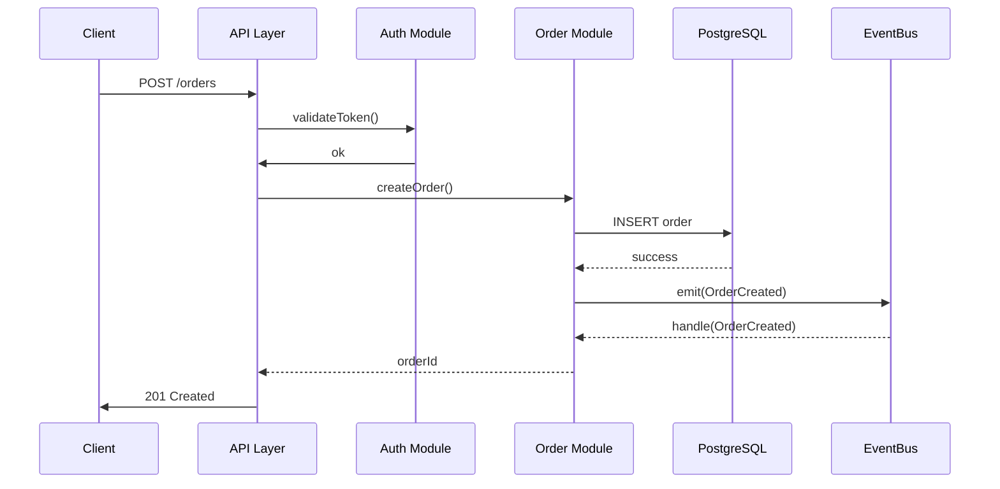

<!-- Generated by Groq via GitHub Actions -->
<!-- Topic ID: T240 -->
<!-- Category: Architecture Patterns -->
<!-- Generated at UTC: 2026-11-21T20:11:44.254549+00:00 -->

# Modular monolith

## 1. What problem does this solve?

| What | Why it matters | Consequence of not using it | Real‑world example |
|------|----------------|-----------------------------|--------------------|
| **Complexity of distributed systems** | Microservices give great scalability but add networking, serialization, distributed tracing, and a lot of operational overhead. | Hard to ship, debug, and maintain; higher latency and failure surface. | A small startup that needs to ship a new feature in a week. |
| **Need for modularity inside a single deployable unit** | Teams want clear boundaries, domain ownership, and the ability to refactor without touching unrelated code. | Tight coupling leads to “big ball of mud” and slow feature development. | An e‑commerce platform where inventory, orders, and payments are owned by separate squads. |
| **Simplified deployment & CI/CD** | One binary or container means one deployment pipeline, one rollback strategy, and one set of health checks. | Frequent deployment failures, longer release cycles. | A SaaS product that updates every day. |

In practice, many companies start with a monolith, split it into microservices when the monolith becomes a bottleneck, and then discover that the microservice overhead outweighs the benefits. A modular monolith sits in the middle: it keeps a single deployable artifact but enforces clear internal boundaries.

---

## 2. Mental model

**Analogy – a kitchen with separate stations**  
Imagine a professional kitchen. There is a *grill station*, a *sauté station*, and a *plating station*. Each station has its own tools and cooks, but they all share the same kitchen space, the same ovens, and the same pantry. The kitchen is a single unit that can be cleaned, inspected, and served to customers together, yet each station can be upgraded or refactored independently.

**Engineering model**  
A modular monolith is a single deployable application that is internally split into *modules* (bounded contexts). Each module owns its domain logic, data access, and APIs, but they all run in the same process or container. Modules communicate via well‑defined interfaces (function calls, events, or HTTP on `localhost`). The whole system can be built, tested, and deployed as one unit, while still giving teams the autonomy of a microservice.

---

## 3. Deep explanation

### Internals

| Layer | Responsibility | Typical tech |
|-------|----------------|--------------|
| **API layer** | Exposes HTTP endpoints, validates requests. | Express, Fastify, NestJS |
| **Domain layer** | Business rules, entities, value objects. | Plain TypeScript classes |
| **Application layer** | Orchestrates domain logic, coordinates modules. | Service classes, command handlers |
| **Infrastructure layer** | Persistence, caching, external services. | Prisma, TypeORM, Redis client |
| **Event bus** | Decouples modules, enables async workflows. | Node’s `EventEmitter`, Redis Pub/Sub, Kafka |

Modules are isolated by **dependency injection** and **bounded contexts**. Each module can have its own database schema or share a schema with clear ownership.

### Important terminology

| Term | Meaning |
|------|---------|
| **Bounded context** | A logical boundary where a specific domain model applies. |
| **Shared kernel** | Small set of types or utilities that multiple modules agree on. |
| **Anti‑corruption layer** | Adapter that translates between two bounded contexts. |
| **Event bus** | In‑process or out‑of‑process channel for publishing/subscribing to domain events. |
| **Domain event** | Immutable record of something that happened in the domain. |

### Trade‑offs

| Benefit | Cost |
|---------|------|
| **Single deployment** | Cannot scale parts independently. |
| **Simpler CI/CD** | One pipeline must handle all modules. |
| **Clear boundaries** | Requires disciplined architecture; risk of shared code bloat. |
| **Fast inter‑module calls** | In‑process calls are faster than HTTP, but you lose process isolation. |

### Failure modes

1. **Module crash** – the whole process stops. Mitigation: graceful shutdown, health checks, process clustering.
2. **Database lock contention** – one module’s heavy writes block others. Mitigation: sharding, read replicas.
3. **Event bus overload** – too many events flood the bus. Mitigation: back‑pressure, rate limiting.

### Limitations

* Cannot scale a single module without scaling the entire app.
* Harder to deploy a hot‑fix to only one module; you must redeploy the whole binary.
* If a module grows too large, it defeats the purpose of modularity.

### Where it fits

* **Between monolith and microservices** – good for early‑stage products or teams that need rapid iteration.
* **Domain‑driven design** – each module can be a bounded context.
* **Event‑driven workflows** – modules can publish events that other modules consume.

### Interaction with related concepts

| Concept | Interaction |
|---------|-------------|
| **CQRS** | You can split read/write models inside modules. |
| **Event sourcing** | Domain events can be persisted and replayed. |
| **Docker** | One container per modular monolith; modules can be built into separate images if needed. |
| **Observability** | Tracing across modules is easier because they share the same process. |

---

## 4. How it works

### Step‑by‑step flow

1. **Client request** → API layer receives HTTP request.  
2. **Routing** → Express router forwards to the appropriate module’s controller.  
3. **Validation** → DTOs are validated (e.g., with `class-validator`).  
4. **Domain logic** → Controller calls a service in the same module.  
5. **Cross‑module interaction** → Service may call another module’s service or publish a domain event.  
6. **Persistence** → Infrastructure layer writes to PostgreSQL or MongoDB.  
7. **Event bus** → Domain event is emitted; other modules subscribe and react.  
8. **Response** → Controller returns HTTP response.  



---

## 5. Practical implementation

Below is a minimal, runnable example of a modular monolith with two modules: **users** and **products**. The modules share a PostgreSQL database via Prisma, and the product module publishes a Redis pub/sub event when a product is created.

### Project structure

```
modular-monolith/
├─ src/
│  ├─ modules/
│  │  ├─ users/
│  │  │  ├─ controller.ts
│  │  │  ├─ service.ts
│  │  │  ├─ repository.ts
│  │  │  └─ routes.ts
│  │  └─ products/
│  │     ├─ controller.ts
│  │     ├─ service.ts
│  │     ├─ repository.ts
│  │     └─ routes.ts
│  ├─ shared/
│  │  ├─ eventBus.ts
│  │  └─ prismaClient.ts
│  ├─ app.ts
│  └─ server.ts
├─ prisma/
│  └─ schema.prisma
├─ docker-compose.yml
├─ Dockerfile
└─ tsconfig.json
```

### `src/shared/prismaClient.ts`

```ts
import { PrismaClient } from '@prisma/client';

export const prisma = new PrismaClient();
```

### `src/shared/eventBus.ts`

```ts
import { EventEmitter } from 'events';

export const eventBus = new EventEmitter();
```

### `src/modules/users/repository.ts`

```ts
import { prisma } from '../../shared/prismaClient';

export class UserRepository {
  async create(email: string, password: string) {
    return prisma.user.create({ data: { email, password } });
  }

  async findByEmail(email: string) {
    return prisma.user.findUnique({ where: { email } });
  }
}
```

### `src/modules/users/service.ts`

```ts
import { UserRepository } from './repository';
import { hash } from 'bcrypt';

export class UserService {
  constructor(private repo = new UserRepository()) {}

  async register(email: string, password: string) {
    const hashed = await hash(password, 10);
    return this.repo.create(email, hashed);
  }

  async login(email: string, password: string) {
    const user = await this.repo.findByEmail(email);
    if (!user) throw new Error('User not found');
    // password check omitted for brevity
    return user;
  }
}
```

### `src/modules/users/controller.ts`

```ts
import { Router, Request, Response } from 'express';
import { UserService } from './service';

export const userRouter = Router();
const service = new UserService();

userRouter.post('/register', async (req: Request, res: Response) => {
  const { email, password } = req.body;
  const user = await service.register(email, password);
  res.status(201).json(user);
});

userRouter.post('/login', async (req: Request, res: Response) => {
  const { email, password } = req.body;
  const user = await service.login(email, password);
  res.json(user);
});
```

### `src/modules/products/repository.ts`

```ts
import { prisma } from '../../shared/prismaClient';

export class ProductRepository {
  async create(name: string, price: number) {
    return prisma.product.create({ data: { name, price } });
  }

  async list() {
    return prisma.product.findMany();
  }
}
```

### `src/modules/products/service.ts`

```ts
import { ProductRepository } from './repository';
import { eventBus } from '../../shared/eventBus';

export class ProductService {
  constructor(private repo = new ProductRepository()) {}

  async add(name: string, price: number) {
    const product = await this.repo.create(name, price);
    // publish event
    eventBus.emit('productCreated', product);
    return product;
  }

  async list() {
    return this.repo.list();
  }
}
```

### `src/modules/products/controller.ts`

```ts
import { Router, Request, Response } from 'express';
import { ProductService } from './service';

export const productRouter = Router();
const service = new ProductService();

productRouter.post('/', async (req: Request, res: Response) => {
  const { name, price } = req.body;
  const product = await service.add(name, price);
  res.status(201).json(product);
});

productRouter.get('/', async (_: Request, res: Response) => {
  const products = await service.list();
  res.json(products);
});
```

### `src/modules/products/events.ts`

```ts
import { eventBus } from '../../shared/eventBus';
import { redisClient } from '../../shared/redisClient';

eventBus.on('productCreated', async (product) => {
  // Publish to Redis so other services can react
  await redisClient.publish('product-events', JSON.stringify({
    type: 'PRODUCT_CREATED',
    payload: product,
  }));
});
```

### `src/shared/redisClient.ts`

```ts
import { createClient } from 'redis';

export const redisClient = createClient();
redisClient.on('error', console.error);
await redisClient.connect();
```

### `src/app.ts`

```ts
import express from 'express';
import { userRouter } from './modules/users/controller';
import { productRouter } from './modules/products/controller';
import './modules/products/events'; // register event listeners

export const app = express();
app.use(express.json());

app.use('/users', userRouter);
app.use('/products', productRouter);
```

### `src/server.ts`

```ts
import { app } from './app';
import { prisma } from './shared/prismaClient';

const PORT = process.env.PORT ?? 3000;

async function main() {
  await prisma.$connect();
  app.listen(PORT, () => console.log(`🚀 Server listening on ${PORT}`));
}

main().catch((e) => {
  console.error(e);
  process.exit(1);
});
```

### `prisma/schema.prisma`

```prisma
datasource db {
  provider = "postgresql"
  url      = env("DATABASE_URL")
}

generator client {
  provider = "prisma-client-js"
}

model User {
  id       Int    @id @default(autoincrement())
  email    String @unique
  password String
}

model Product {
  id    Int     @id @default(autoincrement())
  name  String
  price Float
}
```

### `docker-compose.yml`

```yaml
version: "3.9"
services:
  db:
    image: postgres:16
    environment:
      POSTGRES_USER: postgres
      POSTGRES_PASSWORD: postgres
      POSTGRES_DB: modular
    ports:
      - "5432:5432"
  redis:
    image: redis:7
    ports:
      - "6379:6379"
  app:
    build: .
    depends_on:
      - db
      - redis
    environment:
      DATABASE_URL: postgres://postgres:postgres@db:5432/modular
    ports:
      - "3000:3000"
```

### `Dockerfile`

```dockerfile
FROM node:20-alpine

WORKDIR /app
COPY package*.json ./
RUN npm ci
COPY . .
RUN npm run build

EXPOSE 3000
CMD ["node", "dist/server.js"]
```

**Run**

```bash
docker compose up --build
```

Now you can `POST /users/register`, `POST /products`, and see a Redis event published.

---

## 6. Production considerations

| Concern | How to address it in a modular monolith |
|---------|----------------------------------------|
| **Scalability** | Use Node’s cluster or PM2 to run multiple worker processes. Deploy the whole container behind a load balancer. |
| **Reliability** | Implement graceful shutdown, health checks (`/health`), and a circuit breaker for external calls. |
| **Security** | Centralized auth middleware, role‑based access control, and secrets stored in Vault or Docker secrets. |
| **Observability** | Use OpenTelemetry for tracing across modules, Prometheus for metrics, and Loki/ELK for logs. |
| **Performance** | Cache frequently read data in Redis, batch DB writes, and use async event handlers. |
| **Error handling** | Global error middleware, structured logging, and retry logic for idempotent operations. |
| **Resource usage** | Monitor memory, CPU, and database connections; set limits in Docker Compose or Kubernetes. |
| **Operational concerns** | Versioned Docker images, automated migrations with Prisma, and blue‑green deployments. |
| **Failure recovery** | Event replay for domain events, database snapshots, and automated rollback on failed migrations. |
| **Deployment** | CI pipeline that builds, tests, and pushes a single image; use canary releases for gradual rollout. |

---

## 7. Common mistakes

| Mistake | Why it’s problematic |
|---------|----------------------|
| **Sharing a single database schema without ownership** | Leads to tight coupling; one module’s change can break another. |
| **Over‑exposing internal APIs** | Modules become dependent on each other’s implementation details. |
| **Ignoring versioning of shared libraries** | Breaking changes propagate to all modules. |
| **Using global state (e.g., singletons) for per‑request data** | Causes race conditions in concurrent requests. |
| **Not isolating domain logic** | Business rules leak into infrastructure code, making refactoring hard. |
| **Deploying hot‑fixes to the whole app for a single module** | Increases risk of regressions in unrelated modules. |
| **Neglecting event bus back‑pressure** | Flooding the bus can crash the process or lose events. |

---

## 8. Senior engineer perspective

### What changes at scale?

* **Module boundaries become critical** – you must decide which domain belongs where and enforce it with code reviews and automated tests.
* **Shared libraries** need a versioning strategy (e.g., semantic versioning + npm scopes) to avoid “dependency hell.”
* **Deployment strategy** – you might still deploy the whole monolith, but you can use **canary** or **blue‑green** to isolate failures to a subset of traffic.
* **Observability** – tracing must include module identifiers; metrics should be aggregated per module to spot hotspots.
* **Cost/performance** – running multiple worker processes can be more expensive than a single process, but you gain fault isolation.
* **When NOT to use** – if a module needs to scale independently (e.g., a high‑traffic recommendation engine), a microservice is preferable.

### Design decisions a senior engineer would consider

| Decision | Trade‑off |
|----------|-----------|
| **Event bus implementation** | In‑process `EventEmitter` is fast but loses process isolation; Redis Pub/Sub adds network latency but allows scaling workers. |
| **Database per module vs shared** | Separate schemas reduce coupling but increase operational complexity. |
| **Clustering vs single process** | Clustering improves throughput but introduces inter‑process communication overhead. |
| **CI/CD pipeline** | One pipeline is simpler but can become a bottleneck; splitting pipelines per module can speed up feedback. |
| **Feature toggles** | Useful for gradual rollout but add runtime complexity. |

---

## 9. Interview questions

1. **Beginner** – *What is a modular monolith?*  
   *Answer points:*  
   - Single deployable application.  
   - Internally split into modules with clear boundaries.  
   - Combines benefits of monolith (simple deployment) and modularity (team autonomy).

2. **Beginner** – *How does a modular monolith differ from a traditional monolith?*  
   *Answer points:*  
   - Traditional monolith has no enforced boundaries; all code is tightly coupled.  
   - Modular monolith enforces bounded contexts, dependency injection, and event bus.  
   - Easier to refactor and scale teams.

3. **Senior** – *How would you decide module boundaries in a modular monolith?*  
   *Answer points:*  
   - Use domain‑driven design: each bounded context owns a distinct business capability.  
   - Consider team ownership, data ownership, and change frequency.  
   - Avoid cross‑cutting concerns; isolate them in shared libraries.

4. **Senior** – *How do you handle cross‑cutting concerns (e.g., logging, auth) in a modular monolith?*  
   *Answer points:*  
   - Centralize in middleware or a shared library.  
   - Use dependency injection to provide shared services.  
   - Avoid duplicating logic; expose interfaces for modules to consume.

5. **Scenario / Debugging** – *A request to create a product fails after the database write but before the event is published. How would you recover?*  
   *Answer points:*  
   - Use a transaction that includes both DB write and event publication, or  
   - Persist the event in a durable queue (e.g., Redis, Kafka) and retry on failure, or  
   - Implement a compensating action or idempotent handler to replay events.  
   - Add monitoring to detect such partial failures.

---

## 10. Hands‑on task

**Goal:** Add a new module `orders` that depends on `users` and `products`.

1. Create `src/modules/orders/` with `controller.ts`, `service.ts`, `repository.ts`, and `routes.ts`.  
2. `OrderService` should:
   - Verify the user exists (`UserRepository` from users module).  
   - Verify the product exists (`ProductRepository` from products module).  
   - Create an order record in a new `Order` table.  
   - Publish an `OrderCreated` event on the event bus.  
3. Add a new endpoint `POST /orders` that accepts `{ userId, productId }`.  
4. Write a simple integration test that:
   - Registers a user.  
   - Creates a product.  
   - Places an order.  
   - Asserts the order exists and the event was emitted.  
5. Run the Docker Compose stack and verify the flow works.

---

## 11. Quick revision

- A modular monolith is a single deployable app split into modules (bounded contexts).  
- Modules communicate via function calls or an event bus; they share the same process.  
- Use dependency injection to enforce boundaries.  
- Keep a shared kernel for common types; avoid large shared libraries.  
- Deploy with Docker or Kubernetes; use clustering for throughput.  
- Observability: tracing per module, metrics, structured logs.  
- Failure recovery: graceful shutdown, event replay, database migrations.  
- Avoid tight coupling; version shared libraries.  
- When scaling independently is required, consider microservices.  
- Use Redis Pub/Sub or Kafka for cross‑module events if you need persistence.  
- Centralize cross‑cutting concerns (auth, logging) in shared middleware.

---

## 12. References

- [Modular Monolith – Martin Fowler](https://martinfowler.com/eaaDev/ModularMonolith.html)  
- [Domain‑Driven Design – Eric Evans](https://www.oreilly.com/library/view/domain-driven-design/9780321125217/)  
- [Node.js EventEmitter](https://nodejs.org/api/events.html)  
- [Redis Pub/Sub](https://redis.io/docs/manual/pubsub/)  
- [Prisma ORM](https://www.prisma.io/docs)  
- [OpenTelemetry for Node.js](https://opentelemetry.io/docs/instrumentation/node/)  
- [Docker Compose](https://docs.docker.com/compose/)  
- [FastAPI](https://fastapi.tiangolo.com/)  
- [Next.js API Routes](https://nextjs.org/docs/api-routes/introduction)  
- [PostgreSQL Documentation](https://www.postgresql.org/docs/)  
- [MongoDB Documentation](https://www.mongodb.com/docs/)  
- [Redis Documentation](https://redis.io/docs/)  
- [Kafka Documentation](https://kafka.apache.org/documentation/)
