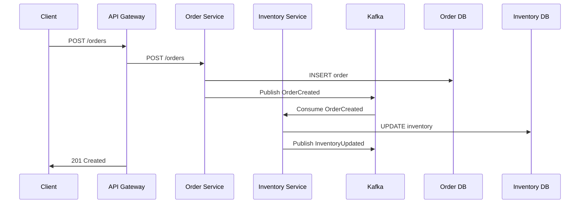

<!-- Generated by Groq via GitHub Actions -->
<!-- Topic ID: T241 -->
<!-- Category: Architecture Patterns -->
<!-- Generated at UTC: 2026-11-22T08:20:43.191275+00:00 -->

# Microservices

## 1. What problem does this solve?

| Problem | Why it matters | Consequence of not using microservices | Real‑world example |
|---------|----------------|----------------------------------------|--------------------|
| **Monolith growth** | A single codebase becomes huge, hard to understand, slow to build, and difficult to scale specific parts. | Long release cycles, risk of breaking unrelated features, hard to onboard new teams. | Facebook’s early monolith, later split into many services. |
| **Team autonomy** | Different teams need to ship features independently. | Coordination bottlenecks, merge conflicts, shared ownership of database schema. | Spotify’s “micro‑service” culture where each team owns a feature set. |
| **Technology heterogeneity** | Teams may prefer different languages or databases for specific problems. | Forced to use a single stack, losing the benefit of best‑for‑purpose tools. | Netflix uses Java, Python, Node, and Go across services. |
| **Scalable deployment** | Some parts of the system need more resources (e.g., image processing). | You must scale the whole application, wasting resources. | Amazon’s recommendation engine runs on a dedicated cluster. |
| **Resilience** | A failure in one area should not bring down the whole system. | A bug in the payment module can crash the entire site. | Twitter’s “fail‑fast” micro‑service design. |

If microservices are not used, the system tends to become a tightly coupled monolith that is hard to evolve, scale, and maintain.

## 2. Mental model

**Analogy – A city**  
Think of a backend as a city.  
- **Districts** (services) specialize: finance, transport, health.  
- **Roads** (APIs, message queues) connect districts.  
- **City council** (API gateway, service mesh) manages traffic, security, and traffic rules.  
- **Citizens** (clients) request services from districts.

**Engineering model**  
- **Service**: a bounded context with its own database, business logic, and API.  
- **Communication**: synchronous HTTP/REST or gRPC, or asynchronous event bus (Kafka, RabbitMQ).  
- **Infrastructure**: containerized deployments, service registry, load balancer, circuit breaker.  
- **Observability**: logs, metrics, tracing across services.

## 3. Deep explanation

### Internals
- **Service boundaries**: defined by business capabilities and data ownership.  
- **API contracts**: JSON schema, OpenAPI, gRPC proto.  
- **Deployment unit**: Docker image, Kubernetes pod, or serverless function.  
- **Data consistency**: eventual consistency via events, or strong consistency via shared DB (anti‑pattern).  
- **Service discovery**: static config, DNS, or dynamic registry (Consul, Eureka).  
- **Resilience patterns**: circuit breaker, bulkhead, retry, timeout, fallback.

### Important terminology
| Term | Definition |
|------|------------|
| **Bounded Context** | Logical boundary where a model is consistent. |
| **Event Sourcing** | Persisting state changes as events instead of snapshots. |
| **Saga** | Long‑running transaction across services. |
| **Service Mesh** | Dedicated infrastructure layer for service‑to‑service communication. |
| **API Gateway** | Single entry point that routes, aggregates, and secures requests. |

### Trade‑offs
| Trade‑off | Pros | Cons |
|-----------|------|------|
| **Synchronous vs Asynchronous** | Simpler flow, immediate response. | Higher latency, tighter coupling. |
| **Shared DB vs Separate DB** | Strong consistency, simpler joins. | Tight coupling, scalability bottleneck. |
| **Monolith vs Microservices** | Simpler deployment, easier debugging. | Harder to scale, slower evolution. |
| **Event‑driven vs Request‑response** | Loose coupling, resilience. | Complexity, eventual consistency. |

### Failure modes
- **Network partitions**: services lose connectivity → timeouts, retries.  
- **Cascading failures**: one service overloads others (e.g., unbounded retries).  
- **Data inconsistency**: stale reads due to eventual consistency.  
- **Version drift**: API changes breaking consumers.  

### Limitations
- **Operational complexity**: many services, more deployments, more monitoring.  
- **Latency**: inter‑service calls add network hops.  
- **Testing**: integration tests become more involved.  
- **Cost**: more containers, more infrastructure.  

### Where it fits
- **Layered architecture**: presentation → API gateway → service layer → data layer.  
- **Polyglot persistence**: each service can choose its own DB.  
- **CI/CD pipelines**: per‑service build, test, deploy.  

### Interaction with related concepts
- **API Gateway**: centralizes auth, rate limiting, request aggregation.  
- **Service Mesh**: handles traffic routing, retries, metrics.  
- **CQRS**: read/write models split across services.  
- **Event Sourcing**: stores events in a dedicated event store service.  

## 4. How it works

1. **Client** sends a request to the **API Gateway**.  
2. Gateway authenticates, authorizes, and routes to the target **service**.  
3. Service processes the request, possibly querying its own DB or calling other services.  
4. If needed, service publishes an **event** to a message broker (Kafka).  
5. Other services consume the event, update their own state, and may publish further events.  
6. Response is returned to the client via the gateway.



## 5. Practical implementation

Below is a minimal **Order Service** in TypeScript/Node.js using Express, PostgreSQL, and Kafka.

```ts
// src/orderService.ts
import express from 'express';
import { Pool } from 'pg';
import { Kafka } from 'kafkajs';

const app = express();
app.use(express.json());

// PostgreSQL pool
const pool = new Pool({
  connectionString: process.env.DATABASE_URL,
});

// Kafka producer
const kafka = new Kafka({ brokers: [process.env.KAFKA_BROKER!] });
const producer = kafka.producer();

app.post('/orders', async (req, res) => {
  const { userId, items } = req.body;

  // 1️⃣ Persist order
  const client = await pool.connect();
  try {
    await client.query('BEGIN');
    const insertRes = await client.query(
      'INSERT INTO orders (user_id, status) VALUES ($1, $2) RETURNING id',
      [userId, 'created']
    );
    const orderId = insertRes.rows[0].id;

    // 2️⃣ Publish event
    await producer.send({
      topic: 'orders',
      messages: [
        { key: orderId.toString(), value: JSON.stringify({ orderId, items }) },
      ],
    });

    await client.query('COMMIT');
    res.status(201).json({ orderId });
  } catch (e) {
    await client.query('ROLLBACK');
    console.error(e);
    res.status(500).json({ error: 'Order failed' });
  } finally {
    client.release();
  }
});

const start = async () => {
  await producer.connect();
  app.listen(3000, () => console.log('Order Service listening on 3000'));
};

start();
```

**Key lines explained**

- `pool.query('BEGIN')` / `COMMIT` – transactional order creation.  
- `producer.send` – publishes `OrderCreated` event to Kafka.  
- `await producer.connect()` – ensures Kafka connection before handling requests.  

**Dockerfile**

```dockerfile
# Dockerfile
FROM node:20-alpine
WORKDIR /app
COPY package*.json ./
RUN npm ci
COPY . .
EXPOSE 3000
CMD ["node", "dist/orderService.js"]
```

**docker-compose.yml**

```yaml
version: "3.8"
services:
  order-service:
    build: .
    ports:
      - "3000:3000"
    environment:
      - DATABASE_URL=postgres://postgres:postgres@db:5432/orders
      - KAFKA_BROKER=kafka:9092
    depends_on:
      - db
      - kafka
  db:
    image: postgres:15
    environment:
      POSTGRES_DB: orders
      POSTGRES_USER: postgres
      POSTGRES_PASSWORD: postgres
    volumes:
      - pgdata:/var/lib/postgresql/data
  kafka:
    image: bitnami/kafka:3
    environment:
      KAFKA_CFG_ZOOKEEPER_CONNECT: zookeeper:2181
      KAFKA_CFG_ADVERTISED_LISTENERS: PLAINTEXT://kafka:9092
    depends_on:
      - zookeeper
  zookeeper:
    image: bitnami/zookeeper:3
    environment:
      ALLOW_ANONYMOUS_LOGIN: yes

volumes:
  pgdata:
```

Run with `docker compose up`.

## 6. Production considerations

| Concern | Recommendation |
|---------|----------------|
| **Scalability** | Horizontal scaling via Kubernetes or ECS; stateless services; use Redis for caching. |
| **Reliability** | Circuit breakers (e.g., `opossum`), bulkheads, retries with exponential backoff. |
| **Security** | Mutual TLS between services, JWT auth at gateway, secrets in Vault. |
| **Observability** | Centralized logging (ELK), metrics (Prometheus + Grafana), distributed tracing (Jaeger). |
| **Performance** | Keep services lightweight, batch database writes, use async event streams. |
| **Error handling** | Return consistent error codes, use `try/catch` with proper status mapping. |
| **Resource usage** | Monitor CPU/memory per pod; use resource limits/requests. |
| **Operational concerns** | CI/CD pipelines per service, automated health checks, blue/green deployments. |
| **Failure recovery** | Idempotent event handlers, dead‑letter queues, manual replay of events. |
| **Deployment** | Immutable containers, versioned images, canary releases. |

## 7. Common mistakes

| Mistake | Why it’s problematic |
|---------|----------------------|
| **Tight coupling via shared DB** | Breaks service autonomy, hinders scaling, creates single point of failure. |
| **Synchronous calls for everything** | Increases latency, risk of cascading failures, hard to recover from partial failures. |
| **No API contract versioning** | Consumers break when a service changes; leads to downtime. |
| **Ignoring idempotency** | Duplicate events cause duplicate orders or inventory decrements. |
| **Skipping observability** | Hard to debug production issues, no visibility into failures. |
| **Over‑splitting services** | Too many tiny services increase operational overhead and latency. |
| **Hard‑coding URLs** | Makes scaling and routing difficult; defeats dynamic discovery. |
| **Not handling partial failures** | One service failure can bring down the whole flow. |

## 8. Senior engineer perspective

When scaling microservices, a senior engineer must:

- **Define clear bounded contexts**: avoid overlapping data ownership.  
- **Choose communication patterns**: synchronous for low‑latency, asynchronous for decoupling.  
- **Implement contract‑first APIs**: OpenAPI or gRPC with versioning.  
- **Design for failure**: circuit breakers, retries, fallback, dead‑letter queues.  
- **Plan for observability**: distributed tracing, centralized logs, alerting.  
- **Optimize cost**: right‑size containers, use spot instances, cache aggressively.  
- **Avoid over‑engineering**: start with a minimal viable set of services, evolve.  
- **When NOT to use microservices**: small teams, simple CRUD apps, low traffic, tight budget.  

### Design decisions
- **Service granularity**: trade‑off between autonomy and complexity.  
- **Data ownership**: one service owns its data; no cross‑service joins.  
- **Event schema evolution**: use schema registry, backward compatibility.  
- **Deployment strategy**: blue/green, canary, or rolling updates.  

### Bottlenecks
- **Network I/O**: inter‑service latency.  
- **Database contention**: shared DB leads to lock contention.  
- **Message broker overload**: Kafka partitions, consumer lag.  

### Monitoring
- **Health checks**: `/healthz` endpoints.  
- **Metrics**: request latency, error rates, queue depth.  
- **Tracing**: propagate trace IDs across services.  

## 9. Interview questions

1. **Beginner**: *What is a microservice and how does it differ from a monolith?*  
   *Answer:* A microservice is an independently deployable unit that encapsulates a specific business capability. Unlike a monolith, services are loosely coupled, can be written in different languages, and scale independently.

2. **Beginner**: *Why do we use an API gateway in a microservice architecture?*  
   *Answer:* It provides a single entry point, handles cross‑cutting concerns (auth, rate limiting, logging), aggregates responses, and routes requests to the appropriate service.

3. **Senior**: *Explain how you would design a saga for an order‑creation flow that involves inventory and payment services.*  
   *Answer:* Use a coordinator saga that sends a `ReserveInventory` command, waits for `InventoryReserved`, then sends `ChargePayment`. If any step fails, send compensating actions (`ReleaseInventory`, `RefundPayment`). Events are persisted to an event store, and each service reacts idempotently.

4. **Senior**: *What are the trade‑offs between synchronous HTTP calls and asynchronous event‑driven communication in microservices?*  
   *Answer:* Synchronous calls give immediate feedback but increase coupling and latency; asynchronous events decouple services, improve resilience, but introduce eventual consistency and complexity in handling retries and ordering.

5. **Scenario/Debugging**: *You notice that the `Order Service` is returning 500 errors intermittently. The logs show a `TimeoutError` when calling the `Inventory Service`. What steps would you take to diagnose and fix the issue?*  
   *Answer:*  
   - Verify network connectivity and DNS resolution between services.  
   - Check the `Inventory Service` health and resource usage (CPU, memory).  
   - Inspect circuit breaker state; see if it’s open.  
   - Look at request latency metrics; identify if the inventory service is slow.  
   - Add retries with backoff or fallback.  
   - If the inventory service is overloaded, scale it horizontally or add caching.  

## 10. Hands‑on task

**Task**: Build a simple **Inventory Service** that consumes `OrderCreated` events from Kafka, updates a PostgreSQL inventory table, and publishes an `InventoryUpdated` event.

1. Create a new Node.js project with Express and `kafkajs`.  
2. Implement a Kafka consumer that listens to the `orders` topic.  
3. On receiving an event, decrement the stock for each item.  
4. Publish an `inventory-updated` event with the new stock levels.  
5. Write integration tests that simulate an order and verify the inventory update.  
6. Dockerize the service and run it alongside the Order Service using `docker compose`.

**Goal**: Understand event consumption, idempotency, and cross‑service communication.

## 11. Quick revision

- Microservice = independently deployable, bounded context.  
- API Gateway centralizes auth, routing, aggregation.  
- Service Mesh handles traffic, retries, metrics.  
- Synchronous vs asynchronous: trade‑off latency vs decoupling.  
- Circuit breaker prevents cascading failures.  
- Idempotent event handlers avoid duplicate processing.  
- Observability: logs, metrics, tracing.  
- Data ownership: each service owns its DB.  
- Versioning: OpenAPI or gRPC with semantic versioning.  
- Deployment: containerized, immutable images, canary releases.  
- Common pitfalls: shared DB, tight coupling, no observability, no idempotency.

## 12. References

- https://microservices.io/  
- https://kafka.apache.org/  
- https://expressjs.com/  
- https://nodejs.org/en/docs/  
- https://www.docker.com/resources/what-container  
- https://prometheus.io/docs/introduction/overview/  
- https://grafana.com/docs/grafana/latest/  
- https://opossum.js.org/  
- https://github.com/Netflix/Hystrix  
- https://opentelemetry.io/docs/  

---
