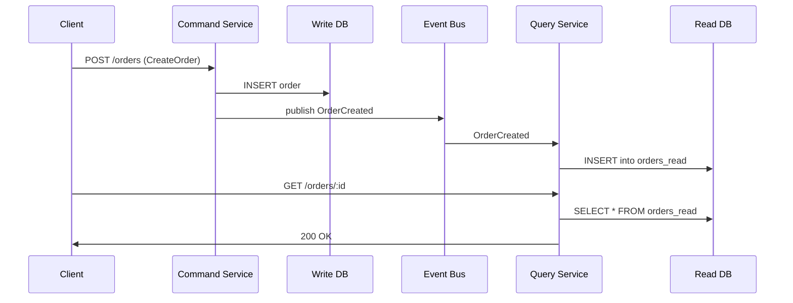

<!-- Generated by Groq via GitHub Actions -->
<!-- Topic ID: T243 -->
<!-- Category: Architecture Patterns -->
<!-- Generated at UTC: 2026-11-22T20:25:59.811591+00:00 -->

# CQRS

## 1. What problem does this solve?

**Motivation**

In many systems the same data store is used for both *reading* (queries) and *writing* (commands).  
When the workload is heavy, the read side can become a bottleneck for writes, and vice versa.  
Additionally, the shape of data needed for a query is often different from the shape needed for a command.  
CQRS (Command Query Responsibility Segregation) separates these two concerns so that each can evolve independently.

**What problem exists**

- **Read/write contention**: A single table or index is updated and queried at the same time, causing lock contention and slow writes.
- **Complex query models**: Queries often need denormalized, read‑optimized projections that are costly to maintain if they share the same schema as writes.
- **Scaling difficulty**: Scaling reads and writes together forces you to duplicate effort; you can’t scale the read side without also scaling the write side.

**Why the problem matters**

- **Performance**: Write latency spikes when reads are heavy.
- **Consistency**: Optimistic or eventual consistency models become hard to reason about.
- **Maintainability**: A single schema must satisfy both worlds, leading to a “one‑size‑fits‑all” design that is brittle.

**What happens if this concept is not used**

- The system may suffer from slow writes, high latency, or even deadlocks under load.
- Developers may be forced to write complex, ad‑hoc denormalization logic in the same codebase that handles business commands.
- Scaling becomes a costly, monolithic operation.

**Where this concept appears in real backend systems**

- E‑commerce order services: separate write model for order placement, read model for order status dashboards.
- Banking: write‑only ledger updates, read‑only balance queries.
- Messaging platforms: write‑only message ingestion, read‑only message feeds.
- IoT telemetry: write‑only sensor data ingestion, read‑only analytics dashboards.

---

## 2. Mental model

**Analogy**

> Think of a library that has two separate rooms:  
> *The “Writing Room”* where new books are added, edited, or removed.  
> *The “Reading Room”* where patrons browse, search, and read books.  
> The two rooms share the same collection of books, but the processes that happen inside each are very different.  
> The Writing Room needs strict control (only one author can edit a book at a time), while the Reading Room can serve many readers simultaneously.

**Engineering model**

- **Command side**: Handles *writes* (create, update, delete). Enforces business rules, validates data, and writes to the source of truth (often a relational DB or event store).
- **Query side**: Handles *reads*. Maintains read‑optimized projections (materialized views, NoSQL tables, caches) that are updated asynchronously from the command side.
- **Event bus**: Commands produce events that the query side consumes to update its projections.

---

## 3. Deep explanation

### Internals

1. **Command Handler**  
   Receives a command object, validates it, applies business logic, and persists the resulting state or emits domain events.

2. **Event Store / Event Bus**  
   Stores domain events or forwards them to interested subscribers. Kafka, RabbitMQ, or a simple in‑memory bus can be used.

3. **Query Model / Projection**  
   Listens to events and updates a read‑optimized data store (e.g., a denormalized PostgreSQL table, a Redis cache, or a MongoDB collection).

4. **Read API**  
   Exposes query endpoints that read from the projection store.

### Important terminology

- **Command**: Intent to change state (e.g., `CreateOrder`).
- **Event**: Immutable record of something that happened (e.g., `OrderCreated`).
- **Projection**: Read‑optimized representation of data built from events.
- **Saga**: Orchestrator that coordinates multiple commands across bounded contexts.
- **Eventual Consistency**: Reads may lag behind writes until projections catch up.

### Trade‑offs

| Aspect | CQRS | Traditional CRUD |
|--------|------|------------------|
| **Complexity** | Higher (separate models, event bus) | Lower |
| **Scalability** | Independent scaling of reads/writes | Coupled scaling |
| **Consistency** | Eventual (unless you add sync) | Strong (if same store) |
| **Latency** | Read latency may increase due to projection lag | Read latency is immediate |
| **Tooling** | Requires event sourcing or pub/sub | Simple CRUD APIs |

### Failure modes

- **Projection drift**: If an event is lost or processed out of order, the read model becomes stale.
- **Event replay**: Replaying a large backlog can be expensive.
- **Command validation**: If business rules are only enforced on the write side, the read side may expose stale or invalid data.

### Limitations

- Not suitable for simple CRUD services where read/write patterns are similar.
- Adds operational overhead (multiple services, data stores, monitoring).
- Requires careful versioning of events and projections.

### Where this concept fits in a backend architecture

```
┌─────────────────────┐
│  Client / API Layer │
└───────┬───────┬───────┘
        │       │
   Commands   Queries
        │       │
┌───────▼───────▼───────┐
│  Command Service     │
│  (Domain, Validation)│
└───────┬───────┬───────┘
        │       │
   Persist  Emit Event
        │       │
┌───────▼───────▼───────┐
│  Event Store / Bus   │
└───────┬───────┬───────┘
        │       │
   Consume  Update Projection
        │       │
┌───────▼───────▼───────┐
│  Query Service       │
│  (Read‑Optimized DB) │
└───────────────────────┘
```

### Interaction with related concepts

- **Event Sourcing**: CQRS is often paired with event sourcing, where the source of truth is the event log.
- **Microservices**: Each bounded context can expose its own CQRS boundary.
- **Saga Pattern**: Orchestrates multi‑service commands.
- **Cache**: Query side may use Redis for fast reads.
- **GraphQL**: Can be used on the query side to shape projections.

---

## 4. How it works

1. **Client sends a command** (e.g., `POST /orders` with `CreateOrderCommand`).
2. **Command Service** validates and applies business rules.
3. **Command Service** writes the new state to the write database *and* emits an event (`OrderCreated`).
4. **Event Bus** delivers the event to all subscribed services.
5. **Query Service** receives the event and updates its projection store (e.g., inserts a row into `orders_read`).
6. **Client queries** (`GET /orders/:id`) hits the Query Service, which reads from the projection store and returns the result.

**Mermaid diagram**



---

## 5. Practical implementation

Below is a minimal Node.js/TypeScript example using **Express**, **PostgreSQL** (write side), **Redis** (read side), and **Kafka** (event bus).  
The example demonstrates creating an order and querying it.

> **Prerequisites**: Docker Compose with PostgreSQL, Redis, and Kafka.

### 1. Project structure

```
cqrs-demo/
├─ src/
│  ├─ commands/
│  │  └─ createOrder.ts
│  ├─ events/
│  │  └─ orderCreated.ts
│  ├─ projections/
│  │  └─ orderProjection.ts
│  ├─ services/
│  │  ├─ commandService.ts
│  │  └─ queryService.ts
│  ├─ app.ts
│  └─ kafka.ts
├─ docker-compose.yml
├─ package.json
└─ tsconfig.json
```

### 2. `docker-compose.yml`

```yaml
version: '3.8'
services:
  postgres:
    image: postgres:15
    environment:
      POSTGRES_USER: cqrs
      POSTGRES_PASSWORD: cqrs
      POSTGRES_DB: cqrs
    ports:
      - "5432:5432"
  redis:
    image: redis:7
    ports:
      - "6379:6379"
  zookeeper:
    image: confluentinc/cp-zookeeper:7.5
    environment:
      ZOOKEEPER_CLIENT_PORT: 2181
  kafka:
    image: confluentinc/cp-kafka:7.5
    depends_on:
      - zookeeper
    environment:
      KAFKA_BROKER_ID: 1
      KAFKA_ZOOKEEPER_CONNECT: zookeeper:2181
      KAFKA_ADVERTISED_LISTENERS: PLAINTEXT://localhost:9092
      KAFKA_OFFSETS_TOPIC_REPLICATION_FACTOR: 1
    ports:
      - "9092:9092"
```

### 3. `src/kafka.ts`

```ts
import { Kafka } from 'kafkajs';

const kafka = new Kafka({
  clientId: 'cqrs-demo',
  brokers: ['localhost:9092'],
});

export const producer = kafka.producer();
export const consumer = kafka.consumer({ groupId: 'cqrs-demo-group' });
```

### 4. `src/commands/createOrder.ts`

```ts
export interface CreateOrderCommand {
  id: string;
  customerId: string;
  items: { productId: string; qty: number }[];
}
```

### 5. `src/events/orderCreated.ts`

```ts
export interface OrderCreatedEvent {
  type: 'OrderCreated';
  payload: {
    id: string;
    customerId: string;
    items: { productId: string; qty: number }[];
    createdAt: string;
  };
}
```

### 6. `src/services/commandService.ts`

```ts
import { Pool } from 'pg';
import { v4 as uuidv4 } from 'uuid';
import { CreateOrderCommand } from '../commands/createOrder';
import { OrderCreatedEvent } from '../events/orderCreated';
import { producer } from '../kafka';

const pool = new Pool({
  user: 'cqrs',
  host: 'localhost',
  database: 'cqrs',
  password: 'cqrs',
  port: 5432,
});

export async function handleCreateOrder(cmd: CreateOrderCommand) {
  // 1. Persist to write DB
  await pool.query(
    'INSERT INTO orders (id, customer_id, created_at) VALUES ($1, $2, $3)',
    [cmd.id, cmd.customerId, new Date()],
  );

  // 2. Persist items
  for (const item of cmd.items) {
    await pool.query(
      'INSERT INTO order_items (order_id, product_id, qty) VALUES ($1, $2, $3)',
      [cmd.id, item.productId, item.qty],
    );
  }

  // 3. Emit event
  const event: OrderCreatedEvent = {
    type: 'OrderCreated',
    payload: {
      id: cmd.id,
      customerId: cmd.customerId,
      items: cmd.items,
      createdAt: new Date().toISOString(),
    },
  };

  await producer.send({
    topic: 'orders',
    messages: [{ value: JSON.stringify(event) }],
  });
}
```

### 7. `src/services/queryService.ts`

```ts
import { createClient } from 'redis';
import { consumer } from '../kafka';
import { OrderCreatedEvent } from '../events/orderCreated';

const redis = createClient({ url: 'redis://localhost:6379' });

export async function startProjection() {
  await redis.connect();

  await consumer.connect();
  await consumer.subscribe({ topic: 'orders', fromBeginning: true });

  await consumer.run({
    eachMessage: async ({ message }) => {
      const event: OrderCreatedEvent = JSON.parse(message.value!.toString());
      // Store a simple JSON string in Redis as the read model
      await redis.set(`order:${event.payload.id}`, JSON.stringify(event.payload));
    },
  });
}
```

### 8. `src/app.ts`

```ts
import express from 'express';
import bodyParser from 'body-parser';
import { v4 as uuidv4 } from 'uuid';
import { handleCreateOrder } from './services/commandService';
import { startProjection } from './services/queryService';
import { createClient } from 'redis';

const app = express();
app.use(bodyParser.json());

const redis = createClient({ url: 'redis://localhost:6379' });
redis.connect();

app.post('/orders', async (req, res) => {
  const cmd = {
    id: uuidv4(),
    customerId: req.body.customerId,
    items: req.body.items,
  };
  await handleCreateOrder(cmd);
  res.status(201).json({ orderId: cmd.id });
});

app.get('/orders/:id', async (req, res) => {
  const data = await redis.get(`order:${req.params.id}`);
  if (!data) return res.status(404).send('Not found');
  res.json(JSON.parse(data));
});

startProjection(); // start listening to events

app.listen(3000, () => console.log('CQRS demo listening on :3000'));
```

### 9. Running the demo

```bash
# 1. Start services
docker compose up -d

# 2. Install deps
npm install

# 3. Build & run
npm run dev
```

Now you can `POST /orders` and `GET /orders/:id`.  
The write side writes to PostgreSQL, emits an event, and the query side updates Redis.

---

## 6. Production considerations

| Concern | CQRS‑specific notes |
|---------|---------------------|
| **Scalability** | Separate services can be scaled independently. Read side can be sharded or replicated; write side can use partitioned tables. |
| **Reliability** | Use a durable event bus (Kafka, Pulsar). Implement idempotent event handlers. |
| **Security** | Separate APIs for commands and queries. Apply RBAC per endpoint. Encrypt event payloads if sensitive. |
| **Observability** | Instrument command handlers (latency, error rates). Track event processing lag. Log correlation IDs across services. |
| **Performance** | Read side can use in‑memory caches (Redis) for hot data. Write side may batch events. |
| **Error handling** | Command failures should roll back DB changes. Event failures should be retried with back‑off. |
| **Resource usage** | Event bus and projection services consume CPU/memory; monitor queue depth. |
| **Operational concerns** | Deploy command and query services separately. Use CI/CD pipelines to version events. |
| **Failure recovery** | Replay events from the event store to rebuild projections. Keep a backup of the event log. |
| **Deployment** | Containerize each service. Use Kubernetes or ECS for scaling. |
| **Cost/performance** | Separate databases may increase storage cost but reduce contention. |

---

## 7. Common mistakes

| Mistake | Why it’s problematic |
|---------|----------------------|
| **Treating CQRS as a silver bullet** | Not all workloads benefit; simple CRUD services may suffer unnecessary complexity. |
| **Ignoring eventual consistency** | Assuming reads are always up‑to‑date can lead to stale data being served. |
| **Not versioning events** | Schema changes break projections if old events are replayed. |
| **Using the same DB for both sides** | Violates the separation; you lose the scalability benefit. |
| **Not handling duplicate events** | Idempotency is essential; otherwise projections can become corrupted. |
| **Blocking command handlers on read side** | Coupling the two sides defeats the purpose of segregation. |
| **Skipping monitoring of event lag** | Unnoticed lag can mean users see outdated data. |
| **Hard‑coding event topics** | Makes refactoring difficult; use a config or registry. |

---

## 8. Senior engineer perspective

### What changes at scale

- **Distributed event bus**: Kafka clusters, topic partitioning, consumer groups.
- **Schema registry**: Avro/Protobuf schemas for events to enforce compatibility.
- **Saga orchestration**: Complex multi‑service workflows.
- **Multi‑region deployments**: Replicate read projections globally.
- **Back‑pressure handling**: Throttle command ingestion when event bus is saturated.

### Design decisions

| Decision | Considerations |
|----------|----------------|
| **Event store vs. database** | Event sourcing stores raw events; can be expensive but gives audit trail. |
| **Projection storage** | Choose between relational (PostgreSQL), NoSQL (MongoDB), or in‑memory (Redis). |
| **Event bus choice** | Kafka for high throughput, Pulsar for multi‑tenant, NATS for low latency. |
| **Command validation** | Centralize in domain services; use DDD aggregates. |
| **Idempotency** | Use unique command IDs or event IDs; store processed IDs. |
| **Monitoring** | Track event lag, projection health, consumer group offsets. |
| **Cost** | Running multiple databases and brokers increases cost; evaluate read/write ratios. |

### When NOT to use CQRS

- Small monoliths with low traffic.
- Simple CRUD services where read/write patterns are identical.
- When operational overhead outweighs performance gains.
- Tight latency requirements that cannot tolerate projection lag.

---

## 9. Interview questions

1. **Beginner**: *What is the main difference between a command and a query in CQRS?*  
   *Answer*: Commands change state and are handled by the write model; queries read state from the read model.

2. **Beginner**: *Why might you use a separate database for the query side?*  
   *Answer*: To avoid contention, optimize for read patterns, and scale reads independently.

3. **Senior**: *How would you handle schema evolution for events in a CQRS system?*  
   *Answer*: Use a schema registry (Avro/Protobuf), maintain backward compatibility, and version events. Rebuild projections when necessary.

4. **Senior**: *Describe how you would implement idempotent command handling in a distributed CQRS architecture.*  
   *Answer*: Store a unique command ID in a processed‑commands table or cache; reject duplicates. Use idempotent event handlers that check event IDs before applying changes.

5. **Scenario/Debugging**: *A user reports that after creating an order, the order details are missing from the dashboard for 30 seconds. What could be causing this delay, and how would you investigate?*  
   *Answer*: Likely event lag or projection failure. Check consumer lag metrics, verify the event bus health, ensure the projection service is running, and inspect logs for errors. Verify that the event was produced and consumed. If the consumer crashed, restart and replay events.*

---

## 10. Hands‑on task

**Task**: Extend the demo to support *order cancellation*.

1. Add a `CancelOrderCommand` that includes `orderId` and `reason`.
2. Update the command service to:
   - Validate that the order exists and is not already cancelled.
   - Persist the cancellation to the write DB.
   - Emit an `OrderCancelled` event.
3. Update the projection service to handle `OrderCancelled` and mark the order as cancelled in Redis.
4. Add a new query endpoint `GET /orders/:id/status` that returns the cancellation status.
5. Write a unit test that:
   - Creates an order.
   - Cancels it.
   - Asserts that the status endpoint returns `cancelled`.

**Hints**:  
- Use a new table `order_cancellations` or add a `status` column.  
- Ensure idempotency by checking if the order is already cancelled.  
- Update the Redis key format to include status.

---

## 11. Quick revision

- CQRS separates *commands* (writes) from *queries* (reads).
- Commands change state; queries read from a read‑optimized projection.
- Events are the bridge: commands emit events, projections consume them.
- Eventual consistency: reads may lag behind writes.
- Use a durable event bus (Kafka, Pulsar) and idempotent handlers.
- Separate databases or data stores for write and read sides.
- Monitor event lag, consumer offsets, and projection health.
- Schema evolution requires versioning and a schema registry.
- Idempotency is critical to avoid duplicate processing.
- CQRS shines when read/write patterns differ significantly.
- Avoid CQRS for simple CRUD services with low contention.

---

## 12. References

- [Microsoft Docs – CQRS](https://learn.microsoft.com/en-us/azure/architecture/patterns/cqrs)
- [Event Sourcing & CQRS – Martin Fowler](https://martinfowler.com/eaaCatalog/cqrs.html)
- [Kafka – Confluent Documentation](https://docs.confluent.io/platform/current/overview.html)
- [Kafkajs – Node.js client](https://kafka.js.org/)
- [Redis – Official Docs](https://redis.io/docs/)
- [PostgreSQL – Official Docs](https://www.postgresql.org/docs/)
- [FastAPI – Official Docs](https://fastapi.tiangolo.com/)
