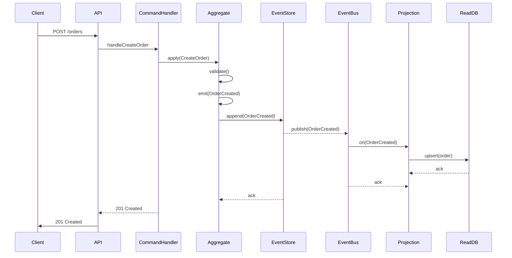

<!-- Generated by Groq via GitHub Actions -->
<!-- Topic ID: T244 -->
<!-- Category: Architecture Patterns -->
<!-- Generated at UTC: 2026-11-22T20:25:59.811591+00:00 -->

# Event sourcing

## 1. What problem does this solve?

**Motivation**  
In a typical CRUD system, the current state of an entity is stored in a table or document. When something changes, the old state is overwritten. This works fine for simple use cases, but it hides *how* the state arrived at its current value.

**Problems with overwriting state**

| Problem | Why it matters | Consequences if ignored | Real‑world examples |
|---------|----------------|------------------------|---------------------|
| **Audit & compliance** | Regulators often need a full history of changes. | Inability to prove how a value was derived. | Banking, healthcare, insurance |
| **Debugging & replay** | Hard to reproduce bugs that happened in the past. | Long, manual debugging sessions. | E‑commerce order processing |
| **Domain events** | Business logic often depends on *events* (e.g., “OrderPlaced”). | Missing triggers for downstream services. | Microservices that react to order events |
| **Temporal queries** | Need to know state at a point in time. | Must reconstruct history manually. | Financial ledgers, inventory snapshots |
| **Concurrency & conflict resolution** | Overwrites can silently lose updates. | Lost work, data corruption. | Collaborative editing, multi‑tenant SaaS |

If event sourcing is not used, developers must build ad‑hoc audit logs, write custom replay logic, or risk losing critical information.

**Where it appears**  
- Event‑driven microservices (Kafka, RabbitMQ)  
- CQRS architectures (read/write models)  
- Financial systems (ledger, audit trail)  
- Collaboration tools (Google Docs style)  
- IoT telemetry (state changes over time)

---

## 2. Mental model

### Analogy: A diary of a house

Imagine you own a house. Instead of just keeping a single sheet that says “The front door is locked,” you keep a diary that records every action: “2024‑01‑01 09:00 – Locked front door,” “2024‑01‑02 14:30 – Opened back door,” etc. If you want to know *why* the door is currently locked, you read the diary from the beginning.

**Engineering model**  
- **Event** = a record of something that happened (immutable).  
- **Event store** = append‑only log of all events.  
- **Projection** = materialized read model built by replaying events.  
- **Command** = intent to change state, which is turned into events.

---

## 3. Deep explanation

### Internals

1. **Event Store**  
   - Append‑only storage (e.g., PostgreSQL table, Kafka topic, DynamoDB stream).  
   - Each event has: `id`, `type`, `payload`, `timestamp`, `aggregateId`, `sequenceNumber`.

2. **Aggregate**  
   - Domain object that encapsulates business rules.  
   - Receives commands → validates → emits events → updates its own state.

3. **Event Bus**  
   - Publishes events to subscribers (other services, projections).

4. **Projection / Read Model**  
   - Consumes events and builds a query‑friendly view (SQL table, Redis cache).

### Important terminology

| Term | Meaning |
|------|---------|
| **Aggregate** | Root entity that owns a set of related events. |
| **Command** | Intent to perform an action (e.g., `CreateOrder`). |
| **Event** | Immutable record of something that happened. |
| **Snapshot** | Periodic capture of aggregate state to speed up replay. |
| **Projection** | Read‑optimized view built from events. |
| **Event Sourcing** | Persisting state changes as a sequence of events. |
| **CQRS** | Command Query Responsibility Segregation – separate write & read models. |

### Trade‑offs

| Benefit | Trade‑off |
|---------|-----------|
| Full audit trail | Larger storage footprint |
| Easy replay | Requires careful versioning of event schemas |
| Decoupled services | Complexity in event versioning & schema evolution |
| Temporal queries | Must maintain projections or replay on demand |
| Strong consistency | Eventual consistency between aggregates & projections |

### Failure modes

- **Event loss** – if the event store crashes before persisting, state is lost.  
- **Out‑of‑order events** – if events are processed out of sequence, projections become inconsistent.  
- **Schema drift** – changing event shape without migration can break consumers.  
- **Performance bottlenecks** – high write volume can saturate the event store.

### Limitations

- Not suitable for simple CRUD where audit isn’t needed.  
- Requires careful handling of idempotency and retries.  
- Adds operational overhead (event store, projections).  
- Harder to enforce ACID across multiple aggregates.

### Where it fits

- **Backend architecture**: sits between domain logic and persistence.  
- **Microservices**: each service owns its own event store or shares a topic.  
- **Data pipelines**: events feed analytics, monitoring, or AI training data.  
- **Integration**: external systems consume events via Kafka or HTTP.

### Interaction with related concepts

| Concept | Interaction |
|---------|-------------|
| **CQRS** | Event sourcing is often paired with CQRS; writes produce events, reads use projections. |
| **Saga** | Orchestrates long‑running transactions via events. |
| **Domain‑Driven Design** | Aggregates encapsulate business rules; events capture state changes. |
| **Event‑Driven Architecture** | Events are the lingua franca between services. |
| **Kafka / Pulsar** | Common event bus implementations. |
| **Redis Streams** | Lightweight event store for small workloads. |

---

## 4. How it works

1. **Client sends a command** (`CreateOrder`).  
2. **Command handler** validates business rules.  
3. **Aggregate** generates one or more events (`OrderCreated`, `PaymentCaptured`).  
4. **Events** are persisted atomically to the event store.  
5. **Event bus** publishes events to subscribers.  
6. **Projections** consume events and update read models.  
7. **Client reads** from the projection (e.g., `GET /orders/123`).  



---

## 5. Practical implementation

Below is a minimal Node.js/TypeScript example using **PostgreSQL** as the event store and **Redis** for a simple projection.

### 5.1 Setup

```bash
# Install dependencies
npm install pg redis uuid
```

### 5.2 Types

```ts
// src/types.ts
export type Event = {
  id: string;
  aggregateId: string;
  type: string;
  payload: any;
  timestamp: Date;
  sequence: number;
};

export type OrderCreated = {
  orderId: string;
  customerId: string;
  items: { sku: string; qty: number }[];
};

export type OrderEvent = OrderCreated; // extend as needed
```

### 5.3 Event Store

```ts
// src/eventStore.ts
import { Pool } from 'pg';
import { v4 as uuidv4 } from 'uuid';
import { Event } from './types';

const pool = new Pool({ connectionString: process.env.DATABASE_URL });

export async function appendEvent(event: Omit<Event, 'id' | 'timestamp' | 'sequence'>): Promise<Event> {
  const id = uuidv4();
  const timestamp = new Date();
  const sequence = await getNextSequence(event.aggregateId);

  const client = await pool.connect();
  try {
    await client.query('BEGIN');
    await client.query(
      `INSERT INTO events (id, aggregate_id, type, payload, timestamp, sequence)
       VALUES ($1, $2, $3, $4, $5, $6)`,
      [id, event.aggregateId, event.type, JSON.stringify(event.payload), timestamp, sequence]
    );
    await client.query('COMMIT');
    return { id, ...event, timestamp, sequence };
  } catch (err) {
    await client.query('ROLLBACK');
    throw err;
  } finally {
    client.release();
  }
}

async function getNextSequence(aggregateId: string): Promise<number> {
  const res = await pool.query(
    `SELECT COALESCE(MAX(sequence), 0) + 1 AS seq FROM events WHERE aggregate_id = $1`,
    [aggregateId]
  );
  return res.rows[0].seq;
}
```

### 5.4 Aggregate & Command

```ts
// src/orderAggregate.ts
import { appendEvent } from './eventStore';
import { OrderCreated, OrderEvent } from './types';

export async function createOrder(orderId: string, customerId: string, items: { sku: string; qty: number }[]) {
  const event: OrderEvent = {
    aggregateId: orderId,
    type: 'OrderCreated',
    payload: { orderId, customerId, items },
  };
  const persisted = await appendEvent(event);
  // publish to bus (omitted for brevity)
  return persisted;
}
```

### 5.5 Projection (Redis)

```ts
// src/projection.ts
import { createClient } from 'redis';
import { Event } from './types';

const redis = createClient({ url: process.env.REDIS_URL });
redis.on('error', console.error);
await redis.connect();

export async function handleEvent(event: Event) {
  if (event.type === 'OrderCreated') {
    const key = `order:${event.aggregateId}`;
    await redis.hSet(key, event.payload);
    await redis.expire(key, 60 * 60 * 24 * 30); // keep for 30 days
  }
  // handle other event types...
}
```

### 5.6 API (Express)

```ts
// src/server.ts
import express from 'express';
import { createOrder } from './orderAggregate';
import { handleEvent } from './projection';

const app = express();
app.use(express.json());

app.post('/orders', async (req, res) => {
  const { orderId, customerId, items } = req.body;
  try {
    const event = await createOrder(orderId, customerId, items);
    await handleEvent(event); // sync projection for demo
    res.status(201).json({ orderId });
  } catch (err) {
    console.error(err);
    res.status(500).json({ error: 'Internal error' });
  }
});

app.get('/orders/:id', async (req, res) => {
  const key = `order:${req.params.id}`;
  const order = await redis.hGetAll(key);
  if (Object.keys(order).length === 0) return res.status(404).json({ error: 'Not found' });
  res.json(order);
});

app.listen(3000, () => console.log('Listening on 3000'));
```

> **Note**: In production you’d separate the projection into its own service, use a proper event bus (Kafka), and add idempotency, retries, and schema migration.

---

## 6. Production considerations

| Concern | What to watch for | Mitigation |
|---------|-------------------|------------|
| **Scalability** | High write volume can saturate the event store. | Partition by aggregateId, use sharded Kafka topics, scale PostgreSQL read replicas. |
| **Reliability** | Event loss if the store crashes before commit. | Use transactional writes, WAL, replication, and durable queues. |
| **Security** | Sensitive data in events. | Encrypt payloads, restrict access to event store, audit logs. |
| **Observability** | Hard to trace event flow. | Add correlation IDs, log event IDs, use distributed tracing (OpenTelemetry). |
| **Performance** | Replaying events for new projections can be slow. | Store snapshots, incremental projections, use change‑data‑capture. |
| **Error handling** | Duplicate events or out‑of‑order processing. | Sequence numbers, idempotent handlers, event versioning. |
| **Resource usage** | Append‑only logs grow indefinitely. | Archival policies, compaction, delete old snapshots. |
| **Operational concerns** | Need to maintain multiple services. | CI/CD pipelines, automated schema migrations, monitoring dashboards. |
| **Failure recovery** | Service crashes during projection update. | Retry loops, dead‑letter queues, transactional updates. |
| **Deployment** | Need to coordinate schema changes. | Versioned event schemas, backward‑compatible handlers, feature flags. |

---

## 7. Common mistakes

| Mistake | Why it’s problematic |
|---------|----------------------|
| **Storing events in the same table as the read model** | Makes the read model mutable; violates immutability and audit guarantees. |
| **Skipping snapshots** | Replaying millions of events for every read becomes impossible. |
| **Ignoring event versioning** | New event shapes break old consumers; leads to runtime errors. |
| **Treating events as commands** | Events are immutable; mutating them breaks the log. |
| **Using a single aggregate per entity** | Over‑aggregating can cause contention; under‑aggregating can lead to duplicate events. |
| **Not handling idempotency** | Retries can produce duplicate events, corrupting state. |
| **Assuming strong consistency** | Eventual consistency is the norm; code must tolerate stale reads. |
| **Over‑optimizing projections** | Premature micro‑optimizations can add complexity; start simple. |

---

## 8. Senior engineer perspective

### What changes at scale

- **Event store choice**: Kafka or Pulsar for high throughput; PostgreSQL for smaller workloads.  
- **Partitioning strategy**: Partition by aggregateId or domain topic to parallelize reads.  
- **Schema evolution**: Adopt a schema registry (Confluent) and use Avro/Protobuf.  
- **Snapshot cadence**: Balance between storage cost and replay speed.  
- **Monitoring**: Track event lag, consumer group health, projection latency.  
- **Cost**: Kafka clusters, storage, and compute for projections can be significant; use tiered storage.  
- **Security**: Encrypt events at rest, use IAM roles for services.  
- **Failure scenarios**: Design for partial failures (e.g., projection service down) without blocking writes.  

### When NOT to use

- Simple CRUD with no audit or temporal requirements.  
- Low write volume where the overhead outweighs benefits.  
- Tight latency constraints where event replay adds unacceptable delay.  
- Environments where operational complexity must be minimal (e.g., small startups).  

---

## 9. Interview questions

| Level | Question | Answer points |
|-------|----------|---------------|
| Beginner | What is the difference between a command and an event in event sourcing? | Command = intent to change state; event = immutable record of what happened. |
| Beginner | Why do we need a projection in an event‑sourced system? | Projections provide query‑friendly read models; events are not directly queryable. |
| Senior | How would you handle schema evolution for events in a production system? | Use a schema registry, versioned event types, backward‑compatible handlers, migration scripts. |
| Senior | Explain how you would design an event store for a system with 10k writes per second. | Partitioned Kafka topics, multiple brokers, replication, use of compaction, consider storage tiering. |
| Scenario | A service consumes events from Kafka but occasionally processes the same event twice, leading to duplicate orders. How would you debug and fix this? | Check consumer group offsets, enable idempotent event handlers, use sequence numbers, add deduplication logic, inspect Kafka logs. |

---

## 10. Hands‑on task

**Build a simple “Todo” service with event sourcing.**

1. Create a PostgreSQL table `events` with columns: `id`, `aggregate_id`, `type`, `payload`, `timestamp`, `sequence`.  
2. Implement a `createTodo` command that emits a `TodoCreated` event.  
3. Write a projection that stores the current state of each todo in Redis.  
4. Expose two HTTP endpoints: `POST /todos` (create) and `GET /todos/:id` (read).  
5. Add a unit test that verifies idempotency: sending the same command twice should not create duplicate events.  

> **Tip**: Use Docker Compose to spin up PostgreSQL, Redis, and the Node.js app.

---

## 11. Quick revision

- Event sourcing stores *changes*, not *state*.  
- **Events** are immutable, append‑only records.  
- **Aggregates** validate commands and emit events.  
- **Event store** guarantees durability and order.  
- **Projections** build read models from events.  
- **Snapshots** speed up replay.  
- **Schema versioning** is essential for evolution.  
- **Idempotency** protects against duplicate processing.  
- **Event bus** (Kafka, Redis Streams) decouples producers & consumers.  
- **CQRS** pairs event sourcing with separate read/write models.  
- **Operational concerns**: scalability, observability, security, failure recovery.  

---

## 12. References

- [Event Sourcing – Domain-Driven Design Community](https://www.dddcommunity.org/2012/07/02/event-sourcing/)  
- [Event Sourcing in Practice – Microsoft Docs](https://learn.microsoft.com/en-us/azure/architecture/patterns/event-sourcing)  
- [Kafka – Apache Kafka Documentation](https://kafka.apache.org/documentation/)  
- [PostgreSQL – Append‑Only Tables](https://www.postgresql.org/docs/current/ddl-constraints.html)  
- [Redis Streams – Redis Documentation](https://redis.io/docs/data-types/streams/)  
- [OpenTelemetry – Distributed Tracing](https://opentelemetry.io/docs/)  

---
