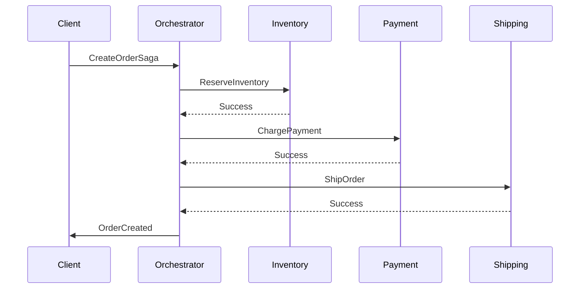

<!-- Generated by Groq via GitHub Actions -->
<!-- Topic ID: T245 -->
<!-- Category: Architecture Patterns -->
<!-- Generated at UTC: 2026-11-23T09:20:03.990412+00:00 -->

# Saga

## 1. What problem does this solve?

**Motivation**  
In a distributed system, a single business transaction often touches multiple services (e.g., order service, inventory service, payment service). Traditional ACID transactions cannot span these services because each runs in its own database or runtime. If one step fails, we need a way to roll back the whole operation without locking resources or compromising consistency.

**Problem exists**  
- *Partial failures*: Service A succeeds, Service B fails → system ends up in an inconsistent state.
- *Long‑running transactions*: Holding locks across services is impossible; we need eventual consistency.
- *Coupling*: Tight coupling between services to coordinate rollback leads to brittle code.

**Why it matters**  
- Users see incomplete orders or double charges.
- Data integrity violations (e.g., inventory over‑deducted).
- Poor user experience and increased support costs.

**What happens if we ignore it**  
- Inconsistent data across services.
- Hard‑to‑debug bugs and data corruption.
- Difficulty scaling because services cannot operate independently.

**Real‑world appearance**  
- E‑commerce order placement (order → inventory → payment → shipping).
- Travel booking (flight, hotel, car rental).
- Micro‑service architectures using event‑driven patterns (Kafka, RabbitMQ).

---

## 2. Mental model

### Analogy: A multi‑step recipe with a “undo” kitchen

Imagine cooking a complex dish that requires several chefs in different kitchens.  
- **Chef A** prepares the sauce.  
- **Chef B** cooks the pasta.  
- **Chef C** plates the dish.

If Chef B burns the pasta, the whole dish is ruined. Instead of letting the whole kitchen fail, each chef keeps a *compensation* recipe:  
- Chef A can remove the sauce if the dish is canceled.  
- Chef C can unplate the dish.

The *saga orchestrator* is the head chef who tells each chef what to do and, if any step fails, orders the compensations in reverse order.

### Engineering model

A **Saga** is a sequence of local transactions (steps) that are coordinated by an orchestrator or choreography.  
- **Orchestrator Saga**: A central coordinator sends commands to participants and records progress.  
- **Choreography Saga**: Participants publish events; each listens for relevant events and decides whether to act.

Each step is **idempotent** and has an associated **compensation** (undo) operation. If any step fails, compensations are executed in reverse order to restore the system to a consistent state.

---

## 3. Deep explanation

| Topic | Explanation |
|-------|-------------|
| **Internals** | The orchestrator maintains a state machine (e.g., `STARTED → STEP1 → STEP2 → … → COMPLETED`). Each step is a local transaction that commits to its own database. If a step fails, the orchestrator triggers compensations. |
| **Terminology** | - **Participant**: Service that performs a local transaction.<br>- **Compensation**: Undo operation for a step.<br>- **Saga ID**: Unique identifier for the saga instance.<br>- **Saga Coordinator**: Orchestrator that tracks progress.<br>- **Saga Event**: Message indicating step success/failure. |
| **Trade‑offs** | - **Complexity**: Need to write compensations for every step.<br>- **Latency**: Multiple round‑trips to services.<br>- **Consistency**: Only eventual consistency; some operations may be partially applied.<br>- **Failure handling**: Compensations may fail themselves. |
| **Failure modes** | - **Compensation failure**: Partial rollback → need manual intervention.<br>- **Lost messages**: Saga state lost → idempotency required.<br>- **Deadlocks**: Compensations that depend on other services. |
| **Limitations** | - Not suitable for high‑throughput, low‑latency scenarios where ACID is required.<br>- Requires careful design of compensations; some operations are irreversible (e.g., sending an email). |
| **Fit in architecture** | Saga sits on top of event‑driven or request‑response patterns. It can be implemented with message queues (Kafka, RabbitMQ), HTTP APIs, or gRPC. |
| **Interaction with related concepts** | - **Event sourcing**: Saga can be driven by events.<br>- **CQRS**: Read models can be updated after saga completion.<br>- **Distributed tracing**: Needed to follow saga flow.<br>- **Circuit breakers**: Protect participants during compensation. |

---

## 4. How it works

### Step‑by‑step flow

1. **Client** sends a request to **Saga Orchestrator** (`CreateOrderSaga`).
2. Orchestrator generates a **Saga ID** and stores initial state (`STARTED`).
3. Orchestrator sends **Command A** (`ReserveInventory`) to **Inventory Service**.
4. Inventory Service performs local transaction, replies `Success` or `Failure`.
5. If **Success**: Orchestrator updates state to `STEP1_COMPLETED` and sends **Command B** (`ChargePayment`) to **Payment Service**.
6. If **Failure**: Orchestrator triggers **Compensation A** (`ReleaseInventory`) and marks saga `FAILED`.
7. Steps 5–6 repeat for each participant.
8. If all steps succeed: Orchestrator marks saga `COMPLETED` and publishes `OrderCreated` event.
9. If any step fails after some successes: Orchestrator executes compensations in reverse order.



---

## 5. Practical implementation

Below is a minimal Node.js/TypeScript orchestrator using **NestJS** and **Redis** as a lightweight message bus.  
Each participant exposes an HTTP endpoint; the orchestrator calls them sequentially and records state in Redis.

```ts
// src/saga-orchestrator/saga.service.ts
import { Injectable, HttpService } from '@nestjs/common';
import { Redis } from 'ioredis';

@Injectable()
export class SagaService {
  private redis = new Redis(); // default localhost:6379

  async createOrderSaga(order: any) {
    const sagaId = `saga:${Date.now()}:${Math.random()}`;
    await this.redis.set(sagaId, JSON.stringify({ status: 'STARTED' }));

    try {
      // Step 1: Reserve inventory
      await this.callParticipant(
        'http://inventory-service/api/reserve',
        order,
        sagaId,
        'reserveInventory',
        'releaseInventory',
      );

      // Step 2: Charge payment
      await this.callParticipant(
        'http://payment-service/api/charge',
        order,
        sagaId,
        'chargePayment',
        'refundPayment',
      );

      // Step 3: Ship order
      await this.callParticipant(
        'http://shipping-service/api/ship',
        order,
        sagaId,
        'shipOrder',
        'cancelShipment',
      );

      await this.redis.set(sagaId, JSON.stringify({ status: 'COMPLETED' }));
      // Publish event (e.g., via Redis pub/sub or Kafka)
      await this.redis.publish('order-events', JSON.stringify({
        type: 'OrderCreated',
        sagaId,
        orderId: order.id,
      }));
    } catch (err) {
      await this.redis.set(sagaId, JSON.stringify({ status: 'FAILED', error: err.message }));
      // Compensation already executed in callParticipant
    }
  }

  private async callParticipant(
    url: string,
    payload: any,
    sagaId: string,
    successEvent: string,
    compensationEvent: string,
  ) {
    try {
      const res = await this.httpService.post(url, payload).toPromise();
      if (res.status !== 200) throw new Error(`Non‑200 status: ${res.status}`);
      await this.redis.set(`${sagaId}:${successEvent}`, 'DONE');
    } catch (err) {
      // Compensation
      await this.httpService.post(`${url.replace('/api/', '/api/compensate/')}${compensationEvent}`, payload).toPromise();
      throw err; // propagate to orchestrator
    }
  }
}
```

**Key points**

- **Idempotency**: Each step writes a marker (`${sagaId}:${successEvent}`) so retries are safe.
- **Compensation**: If a step fails, the orchestrator calls a dedicated compensation endpoint.
- **State persistence**: Redis stores saga state; can be replaced with a durable store (PostgreSQL, DynamoDB).
- **Event publication**: After completion, an event is published for downstream consumers.

> **Note**: In production, replace HTTP calls with a message broker (Kafka, NATS) for better reliability and decoupling.

---

## 6. Production considerations

| Concern | How to address |
|---------|----------------|
| **Scalability** | Use a message broker; partition sagas by key to avoid hotspots. |
| **Reliability** | Persist saga state in durable storage; use idempotent handlers. |
| **Security** | Authenticate/authorize each participant call; encrypt messages. |
| **Observability** | Distributed tracing (OpenTelemetry), logs per saga ID, metrics (saga duration, failures). |
| **Performance** | Batch compensations; avoid synchronous HTTP; use async callbacks. |
| **Error handling** | Retry with exponential backoff; circuit breakers for participants. |
| **Resource usage** | Keep saga state small; clean up old sagas after TTL. |
| **Operational concerns** | Monitor message queue health; set up alerts for saga failures. |
| **Failure recovery** | Manual intervention for compensation failures; automated rollback retries. |
| **Deployment** | Deploy orchestrator and participants independently; version‑ed APIs. |

---

## 7. Common mistakes

| Mistake | Why it’s problematic |
|---------|----------------------|
| Writing non‑idempotent steps | Retries can corrupt data. |
| Forgetting compensations for irreversible actions | Cannot roll back (e.g., sending an email). |
| Using a single thread for all sagas | Bottleneck; sagas block each other. |
| Not persisting saga state | Lost progress on crash. |
| Ignoring eventual consistency in downstream reads | Consumers see stale data. |
| Over‑complicating compensations | Hard to maintain; increases failure surface. |

---

## 8. Senior engineer perspective

### What changes at scale?

- **Architecture decisions**: Choose orchestrator vs choreography based on team ownership and latency requirements.
- **Trade‑offs**: Orchestrator centralizes control but can become a bottleneck; choreography distributes control but increases coupling.
- **Bottlenecks**: Message queue throughput, database locks during compensations.
- **Failure scenarios**: Compensations that depend on other services; cascading failures.
- **Monitoring**: Dashboards for saga health, compensation success rates, latency per step.
- **Cost/performance**: Extra network hops, storage for saga state, potential double writes during compensation.
- **When NOT to use**: For simple, single‑service transactions; when strict ACID is required; when compensations are impossible.

---

## 9. Interview questions

1. **Beginner**: *What is a Saga and why do we need it?*  
   *Answer*: A Saga is a sequence of local transactions coordinated to achieve eventual consistency across services. It solves the problem of distributed transactions without locking resources.

2. **Beginner**: *Explain the difference between orchestrated and choreographed sagas.*  
   *Answer*: Orchestrated sagas have a central coordinator that sends commands; choreographed sagas rely on participants publishing and listening to events.

3. **Senior**: *How would you design a saga for an e‑commerce order that involves inventory, payment, and shipping, ensuring idempotency and fault tolerance?*  
   *Answer*: Use a state machine stored in a durable store; each step is idempotent; compensations are defined; use a message broker; implement retries with backoff; add distributed tracing; monitor failure rates.

4. **Senior**: *What are the main failure modes of compensations and how can you mitigate them?*  
   *Answer*: Compensations may fail due to downstream service outages; mitigate by retrying, using circuit breakers, and having manual intervention workflows; design compensations to be safe even if partially applied.

5. **Scenario/Debugging**: *During a saga, the inventory reservation succeeds but the payment charge fails. The orchestrator triggers compensation for inventory, but the inventory service rejects the release because the item was already shipped. How would you debug and fix this?*  
   *Answer*: Check logs for the inventory release request; verify that the inventory service correctly tracks reservation state; ensure compensations are idempotent and can handle stale state; consider adding a “release only if reserved” check; add a fallback manual release; update the saga to include a shipping check before releasing inventory.

---

## 10. Hands‑on task

**Implement a simple “Book Purchase” saga**

1. Create three micro‑services (`inventory`, `payment`, `order`) in a local Node.js project.  
2. Use **Redis Pub/Sub** to communicate between them.  
3. The orchestrator should:
   - Reserve a book in inventory.
   - Charge the user’s payment method.
   - Create an order record.
4. If any step fails, trigger compensations in reverse order.  
5. Add logging and a simple dashboard (e.g., using `express-status-monitor`) to observe saga progress.  
6. Write unit tests for success and failure scenarios.

---

## 11. Quick revision

- A Saga is a sequence of local transactions with compensations for eventual consistency.  
- **Orchestrator**: Central coordinator; **Choreography**: Event‑driven.  
- Each step must be **idempotent** and have a **compensation**.  
- Saga state is persisted (Redis, DB) to survive crashes.  
- Failure triggers compensations in reverse order.  
- Use a message broker for decoupling and reliability.  
- Monitor saga lifecycle, compensation success, and latency.  
- Compensations may fail; design for retries and manual intervention.  
- Not suitable for operations that cannot be undone (e.g., sending an email).  
- Scale by partitioning sagas, using async callbacks, and avoiding a single orchestrator bottleneck.

---

## 12. References

- [Saga Pattern – Microsoft Docs](https://learn.microsoft.com/en-us/azure/architecture/patterns/saga)  
- [Distributed Transactions – Saga Pattern](https://martinfowler.com/eaaCatalog/saga.html)  
- [NestJS Microservices Guide](https://docs.nestjs.com/microservices/basics)  
- [ioredis – Redis client for Node.js](https://github.com/luin/ioredis)  
- [OpenTelemetry – Distributed Tracing](https://opentelemetry.io/docs/)  
- [Kafka – Event‑Driven Architecture](https://kafka.apache.org/documentation/)  

---
