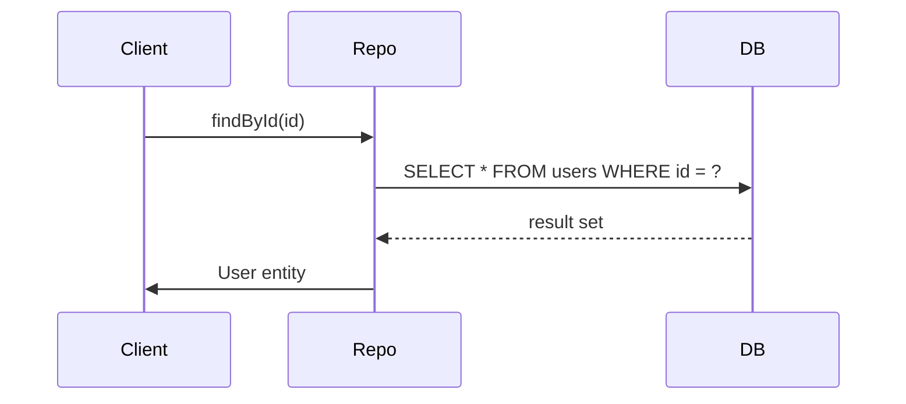

<!-- Generated by Groq via GitHub Actions -->
<!-- Topic ID: T246 -->
<!-- Category: Architecture Patterns -->
<!-- Generated at UTC: 2026-11-23T09:20:03.990412+00:00 -->

# Repository pattern

## 1. What problem does this solve?

**Motivation**  
When building a backend you usually talk to a database, a cache, or an external API.  
If every service or controller reaches directly into the database layer, you end up with:

- **Tight coupling** – the business logic knows the shape of the persistence layer.
- **Duplication** – the same query logic is scattered across the codebase.
- **Hard‑to‑test code** – you cannot swap a real DB for a mock without touching many files.
- **Limited flexibility** – changing the storage engine (PostgreSQL → MongoDB) requires touching all callers.

**Problem that the Repository pattern solves**

| Problem | Why it matters | Consequence if ignored | Real‑world example |
|---------|----------------|------------------------|--------------------|
| Coupling between domain and persistence | Domain logic becomes brittle; changes ripple through the system | Hard to refactor, test, or swap storage | A microservice that directly uses `pg` queries in every controller |
| Code duplication | Inconsistent query logic, bugs, and maintenance overhead | Divergent behavior, hard to audit | Two services both query `users` but with slightly different joins |
| Testing difficulty | Need to spin up a real DB or mock every query | Slower tests, flaky integration tests | Unit tests for a service that uses raw SQL |
| Limited abstraction | Hard to switch from SQL to NoSQL or add caching | Vendor lock‑in, slower evolution | A service that needs to support both PostgreSQL and Redis for caching |

**Where it appears in real backend systems**

- **CQRS**: Command side uses repositories to persist aggregates; query side uses read‑model repositories.
- **Domain‑Driven Design (DDD)**: Repositories are part of the domain layer, exposing only domain‑specific operations.
- **Microservice boundaries**: Each service owns its own repository, keeping the persistence contract local.
- **Data‑access layers in monoliths**: A `UserRepository` hides raw SQL or ORM details from the rest of the app.

---

## 2. Mental model

### Analogy: The Library

Think of a repository as a **library**.  
- The **books** are your domain entities (e.g., `User`, `Order`).  
- The **librarian** (the repository) knows how to fetch, add, update, or delete books from the shelves (the database).  
- You, the developer, ask the librarian for a book by title or author; you never need to know how the books are stored or how the shelves are arranged.

### Engineering model

- **Repository interface**: Declares domain‑specific methods (`findById`, `save`, `delete`, `findActiveUsers`).
- **Concrete implementation**: Knows the persistence mechanism (SQL, NoSQL, cache, external API).
- **Domain layer**: Calls the interface; never touches the implementation.
- **Application layer**: Orchestrates use‑cases, uses repositories to persist or retrieve data.

The key is that the *client* (domain/application) only sees the interface, not the underlying storage details.

---

## 3. Deep explanation

### Internals

1. **Interface (TypeScript)** – defines contract.
2. **Concrete class** – implements the interface, contains actual queries.
3. **Factory/DI container** – supplies the concrete implementation to the application.
4. **Unit of Work (optional)** – groups multiple repository operations into a single transaction.

### Important terminology

| Term | Meaning |
|------|---------|
| **Repository** | Abstraction over data access. |
| **Unit of Work** | Tracks changes to entities and commits them atomically. |
| **Aggregate** | DDD concept; a cluster of domain objects treated as a single unit. |
| **Read‑Model / Write‑Model** | In CQRS, separate repositories for queries and commands. |

### Trade‑offs

| Benefit | Trade‑off |
|---------|-----------|
| Decoupling | Extra layer of indirection; potential performance overhead. |
| Testability | Need to mock repository interfaces. |
| Flexibility | Can swap persistence engines without touching business logic. |
| Complexity | Adds boilerplate; risk of over‑engineering small projects. |

### Failure modes

- **Thin wrappers**: Repositories that simply forward calls to an ORM expose the ORM’s API to the domain, defeating the purpose.
- **Over‑abstraction**: Exposing too many generic methods (`find`, `query`) can lead to a “repository god” that knows everything.
- **Missing transaction handling**: If the repository does not manage transactions, you may end up with partial updates.

### Limitations

- **Not a silver bullet**: It does not solve all data‑access problems (e.g., eventual consistency, distributed transactions).
- **Not suitable for simple CRUD apps**: The overhead may outweigh benefits.
- **Requires discipline**: All data access must go through the repository; otherwise, the pattern breaks.

### Where it fits in a backend architecture

```
┌─────────────────────┐
│   Application Layer │
│ (Use‑case services) │
└───────▲──────────────┘
        │
        │ uses
        ▼
┌─────────────────────┐
│   Domain Layer      │
│ (Entities + Repos)  │
└───────▲──────────────┘
        │
        │ persistence
        ▼
┌─────────────────────┐
│   Infrastructure    │
│ (PostgreSQL, Redis) │
└─────────────────────┘
```

### Interaction with related concepts

- **ORMs**: Repositories often wrap an ORM, exposing only domain‑specific methods.
- **CQRS**: Separate read/write repositories.
- **Event Sourcing**: Repositories may load aggregates from event streams.
- **Dependency Injection**: Repositories are injected into services.

---

## 4. How it works

### Step‑by‑step flow

1. **Client** (service) calls a repository method (`findById`).
2. **Repository** translates the call into a persistence query.
3. **Persistence layer** executes the query and returns raw data.
4. **Repository** maps raw data to domain entities.
5. **Client** receives domain entities and continues business logic.



---

## 5. Practical implementation

### TypeScript/Node.js example – PostgreSQL with `pg`

```ts
// src/domain/User.ts
export interface User {
  id: string;
  email: string;
  name: string;
  createdAt: Date;
}

// src/domain/UserRepository.ts
export interface UserRepository {
  findById(id: string): Promise<User | null>;
  findByEmail(email: string): Promise<User | null>;
  save(user: User): Promise<void>;
  delete(id: string): Promise<void>;
}

// src/infrastructure/pg/UserRepositoryPg.ts
import { Pool } from 'pg';
import { User, UserRepository } from '../../domain';

export class UserRepositoryPg implements UserRepository {
  constructor(private pool: Pool) {}

  async findById(id: string): Promise<User | null> {
    const res = await this.pool.query(
      'SELECT id, email, name, created_at FROM users WHERE id = $1',
      [id]
    );
    if (!res.rows.length) return null;
    const row = res.rows[0];
    return {
      id: row.id,
      email: row.email,
      name: row.name,
      createdAt: row.created_at,
    };
  }

  async findByEmail(email: string): Promise<User | null> {
    const res = await this.pool.query(
      'SELECT id, email, name, created_at FROM users WHERE email = $1',
      [email]
    );
    if (!res.rows.length) return null;
    const row = res.rows[0];
    return {
      id: row.id,
      email: row.email,
      name: row.name,
      createdAt: row.created_at,
    };
  }

  async save(user: User): Promise<void> {
    await this.pool.query(
      `INSERT INTO users (id, email, name, created_at)
       VALUES ($1, $2, $3, $4)
       ON CONFLICT (id) DO UPDATE
       SET email = EXCLUDED.email,
           name = EXCLUDED.name`,
      [user.id, user.email, user.name, user.createdAt]
    );
  }

  async delete(id: string): Promise<void> {
    await this.pool.query('DELETE FROM users WHERE id = $1', [id]);
  }
}
```

### Using the repository in a service

```ts
// src/application/UserService.ts
import { UserRepository } from '../domain';

export class UserService {
  constructor(private repo: UserRepository) {}

  async register(email: string, name: string): Promise<void> {
    const user = {
      id: crypto.randomUUID(),
      email,
      name,
      createdAt: new Date(),
    };
    await this.repo.save(user);
  }

  async getProfile(id: string) {
    const user = await this.repo.findById(id);
    if (!user) throw new Error('User not found');
    return user;
  }
}
```

### Dependency injection (simple example)

```ts
// src/infrastructure/pg/index.ts
import { Pool } from 'pg';
import { UserRepositoryPg } from './UserRepositoryPg';

export const pool = new Pool({ connectionString: process.env.DATABASE_URL });

export const userRepo = new UserRepositoryPg(pool);
```

```ts
// src/main.ts
import { userRepo } from './infrastructure/pg';
import { UserService } from './application/UserService';

const userService = new UserService(userRepo);

// Example usage
await userService.register('alice@example.com', 'Alice');
const profile = await userService.getProfile('some-uuid');
console.log(profile);
```

> **Note**: In production you would use a DI container (e.g., `tsyringe`) or a framework that supports injection.

---

## 6. Production considerations

| Concern | How the repository pattern helps | Practical tips |
|---------|----------------------------------|----------------|
| **Scalability** | Allows swapping to sharded or replicated databases without touching business logic. | Keep queries efficient; use indexes; consider read replicas for read‑heavy repos. |
| **Reliability** | Centralized error handling; can retry or fallback within the repo. | Wrap DB calls in retry logic; expose a `Result<T>` type. |
| **Security** | Repository can enforce row‑level security or mask sensitive fields. | Use parameterized queries; avoid returning raw DB rows. |
| **Observability** | Central place to log query metrics, latency, and errors. | Add instrumentation (OpenTelemetry) inside repo methods. |
| **Performance** | Avoid N+1 queries by batching in the repo. | Use `IN` clauses or `JOIN`s; cache results if appropriate. |
| **Error handling** | Translate DB errors to domain‑specific exceptions. | Map `pg` error codes to custom errors (`UserNotFoundError`). |
| **Resource usage** | Reuse connection pools; close idle connections. | Use `pg.Pool` with `idleTimeoutMillis`. |
| **Operational concerns** | Repositories can be versioned; migrations are isolated. | Use migration tools (e.g., `node-pg-migrate`). |
| **Failure recovery** | Unit of Work can roll back partial changes. | Wrap multiple repo calls in a transaction. |
| **Deployment** | Repositories are pure code; can be redeployed independently. | Keep repo code in a separate package for microservices. |

---

## 7. Common mistakes

| Mistake | Why it’s problematic |
|---------|----------------------|
| **Thin wrappers** – repo just forwards to ORM methods. | Domain still knows ORM internals; no real abstraction. |
| **Over‑engineering** – adding a repository for every table in a small CRUD app. | Adds boilerplate, increases maintenance cost. |
| **Mixing concerns** – putting business logic inside the repo. | Violates single responsibility; hard to test. |
| **Not using interfaces** – concrete classes only. | Hard to swap implementations or mock in tests. |
| **Ignoring transactions** – multiple repo calls without a unit of work. | Leads to data inconsistency. |
| **Caching inside repo without invalidation** | Stale data; hard to reason about cache consistency. |
| **Hard‑coding SQL** – no parameterization. | SQL injection risk. |
| **Not handling errors** – swallowing DB errors. | Silent failures, hard to debug. |

---

## 8. Senior engineer perspective

### What changes at scale?

- **Repository as a contract**: Teams agree on the interface; multiple services can share the same repo implementation.
- **Versioning**: Repositories evolve independently; you may need to support multiple versions of the same repo for backward compatibility.
- **Distributed transactions**: In microservices, you may need sagas or eventual consistency; the repo must expose idempotent operations.

### Design decisions

| Decision | Considerations |
|----------|----------------|
| **Single vs. multiple repositories** | One repo per aggregate vs. one per table. |
| **Read‑model vs. write‑model** | Separate repos for CQRS; may use different storage (PostgreSQL + Redis). |
| **Caching strategy** | Cache inside repo or external layer? |
| **Batching** | Use `IN` queries or bulk inserts to reduce round‑trips. |
| **Monitoring** | Expose metrics per repo method; track latency. |
| **Security** | Enforce row‑level security at the repo level. |
| **Failure scenarios** | Implement retry, circuit breaker, or fallback. |
| **Cost/performance** | Choose connection pool size, query optimization, and indexing. |
| **When NOT to use** | Simple CRUD apps, scripts, or when using an ORM that already provides a clean abstraction (e.g., Prisma). |

---

## 9. Interview questions

1. **Beginner**: *What is the purpose of the Repository pattern?*  
   *Answer*: It abstracts data access, decouples domain logic from persistence, and centralizes queries.

2. **Intermediate**: *How does a repository differ from an ORM?*  
   *Answer*: An ORM maps objects to tables; a repository exposes domain‑specific methods and hides the ORM from the rest of the code.

3. **Senior**: *Explain how you would implement a unit of work with repositories in a Node.js application.*  
   *Answer*: Use a transaction object (e.g., `pg.Client` with `BEGIN/COMMIT`) passed to multiple repositories; each repository uses the same client to ensure atomicity.

4. **Senior**: *What are the trade‑offs of using a repository pattern in a microservice that already uses an ORM like Prisma?*  
   *Answer*: Adds an extra abstraction layer; may reduce flexibility if the ORM already provides clean APIs; but can enforce domain boundaries and enable swapping storage engines.

5. **Scenario/Debugging**: *You notice that a service using a repository is experiencing a 5‑second latency spike during peak traffic. What steps would you take to diagnose and fix the issue?*  
   *Answer*:  
   - Profile the repository method (add logging or use a profiler).  
   - Check query plans and indexes in the database.  
   - Verify connection pool size and contention.  
   - Look for N+1 query patterns.  
   - Consider caching or batching.  
   - If using a transaction, ensure it isn’t holding locks too long.

---

## 10. Hands‑on task

**Task**: Implement a `ProductRepository` for an e‑commerce service that supports both PostgreSQL and Redis caching.

1. Define a `Product` domain model with fields: `id`, `name`, `price`, `stock`.
2. Create a `ProductRepository` interface with methods:
   - `findById(id: string): Promise<Product | null>`
   - `save(product: Product): Promise<void>`
   - `decrementStock(id: string, amount: number): Promise<void>`
3. Implement `ProductRepositoryPg` using `pg`.
4. Implement `ProductRepositoryCached` that wraps `ProductRepositoryPg` and caches `findById` results in Redis (use `ioredis`).
5. Write a unit test that mocks the PostgreSQL implementation and verifies that the cache is used on subsequent calls.

> **Hint**: Use dependency injection to swap the concrete implementation. Use `jest` for testing.

---

## 11. Quick revision

- Repository abstracts persistence, exposing domain‑specific methods.
- Keeps domain logic decoupled from DB details.
- Enables unit testing with mocks.
- Common pattern in DDD, CQRS, and microservices.
- Repository interfaces should be minimal and focused on aggregates.
- Use parameterized queries to avoid SQL injection.
- Centralize error handling and logging inside the repo.
- Consider caching, batching, and transactions at the repo level.
- Avoid thin wrappers that expose ORM internals.
- At scale, think about versioning, monitoring, and failure recovery.

---

## 12. References

- [Repository Pattern – Microsoft Docs](https://learn.microsoft.com/en-us/previous-versions/dotnet/articles/ff650537(v=vs.110))
- [Domain‑Driven Design – Repository](https://en.wikipedia.org/wiki/Repository_pattern)
- [Node.js pg documentation](https://node-postgres.com/)
- [ioredis documentation](https://github.com/luin/ioredis)
- [OpenTelemetry for Node.js](https://opentelemetry.io/docs/instrumentation/node/)
- [Prisma – Data Access Layer](https://www.prisma.io/docs/concepts/components/prisma-client)
