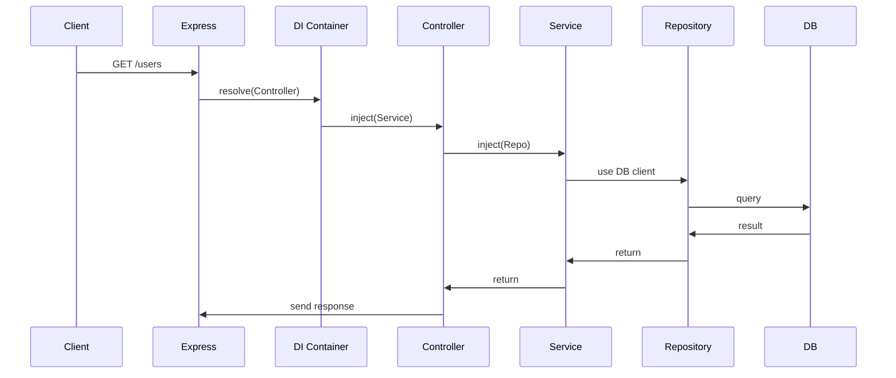

<!-- Generated by Groq via GitHub Actions -->
<!-- Topic ID: T247 -->
<!-- Category: Architecture Patterns -->
<!-- Generated at UTC: 2026-11-24T01:07:32.219984+00:00 -->

# Dependency injection

## 1. What problem does this solve?

**Motivation**  
When a backend service grows, components (controllers, services, repositories, etc.) start to depend on each other. If each component creates its own dependencies, the code becomes tightly coupled, hard to test, and difficult to evolve.

**Problem exists**  
- **Tight coupling**: A controller that `new`s a repository is bound to that concrete implementation.
- **Hard to test**: Unit tests must spin up real dependencies (DB, cache) or use complex mocks.
- **Code duplication**: Each component repeats the same construction logic.
- **Configuration drift**: Changing a dependency (e.g., switching from PostgreSQL to MongoDB) requires touching many files.

**Why the problem matters**  
- **Maintainability**: Future developers struggle to understand how components are wired.
- **Testability**: Without isolation, tests become integration tests, slower and flaky.
- **Scalability**: Re‑creating dependencies per request wastes resources.

**What happens if this concept is not used**  
- **Fragile code**: A change in one module can break many others.
- **Slow feedback loop**: Tests take longer, CI pipelines stall.
- **Hard to refactor**: Switching to a new database or caching layer requires a large code rewrite.

**Where this concept appears in real backend systems**  
- **Web frameworks**: Express + custom DI, NestJS, FastAPI’s dependency injection.
- **Microservice orchestration**: Services that need to swap out message brokers or storage engines.
- **Monoliths**: Large codebases where services are split into modules but still share a common container.

---

## 2. Mental model

**Simple analogy**  
Imagine a kitchen where a chef (controller) needs ingredients (dependencies). Instead of each chef buying their own groceries, there is a pantry (DI container) that holds all ingredients. The chef just asks the pantry for what they need, and the pantry gives the right portion. The chef stays focused on cooking, not on sourcing ingredients.

**Engineering model**  
- **Container**: A registry that knows how to create and provide instances.
- **Provider**: A recipe that tells the container how to instantiate a dependency.
- **Injection**: The act of giving a component the instances it needs, usually via constructor arguments.
- **Scope**: Determines the lifetime of a dependency (singleton, request‑scoped, transient).

---

## 3. Deep explanation

### Internals
- **Registration**: At startup, the container is configured with bindings (`bind(Service).to(ConcreteService)`).
- **Resolution**: When a component is requested, the container walks the dependency graph, instantiating objects as needed.
- **Lifecycle management**: The container can cache singletons, create new instances per request, or dispose of resources.

### Important terminology
| Term | Meaning |
|------|---------|
| **Injector / Container** | The runtime that resolves dependencies. |
| **Provider / Binding** | A mapping from an abstraction to a concrete implementation. |
| **Scope** | Lifetime policy (singleton, transient, request). |
| **Constructor injection** | Dependencies passed via constructor parameters. |
| **Property injection** | Dependencies set on object properties after construction. |
| **Method injection** | Dependencies passed to a method call. |

### Trade‑offs
| Benefit | Cost |
|---------|------|
| **Decoupling** | Slight runtime overhead for resolution. |
| **Testability** | Easier to mock, but requires a test container. |
| **Configuration** | Centralized wiring can become complex. |
| **Performance** | First request may be slower due to container bootstrap. |

### Failure modes
- **Circular dependencies**: Two services depend on each other → container throws or creates proxies that may break at runtime.
- **Missing bindings**: Requesting an unregistered type → runtime error.
- **Incorrect scopes**: Singleton services holding request‑specific state → data leakage.

### Limitations
- **Over‑engineering**: For tiny projects, a simple factory pattern may suffice.
- **Learning curve**: Developers must understand the container’s API.
- **Static analysis**: TypeScript’s type system can’t always infer injection metadata without decorators or explicit registration.

### Where it fits in a backend architecture
- **Layered architecture**: Controllers → Services → Repositories → Data sources.
- **Microservices**: Each service has its own container; the container can be shared across modules.
- **Infrastructure layer**: Database clients, cache clients, message brokers are registered once and injected where needed.

### Interaction with related concepts
- **Factory pattern**: DI containers are essentially advanced factories.
- **Inversion of Control (IoC)**: DI is a form of IoC; the framework “inverts” the control of object creation.
- **Configuration management**: Environment variables and config files feed into the container during registration.
- **Testing frameworks**: Jest, Mocha can use a test container to inject mocks.

---

## 4. How it works

1. **Application startup**  
   - Create a container instance.  
   - Register all bindings (services, repositories, clients).  
   - Optionally load environment‑specific overrides.

2. **Incoming request**  
   - The HTTP framework (e.g., Express) receives a request.  
   - It asks the container for a controller instance.  
   - The container resolves the controller’s constructor dependencies recursively.

3. **Execution**  
   - The controller handles the request, calling services.  
   - Services use repositories or external clients, all injected by the container.

4. **Cleanup** (if scoped)  
   - After the request finishes, the container disposes of request‑scoped instances.



---

## 5. Practical implementation

Below is a minimal, runnable DI container in TypeScript.  
It demonstrates constructor injection, singleton scope, and request‑scoped services.

```ts
// di.ts
export type Constructor<T> = new (...args: any[]) => T;

export interface Provider<T> {
  useClass: Constructor<T>;
  scope?: 'singleton' | 'transient';
}

export class Container {
  private providers = new Map<string, Provider<any>>();
  private singletons = new Map<string, any>();

  // Register a binding
  bind<T>(token: string, provider: Provider<T>) {
    this.providers.set(token, provider);
  }

  // Resolve an instance
  resolve<T>(token: string): T {
    const provider = this.providers.get(token);
    if (!provider) throw new Error(`No provider for ${token}`);

    if (provider.scope === 'singleton') {
      if (this.singletons.has(token)) {
        return this.singletons.get(token);
      }
      const instance = this.instantiate(provider.useClass);
      this.singletons.set(token, instance);
      return instance;
    }

    // transient
    return this.instantiate(provider.useClass);
  }

  // Instantiate with constructor injection
  private instantiate<T>(ctor: Constructor<T>): T {
    const paramTypes: any[] = Reflect.getMetadata('design:paramtypes', ctor) || [];
    const params = paramTypes.map((param: any) => {
      const token = param.name; // simple token strategy
      return this.resolve(token);
    });
    return new ctor(...params);
  }
}
```

> **Note**: This container uses TypeScript’s `emitDecoratorMetadata` to read constructor parameter types. Enable it in `tsconfig.json`.

```ts
// services/userService.ts
export class UserService {
  constructor(private readonly repo: UserRepository) {}

  async getUser(id: string) {
    return this.repo.findById(id);
  }
}
```

```ts
// repositories/userRepository.ts
export class UserRepository {
  constructor(private readonly db: PostgresClient) {}

  async findById(id: string) {
    const res = await this.db.query('SELECT * FROM users WHERE id = $1', [id]);
    return res.rows[0];
  }
}
```

```ts
// clients/postgresClient.ts
export class PostgresClient {
  constructor(private readonly pool: any) {} // pool from pg

  async query(sql: string, params: any[]) {
    return this.pool.query(sql, params);
  }
}
```

```ts
// app.ts
import 'reflect-metadata';
import express from 'express';
import { Container } from './di';
import { UserService } from './services/userService';
import { UserRepository } from './repositories/userRepository';
import { PostgresClient } from './clients/postgresClient';
import { Pool } from 'pg';

const container = new Container();

// Register providers
container.bind('PostgresClient', {
  useClass: PostgresClient,
  scope: 'singleton',
});
container.bind('UserRepository', {
  useClass: UserRepository,
  scope: 'singleton',
});
container.bind('UserService', {
  useClass: UserService,
  scope: 'singleton',
});

const app = express();

app.get('/users/:id', async (req, res) => {
  const userService = container.resolve<UserService>('UserService');
  const user = await userService.getUser(req.params.id);
  res.json(user);
});

app.listen(3000, () => console.log('Server running on :3000'));
```

**Running the example**

```bash
# Install dependencies
npm install express pg reflect-metadata

# Compile TypeScript
tsc

# Start server
node dist/app.js
```

The container automatically wires `UserService` → `UserRepository` → `PostgresClient` without manual `new` calls.

---

## 6. Production considerations

| Concern | How DI helps / what to watch |
|---------|------------------------------|
| **Scalability** | Singleton services (e.g., DB pool) share resources across requests. |
| **Reliability** | Centralized error handling in the container can catch missing bindings early. |
| **Security** | Sensitive config (DB passwords) injected via environment‑specific providers. |
| **Observability** | Wrap providers with instrumentation (e.g., metrics, tracing). |
| **Performance** | Cache singletons; avoid per‑request instantiation of heavy objects. |
| **Error handling** | Container throws descriptive errors for missing or circular dependencies. |
| **Resource usage** | Dispose of request‑scoped objects after response; use `finally` blocks. |
| **Operational concerns** | Versioned containers per deployment; hot‑reload providers in dev. |
| **Failure recovery** | Graceful shutdown hooks to close DB pools, Kafka consumers. |
| **Deployment** | Container registration can be split into modules for CI/CD pipelines. |

---

## 7. Common mistakes

| Mistake | Why it’s problematic |
|---------|----------------------|
| **Hard‑coding `new` inside services** | Breaks decoupling; tests must mock internals. |
| **Using global singletons for stateful services** | Leads to data leakage across requests. |
| **Circular dependencies** | Container throws or creates proxies that may fail at runtime. |
| **Over‑registering every class** | Increases container bootstrap time; hard to track. |
| **Mixing constructor and property injection** | Inconsistent lifecycles; harder to reason. |
| **Ignoring scopes** | Transient services that hold DB connections cause exhaustion. |
| **Not handling async initialization** | Services that need async setup (e.g., cache warm‑up) may be used before ready. |
| **Using string tokens without a registry** | Typos cause silent failures; better to use symbols or classes. |

---

## 8. Senior engineer perspective

### What changes at scale?
- **Container size**: Hundreds of bindings; need modular registration to keep startup fast.
- **Service discovery**: In microservices, each service may expose its own container; cross‑service DI is replaced by API contracts.
- **Observability**: Wrap every provider with tracing; monitor resolution latency.
- **Security**: Use secrets managers; inject credentials via secure providers.

### Design decisions a senior engineer would consider
| Decision | Impact |
|----------|--------|
| **Singleton vs. request scope** | Memory vs. isolation trade‑off. |
| **Provider strategy** | Class vs. factory vs. value; affects testability. |
| **Lazy vs. eager initialization** | Startup time vs. first‑request latency. |
| **Container per module** | Encapsulation vs. global registry complexity. |
| **Error handling policy** | Fail fast vs. graceful degradation. |
| **Versioning** | Backward compatibility of providers across deployments. |

### Bottlenecks
- **Container bootstrap**: Large graphs can slow startup; consider lazy loading.
- **Circular dependencies**: Hard to detect statically; can cause runtime crashes.
- **Singleton overuse**: Memory bloat, stale state.

### Failure scenarios
- **Missing provider**: Application crashes on first request; log clearly.
- **Provider throws during construction**: Use try/catch in container to surface meaningful errors.
- **Resource exhaustion**: Too many singletons holding connections; monitor pool usage.

### Monitoring
- **Resolution latency**: Track time to resolve each token.
- **Instance counts**: Verify expected number of singletons.
- **Error rates**: Count missing or circular dependency errors.

### Cost/performance
- **Memory**: Singleton services consume RAM; weigh against connection pool benefits.
- **CPU**: Container resolution is lightweight; avoid heavy work in constructors.

### When NOT to use DI
- **Tiny scripts**: Overkill; simple factories suffice.
- **Highly dynamic plugins**: Use a plugin system instead of a static container.
- **Performance‑critical loops**: Avoid container resolution inside tight loops; pre‑resolve.

---

## 9. Interview questions

1. **Beginner** – *What is dependency injection and why is it useful?*  
   *Answer points:* Decouples object creation, improves testability, centralizes configuration.

2. **Beginner** – *How does a DI container resolve circular dependencies?*  
   *Answer points:* Some containers use proxies or lazy getters; others throw errors; explain typical strategies.

3. **Senior** – *Describe how you would design a DI container for a microservice that needs to switch between PostgreSQL and MongoDB at runtime.*  
   *Answer points:* Use provider factories, environment‑based binding, strategy pattern, ensure thread‑safe initialization.

4. **Senior** – *What are the trade‑offs between singleton and request‑scoped services in a high‑throughput API?*  
   *Answer points:* Singletons reduce overhead but risk shared state; request scope ensures isolation but increases GC pressure.

5. **Scenario/Debugging** – *You have a service that throws “Missing provider for UserRepository” at runtime. What steps would you take to diagnose and fix the issue?*  
   *Answer points:* Check registration order, verify token names, ensure `emitDecoratorMetadata` is enabled, inspect stack trace, add logging in container, use unit tests to isolate.

---

## 10. Hands‑on task

**Task:**  
Add a new `EmailService` that sends welcome emails when a user registers.  
- Register `EmailService` in the DI container.  
- Inject it into `UserService`.  
- Mock the email client in tests.  
- Verify that `UserService.register()` calls `EmailService.sendWelcome()`.

**Hints:**  
- Use a simple `EmailClient` class that logs to console.  
- Create a `UserService.register()` method that creates a user and then calls the email service.  
- Write a Jest test that resolves `UserService` from the container, spies on `EmailClient.send`, and asserts it was called.

---

## 11. Quick revision

- DI decouples object creation from usage.  
- Container registers providers (class, factory, value).  
- Scopes: singleton (one instance), transient (new each resolve), request (per HTTP request).  
- Constructor injection is the most common pattern.  
- Circular dependencies must be avoided or handled with proxies.  
- In Node.js, `reflect-metadata` + `emitDecoratorMetadata` lets the container read constructor types.  
- Production concerns: startup time, memory usage, error handling, observability.  
- Common mistakes: hard‑coding `new`, overusing singletons, missing bindings, ignoring scopes.  
- Senior engineers weigh container size, lazy loading, and monitoring.  
- When not to use DI: tiny scripts, highly dynamic plugin systems, performance‑critical loops.

---

## 12. References

- [TypeScript Handbook – Decorators](https://www.typescriptlang.org/docs/handbook/decorators.html)  
- [InversifyJS – A powerful IoC container for TypeScript](https://inversify.io/)  
- [NestJS – Dependency Injection](https://docs.nestjs.com/fundamentals/injection-scopes)  
- [FastAPI – Dependency Injection](https://fastapi.tiangolo.com/tutorial/dependencies/)  
- [Node.js – `pg` module](https://node-postgres.com/)  
- [OpenTelemetry – Tracing](https://opentelemetry.io/docs/)
