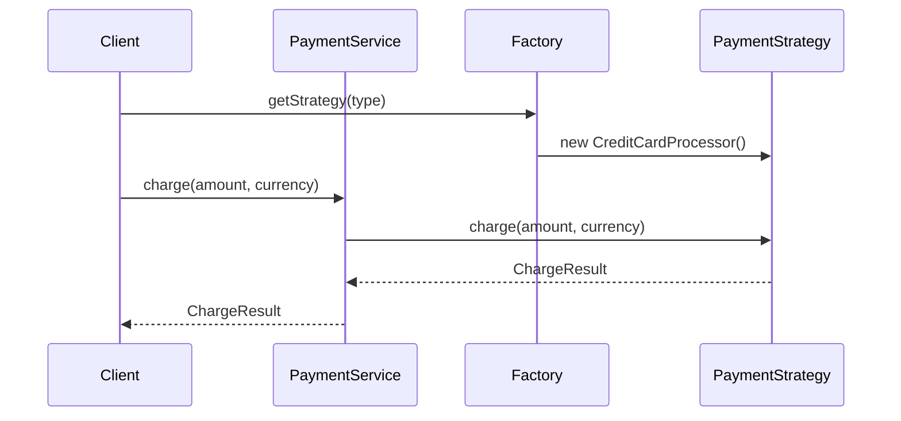

<!-- Generated by Groq via GitHub Actions -->
<!-- Topic ID: T248 -->
<!-- Category: Architecture Patterns -->
<!-- Generated at UTC: 2026-11-24T01:07:32.219984+00:00 -->

# Strategy pattern

## 1. What problem does this solve?

| What | Why it matters | Consequence of not using it | Real‑world example |
|------|----------------|-----------------------------|--------------------|
| **Multiple interchangeable algorithms** that a system must pick from at runtime. | Different clients, environments, or data sets may require different logic (e.g., payment gateways, compression, routing). | Hard‑coded `if/else` chains become brittle, hard to test, and impossible to extend without touching core code. | A microservice that supports several authentication providers (OAuth, SAML, API key). |
| **Decoupling algorithm implementation from its usage**. | Keeps the client code clean and focused on orchestration, not on algorithm details. | Tight coupling leads to duplicated code, accidental regressions, and difficulty in swapping or adding new strategies. | A caching layer that can switch between Redis, Memcached, or in‑memory cache. |
| **Runtime flexibility**. | Allows the system to adapt to changing requirements without redeploying the whole service. | Every change requires a new deployment or code change in the client. | Feature flag‑controlled data serialization (JSON vs. Protobuf). |

The Strategy pattern is a **behavioral** design pattern that lets you define a family of algorithms, encapsulate each one, and make them interchangeable. The client code uses a *strategy interface* and can swap concrete implementations at runtime.

---

## 2. Mental model

### Analogy  
Think of a **remote‑control car** that can drive in different modes: *sport*, *eco*, *off‑road*. The car’s body (the client) stays the same, but the *drive mode* (the strategy) changes how the motors behave. You can switch modes on the fly without touching the car’s chassis.

### Engineering model  
- **Context**: The component that needs a behavior (e.g., a payment processor).  
- **Strategy interface**: A contract that all concrete strategies implement.  
- **Concrete strategies**: Different algorithm implementations (e.g., `CreditCardProcessor`, `PayPalProcessor`).  
- **Strategy selection**: The context chooses a strategy based on configuration, request data, or runtime conditions.

---

## 3. Deep explanation

### Internals
```ts
interface PaymentStrategy {
  charge(amount: number, currency: string): Promise<ChargeResult>;
}
```
The context holds a reference to `PaymentStrategy`. All concrete strategies implement the same method signature, so the context can call `charge` without knowing the details.

### Important terminology
- **Context** – the object that uses a strategy.  
- **Strategy** – the interface defining the algorithm.  
- **Concrete Strategy** – a concrete implementation of the strategy.  
- **Strategy selection** – the decision logic that picks a concrete strategy.

### Trade‑offs
| Benefit | Cost |
|---------|------|
| **Extensibility** – add new strategies without touching the context. | **More classes** – each strategy is a separate file/class. |
| **Testability** – strategies can be unit‑tested in isolation. | **Runtime overhead** – dynamic dispatch adds a few nanoseconds. |
| **Runtime flexibility** – switch strategies per request or config. | **Configuration complexity** – need a registry or factory. |

### Failure modes
- **Strategy not found**: If the selection logic fails to provide a strategy, the context must handle it gracefully.  
- **State leakage**: Strategies that keep internal state can cause bugs if reused across requests.  
- **Performance regression**: A new strategy might be slower; performance tests are required.

### Limitations
- **Not for single‑method variations**: If only a single line differs, a simple function or higher‑order function may be simpler.  
- **Over‑engineering**: For a small, static set of algorithms, a switch statement may be clearer.

### Where it fits in a backend architecture
- **Service layer**: Payment, authentication, routing, caching.  
- **Middleware**: Request validation, logging, metrics.  
- **Infrastructure**: Database adapters, message queue consumers.

### Interaction with related concepts
- **Factory pattern**: Often used to create strategies based on config.  
- **Dependency Injection**: Injects the strategy into the context.  
- **Command pattern**: Strategies can be commands that encapsulate a request.

---

## 4. How it works

1. **Define the strategy interface** (`PaymentStrategy`).  
2. **Implement concrete strategies** (`CreditCardProcessor`, `PayPalProcessor`).  
3. **Create a factory or registry** that maps identifiers to concrete strategies.  
4. **Inject the chosen strategy into the context** (`PaymentService`).  
5. **Execute the strategy** (`service.charge(...)`).  
6. **Handle errors and fallback** if the strategy fails.



---

## 5. Practical implementation

### TypeScript/Node.js example – payment processing

```ts
// paymentStrategy.ts
export interface PaymentStrategy {
  charge(amount: number, currency: string): Promise<ChargeResult>;
}

export type ChargeResult = {
  success: boolean;
  transactionId?: string;
  error?: string;
};
```

```ts
// creditCardProcessor.ts
import { PaymentStrategy, ChargeResult } from './paymentStrategy';

export class CreditCardProcessor implements PaymentStrategy {
  async charge(amount: number, currency: string): Promise<ChargeResult> {
    // Simulate external API call
    const transactionId = `cc-${Date.now()}`;
    return { success: true, transactionId };
  }
}
```

```ts
// payPalProcessor.ts
import { PaymentStrategy, ChargeResult } from './paymentStrategy';

export class PayPalProcessor implements PaymentStrategy {
  async charge(amount: number, currency: string): Promise<ChargeResult> {
    // Simulate external API call
    const transactionId = `pp-${Date.now()}`;
    return { success: true, transactionId };
  }
}
```

```ts
// strategyFactory.ts
import { PaymentStrategy } from './paymentStrategy';
import { CreditCardProcessor } from './creditCardProcessor';
import { PayPalProcessor } from './payPalProcessor';

export const strategyFactory = (type: string): PaymentStrategy => {
  switch (type) {
    case 'credit_card':
      return new CreditCardProcessor();
    case 'paypal':
      return new PayPalProcessor();
    default:
      throw new Error(`Unsupported payment type: ${type}`);
  }
};
```

```ts
// paymentService.ts
import { PaymentStrategy, ChargeResult } from './paymentStrategy';
import { strategyFactory } from './strategyFactory';

export class PaymentService {
  private strategy: PaymentStrategy;

  constructor(strategyType: string) {
    this.strategy = strategyFactory(strategyType);
  }

  async charge(amount: number, currency: string): Promise<ChargeResult> {
    try {
      return await this.strategy.charge(amount, currency);
    } catch (err) {
      // Graceful fallback or retry logic
      return { success: false, error: (err as Error).message };
    }
  }
}
```

```ts
// usage.ts
import { PaymentService } from './paymentService';

async function main() {
  const service = new PaymentService(process.env.PAYMENT_TYPE ?? 'credit_card');
  const result = await service.charge(100, 'USD');
  console.log(result);
}

main().catch(console.error);
```

**Key lines explained**

- `strategyFactory` decouples the context from concrete classes.  
- `PaymentService` holds a single strategy instance; you can swap it at runtime if needed.  
- Error handling in `charge` ensures the service remains reliable even if the external API fails.

---

## 6. Production considerations

| Concern | How Strategy pattern helps | Practical tips |
|---------|---------------------------|----------------|
| **Scalability** | Strategies can be stateless or use external services; no shared mutable state. | Keep strategies lightweight; avoid per‑request DB connections. |
| **Reliability** | Each strategy can implement its own retry/backoff logic. | Use circuit breakers (e.g., `opossum`) inside strategies. |
| **Security** | Sensitive logic (e.g., token handling) isolated in a strategy. | Store secrets in environment variables; never log them. |
| **Observability** | Wrap strategy calls with metrics and tracing. | Use OpenTelemetry to trace `charge` calls per strategy. |
| **Performance** | Strategies can be optimized independently. | Benchmark each strategy; cache results if idempotent. |
| **Error handling** | Centralized error handling in context; strategies expose clear error contracts. | Return structured error objects; avoid throwing raw errors. |
| **Resource usage** | Strategies can share connection pools. | Use a shared Redis or DB pool across strategies. |
| **Operational concerns** | Deploy strategies as separate modules; version them independently. | Use semantic versioning; tag Docker images per strategy. |
| **Failure recovery** | Fallback strategies (e.g., retry with a different gateway). | Implement a fallback chain in the context. |
| **Deployment** | Strategy selection can be driven by config or feature flags. | Use a config service (e.g., Consul) to change strategy without redeploy. |

---

## 7. Common mistakes

| Mistake | Why it’s problematic |
|---------|----------------------|
| **Using a single `if/else` chain instead of strategies** | Hard to test, violates Open/Closed principle, hard to add new algorithms. |
| **Tight coupling of strategy to context** (e.g., `new CreditCardProcessor()` inside `PaymentService`) | Makes unit testing impossible; changes require touching the context. |
| **Stateful strategies reused across requests** | Race conditions, data leakage between users. |
| **Not handling strategy selection errors** | Application crashes if an unknown type is requested. |
| **Over‑engineering for trivial variations** | Adds unnecessary complexity and maintenance burden. |
| **Ignoring performance of strategy selection** | Re‑creating strategy objects per request can be expensive. |
| **Not documenting strategy contracts** | Future developers may misuse or misimplement strategies. |

---

## 8. Senior engineer perspective

### What changes at scale?

- **Strategy registry becomes a service**: Instead of a static switch, use a dynamic registry that can be updated via a config service or feature flag.  
- **Versioning**: Each strategy may evolve; maintain backward compatibility or use API versioning.  
- **Observability**: Instrument each strategy separately; aggregate metrics per strategy type.  
- **Security isolation**: Run strategies in separate containers or micro‑services if they require different credentials.  
- **Failure isolation**: Use circuit breakers per strategy to prevent cascading failures.

### Design decisions

| Decision | Trade‑off | When to choose |
|----------|-----------|----------------|
| **Inline vs. external strategy** | Inline is simpler but less flexible. | Small, static set of algorithms. |
| **Factory vs. DI container** | Factory is lightweight; DI offers more features (scoping, lifecycle). | Large codebase with many strategies. |
| **Stateless vs. stateful strategies** | Stateless = easier to scale horizontally. | Stateless is preferred; stateful only if necessary (e.g., caching). |
| **Synchronous vs. asynchronous strategies** | Async allows non‑blocking I/O; synchronous may be simpler. | Use async for I/O‑bound operations. |
| **Single strategy per request vs. strategy chain** | Chain allows fallback but adds complexity. | Use chain when a fallback is required (e.g., primary/secondary payment gateway). |

### Bottlenecks & monitoring

- **Strategy selection latency**: Cache the selected strategy per request context.  
- **External API latency**: Use async/await with timeouts; monitor per‑strategy latency.  
- **Resource contention**: If strategies share DB connections, use connection pooling.  
- **Error rates**: Set up alerts for high failure rates per strategy.

### When NOT to use Strategy

- When the algorithm set is fixed and unlikely to change.  
- When the variation is a single line of code; a higher‑order function may be clearer.  
- When performance is critical and the overhead of dynamic dispatch outweighs benefits.

---

## 9. Interview questions

1. **Beginner**: *What is the Strategy pattern and why would you use it?*  
   *Answer:* A behavioral pattern that defines a family of algorithms, encapsulates each one, and makes them interchangeable. It promotes the Open/Closed principle, improves testability, and allows runtime flexibility.

2. **Beginner**: *How does the Strategy pattern differ from a simple `switch` statement?*  
   *Answer:* A `switch` is a static, hard‑coded decision that violates Open/Closed. Strategy encapsulates each algorithm in its own class, enabling dynamic selection, easier testing, and extension without modifying the client.

3. **Senior**: *Describe how you would design a strategy registry that can be updated at runtime without redeploying the service.*  
   *Answer:* Use a configuration service (e.g., Consul, etcd) or feature flag system. The registry loads strategy mappings from config, watches for changes, and updates the in‑memory map. Strategies can be loaded via dynamic imports or a plugin system.

4. **Senior**: *What are the trade‑offs between using a Strategy pattern and a higher‑order function in a Node.js service?*  
   *Answer:* Strategy classes provide a clear contract, easier dependency injection, and better type safety in TypeScript. Higher‑order functions are lighter weight, easier to write for simple variations, but can become unwieldy for complex algorithms and harder to test in isolation.

5. **Scenario/Debugging**: *You have a payment service that sometimes returns `null` instead of a `ChargeResult`. The logs show no errors. What could be happening and how would you investigate?*  
   *Answer:* Likely a strategy returned `undefined` or threw an exception that was swallowed. Check the strategy implementation for missing return statements, ensure the context catches exceptions, and add logging inside each strategy. Use a debugger or add a `finally` block to log the returned value.

---

## 10. Hands‑on task

**Implement a caching strategy switcher** in a small Node.js project:

1. Create a `CacheStrategy` interface with `get(key)` and `set(key, value)` methods.  
2. Implement two strategies: `InMemoryCache` and `RedisCache`.  
3. Add a `CacheFactory` that selects a strategy based on an environment variable.  
4. Write a `CacheService` that uses the selected strategy.  
5. Write unit tests for each strategy and integration tests that switch strategies at runtime.  
6. Add OpenTelemetry tracing to each cache operation.

Commit your changes to the repository and push a PR.

---

## 11. Quick revision

- Strategy pattern = interchangeable algorithms with a common interface.  
- **Context** holds a strategy reference; **Strategy** defines the contract.  
- Use a **factory** or **registry** to create strategies.  
- Keep strategies **stateless** for scalability.  
- Handle strategy selection errors gracefully.  
- Instrument strategies for observability.  
- Avoid over‑engineering; use simple functions for trivial variations.  
- At scale, externalize strategy selection via config/feature flags.  
- Use dependency injection for testability.  
- Monitor per‑strategy latency and error rates.

---

## 12. References

- [Strategy Pattern – Wikipedia](https://en.wikipedia.org/wiki/Strategy_pattern)  
- [Design Patterns – Strategy](https://refactoring.guru/design-patterns/strategy)  
- [TypeScript Handbook – Interfaces](https://www.typescriptlang.org/docs/handbook/interfaces.html)  
- [Node.js Docs – Event Loop](https://nodejs.org/api/process.html#process_event_loop)  
- [OpenTelemetry for Node.js](https://opentelemetry.io/docs/instrumentation/node/)  
- [Opossum – Circuit Breaker](https://github.com/nodeshift/opossum)  

---
