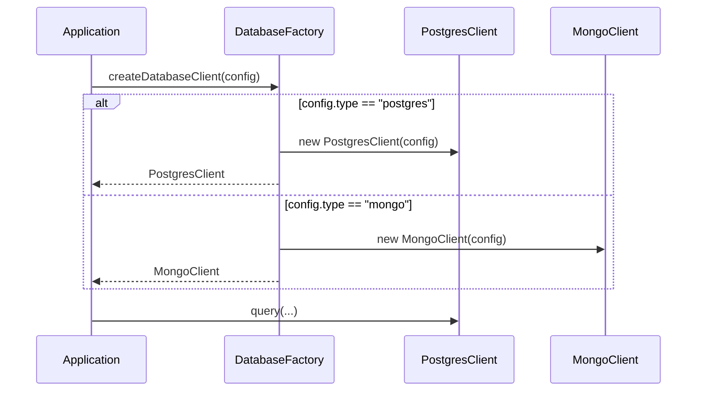

<!-- Generated by Groq via GitHub Actions -->
<!-- Topic ID: T249 -->
<!-- Category: Architecture Patterns -->
<!-- Generated at UTC: 2026-11-24T11:14:22.195392+00:00 -->

# Factory pattern

## 1. What problem does this solve?

**Motivation**  
When a backend service needs to create objects that vary by configuration or context (e.g., database connections, payment gateways, message queue clients), the code that decides *which* concrete implementation to instantiate can become scattered, duplicated, and tightly coupled to the rest of the system.

**Problem exists**  
- Multiple places in the codebase create the same type of object with different parameters.  
- Hard‑to‑test code because concrete dependencies are instantiated inline.  
- Adding a new implementation requires touching many modules.

**Why the problem matters**  
- **Maintenance cost**: Every change to the creation logic forces edits in many files.  
- **Testing friction**: Unit tests must mock or stub the creation logic, or they end up hitting real services.  
- **Coupling**: Modules become dependent on concrete classes instead of abstractions.

**What happens if this concept is not used**  
- Code duplication and “factory‑like” logic scattered across the codebase.  
- Harder to swap implementations (e.g., switching from PostgreSQL to MongoDB).  
- Increased risk of subtle bugs when configuration changes.

**Where this concept appears in real backend systems**  
- Service factories that produce database clients (`PgClient`, `MongoClient`).  
- Payment gateway factories that return `StripeClient` or `PayPalClient`.  
- Logger factories that return different loggers (console, file, remote).  
- HTTP client factories that configure retry policies, timeouts, or authentication.

---

## 2. Mental model

**Analogy**  
Think of a factory like a *restaurant kitchen* that receives an order (the *request*) and produces a dish (the *object*). The kitchen knows how to prepare many dishes, but the waiter (caller) only cares about receiving the finished dish, not how it was cooked.

**Engineering model**  
- **Abstract product**: An interface or base class that all concrete products implement.  
- **Concrete product**: A specific implementation (e.g., `PostgresClient`).  
- **Creator**: The factory that decides which concrete product to instantiate based on input (configuration, environment, or runtime data).  
- **Client**: The code that asks the factory for a product and uses it via the abstract interface.

---

## 3. Deep explanation

### Internals
- The factory is typically a function or class that receives a *key* (string, enum, config object) and returns an instance of the abstract type.  
- In TypeScript, generics and discriminated unions help type‑safely express the mapping between keys and concrete classes.

### Important terminology
- **Factory Method**: A method that returns an instance of a class, often used in object‑oriented languages.  
- **Abstract Factory**: A higher‑level factory that creates families of related objects (e.g., a `DatabaseFactory` that returns both a `Client` and a `TransactionManager`).  
- **Singleton**: A factory that ensures only one instance of a product exists (common for database connections).

### Trade‑offs
| Benefit | Trade‑off |
|---------|-----------|
| Decouples creation from usage | Adds an extra layer of indirection |
| Easier to swap implementations | Slight runtime overhead |
| Centralized configuration | Requires careful versioning of factory API |

### Failure modes
- **Mis‑configured key** → factory throws or returns `undefined`.  
- **Circular dependencies** if the factory imports modules that import the factory.  
- **Lazy initialization** can lead to race conditions in concurrent environments.

### Limitations
- Not a replacement for dependency injection frameworks; it’s a *manual* DI approach.  
- Does not handle complex lifecycle management (e.g., pooling) unless explicitly coded.

### Where this concept fits in a backend architecture
- **Service layer**: Factories create service clients that the business logic consumes.  
- **Infrastructure layer**: Factories produce database connections, cache clients, or message brokers.  
- **Application bootstrap**: The entry point uses factories to wire up the whole system.

### Interaction with related concepts
- **Dependency Injection (DI)**: Factories are often used by DI containers to resolve dependencies.  
- **Singleton pattern**: Factories can enforce singleton instances.  
- **Strategy pattern**: The factory selects a strategy implementation.  
- **Configuration management**: The factory reads config to decide which concrete class to instantiate.

---

## 4. How it works

1. **Define an abstract interface** (`DatabaseClient`) that declares the operations needed.  
2. **Implement concrete classes** (`PostgresClient`, `MongoClient`) that satisfy the interface.  
3. **Create a factory function** (`createDatabaseClient`) that takes a config or key and returns the appropriate concrete instance.  
4. **Client code** calls the factory once during initialization and stores the returned instance for reuse.  
5. **Optional**: Wrap the factory in a singleton to reuse connections.



---

## 5. Practical implementation

### TypeScript/Node.js example – Database client factory

```ts
// src/database/DatabaseClient.ts
export interface DatabaseClient {
  query(sql: string, params?: any[]): Promise<any>;
  close(): Promise<void>;
}
```

```ts
// src/database/PostgresClient.ts
import { Pool } from 'pg';
import { DatabaseClient } from './DatabaseClient';

export class PostgresClient implements DatabaseClient {
  private pool: Pool;

  constructor(private config: { connectionString: string }) {
    this.pool = new Pool({ connectionString: config.connectionString });
  }

  async query(sql: string, params: any[] = []) {
    const res = await this.pool.query(sql, params);
    return res.rows;
  }

  async close() {
    await this.pool.end();
  }
}
```

```ts
// src/database/MongoClient.ts
import { MongoClient as MongoDriver } from 'mongodb';
import { DatabaseClient } from './DatabaseClient';

export class MongoClient implements DatabaseClient {
  private client: MongoDriver;

  constructor(private config: { uri: string; dbName: string }) {
    this.client = new MongoDriver(config.uri, { useUnifiedTopology: true });
  }

  async query(sql: string, params: any[] = []) {
    // For illustration; in real code you'd use the MongoDB API
    const db = this.client.db(this.config.dbName);
    const collection = db.collection(sql); // sql is collection name
    return await collection.find(params).toArray();
  }

  async close() {
    await this.client.close();
  }
}
```

```ts
// src/database/DatabaseFactory.ts
import { DatabaseClient } from './DatabaseClient';
import { PostgresClient } from './PostgresClient';
import { MongoClient } from './MongoClient';

export type DbType = 'postgres' | 'mongo';

export interface DbConfig {
  type: DbType;
  connectionString?: string; // for Postgres
  uri?: string;              // for Mongo
  dbName?: string;           // for Mongo
}

export class DatabaseFactory {
  // Singleton cache to reuse connections
  private static instance: DatabaseClient | null = null;

  static create(config: DbConfig): DatabaseClient {
    if (this.instance) return this.instance;

    switch (config.type) {
      case 'postgres':
        if (!config.connectionString) throw new Error('Missing connectionString');
        this.instance = new PostgresClient({ connectionString: config.connectionString });
        break;
      case 'mongo':
        if (!config.uri || !config.dbName) throw new Error('Missing Mongo config');
        this.instance = new MongoClient({ uri: config.uri, dbName: config.dbName });
        break;
      default:
        throw new Error(`Unsupported DB type: ${config.type}`);
    }
    return this.instance;
  }
}
```

```ts
// src/app.ts
import { DatabaseFactory, DbConfig } from './database/DatabaseFactory';

const dbConfig: DbConfig = {
  type: process.env.DB_TYPE as any, // 'postgres' | 'mongo'
  connectionString: process.env.PG_CONN,
  uri: process.env.MONGO_URI,
  dbName: process.env.MONGO_DB,
};

const db = DatabaseFactory.create(dbConfig);

async function main() {
  const users = await db.query('SELECT * FROM users');
  console.log(users);
}

main().catch(console.error);
```

**Key points**  
- The factory centralizes the decision logic.  
- The client code (`app.ts`) never knows the concrete class.  
- The singleton cache prevents opening multiple connections.

---

## 6. Production considerations

| Concern | How the factory helps / what to watch |
|---------|---------------------------------------|
| **Scalability** | Centralized connection pooling (e.g., `pg.Pool`) reduces connection churn. |
| **Reliability** | Factory can implement retry logic or fallback to a secondary client. |
| **Security** | Credentials are passed once to the factory; no hard‑coded secrets in code. |
| **Observability** | Factory can instrument creation events (metrics, logs). |
| **Performance** | Avoid repeated instantiation; use singleton or pool. |
| **Error handling** | Factory throws descriptive errors on mis‑config; catch early. |
| **Resource usage** | Pool size can be tuned per environment; factory can expose config. |
| **Operational concerns** | Centralized config makes it easier to rotate secrets or switch providers. |
| **Failure recovery** | Factory can expose a `reset()` method to close and recreate connections. |
| **Deployment** | Factory reads env vars; no code changes needed when moving between environments. |

---

## 7. Common mistakes

| Mistake | Why it’s problematic |
|---------|----------------------|
| **Instantiating concrete classes directly in many modules** | Tight coupling, hard to swap implementations. |
| **Not using a singleton/pool** | Creates many connections, exhausting DB resources. |
| **Hard‑coding configuration** | Secrets leak, impossible to change per environment. |
| **Ignoring type safety** | Factory returns `any`, leading to runtime errors. |
| **Over‑engineering the factory** | Adding complex logic that belongs elsewhere (e.g., retry loops). |
| **Not handling errors from the factory** | Silent failures that surface later in the request pipeline. |
| **Using the factory for every dependency** | Adds unnecessary indirection for simple objects. |

---

## 8. Senior engineer perspective

### What changes at scale
- **Decoupling becomes critical**: A single change in a database driver should not ripple through the codebase.  
- **Performance tuning**: The factory must expose pool configuration, connection timeouts, and health checks.  
- **Observability**: Instrument factory creation, connection health, and metrics (e.g., `db.connections.active`).  
- **Security**: Secrets must be injected via secure vaults; the factory should validate them.  
- **Deployment**: In Kubernetes, the factory reads from ConfigMaps/Secrets; rolling updates must preserve connection stability.

### Design decisions
- **Abstract Factory vs. Simple Factory**: Use Abstract Factory when you need to create families (e.g., DB client + transaction manager).  
- **Singleton vs. Per‑request**: For stateless services, a singleton pool is fine; for stateful services, consider per‑request scopes.  
- **Lazy vs. Eager initialization**: Lazy can delay failures until first use; eager can surface mis‑config early.  
- **Error handling strategy**: Decide between throwing, returning `Result` types, or using a global error handler.  
- **Monitoring**: Expose metrics on connection pool size, latency, and error rates.  
- **Cost/performance**: Pool size vs. memory usage; avoid over‑provisioning.  
- **When NOT to use**: If the dependency is trivial (e.g., a simple logger) or if a DI framework already handles it, a factory may add unnecessary indirection.

---

## 9. Interview questions

1. **Beginner** – *What is a factory pattern and why would you use it?*  
   *Answer*: A design pattern that centralizes object creation, decoupling the client from concrete implementations. It’s used to swap implementations, manage lifecycles, and keep code testable.

2. **Beginner** – *How does a factory differ from a constructor?*  
   *Answer*: A constructor creates a single instance; a factory can decide which subclass to instantiate, manage pooling, or apply configuration logic.

3. **Senior** – *Describe how you would implement a database client factory in a microservice that needs to support both PostgreSQL and MongoDB, ensuring connection pooling and graceful shutdown.*  
   *Answer*: Use a singleton factory that reads config, creates a `pg.Pool` or `MongoClient` with pooling options, caches the instance, exposes a `close()` method, and registers a process‑exit handler to close connections.

4. **Senior** – *What are the trade‑offs between using a factory pattern versus a dependency injection container in a Node.js backend?*  
   *Answer*: Factories are lightweight and explicit, but require manual wiring. DI containers automate wiring, support scopes, and can inject metadata, but add complexity and a learning curve. Choice depends on project size and team familiarity.

5. **Scenario/Debugging** – *You notice that after a deployment, database queries start timing out. The logs show that the factory is creating new connections for every request. What could be wrong and how would you fix it?*  
   *Answer*: Likely the factory is not caching the connection (no singleton/pool). Fix by implementing a pool (e.g., `pg.Pool`) and ensuring the factory returns the same instance. Also verify that the pool size is adequate and that the application is not closing connections prematurely.

---

## 10. Hands‑on task

**Task**: Extend the existing `DatabaseFactory` to support a *read‑replica* configuration for PostgreSQL.  
- Add a new config field `replicaConnectionString`.  
- If present, the factory should create a `pg.Pool` that connects to the replica for read queries and to the primary for writes.  
- Implement a simple method `isReadOnly()` on the client to indicate which pool is used.  
- Update the `app.ts` to perform a read query and a write query, demonstrating the routing.

---

## 11. Quick revision

- Factory pattern centralizes object creation, decoupling client from concrete classes.  
- Abstract product vs. concrete product; creator vs. client.  
- Singleton factories are common for database connections to enable pooling.  
- Factory can be simple (switch/case) or abstract (family of objects).  
- Use TypeScript generics and discriminated unions for type safety.  
- Centralize configuration; avoid hard‑coding secrets.  
- Monitor pool metrics, connection health, and error rates.  
- Avoid over‑engineering; keep factory logic focused on creation.  
- In production, expose graceful shutdown hooks to close connections.  
- For microservices, factories help swap providers without code changes.  
- Common pitfalls: multiple instances, missing error handling, tight coupling.

---

## 12. References

- [TypeScript Handbook – Interfaces](https://www.typescriptlang.org/docs/handbook/2/objects.html#interfaces)  
- [Node.js pg – Connection Pooling](https://node-postgres.com/features/pooling)  
- [MongoDB Node.js Driver – Connection](https://mongodb.github.io/node-mongodb-native/4.0/reference/connecting/)  
- [Design Patterns – Factory Method](https://refactoring.guru/design-patterns/factory-method)  
- [Design Patterns – Abstract Factory](https://refactoring.guru/design-patterns/abstract-factory)  
- [Node.js Process Lifecycle](https://nodejs.org/api/process.html#process_event_exit)
