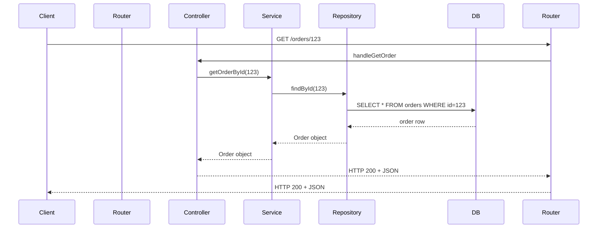
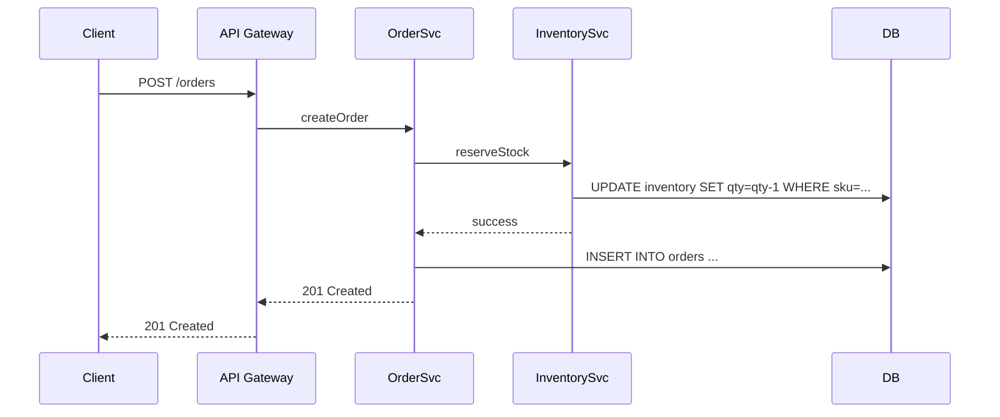

<!-- Generated by Groq via GitHub Actions -->
<!-- Topic ID: T250 -->
<!-- Category: Architecture Patterns -->
<!-- Generated at UTC: 2026-11-24T11:14:22.195392+00:00 -->

# When not to use microservices

## 1. What problem does this solve?

### Motivation
Microservices promise modularity, independent deployment, and polyglot teams.  
But they also introduce **distributed‑system complexity**: network latency, data consistency, service discovery, and operational overhead.  
When a system is small, tightly coupled, or has a single clear business domain, those benefits are outweighed by the added cost.

### What problem exists
- **Over‑engineering**: Splitting a simple CRUD API into dozens of services adds unnecessary layers.
- **Latency & reliability**: Every inter‑service call is a network hop that can fail.
- **Data consistency**: Maintaining ACID guarantees across services is hard; eventual consistency can break user expectations.
- **Operational burden**: More containers, more CI/CD pipelines, more monitoring, more security boundaries.

### Why the problem matters
- **Cost**: Extra compute, networking, and storage.
- **Time to market**: More code, more tests, more deployment steps.
- **Developer experience**: Teams must learn inter‑service contracts, versioning, and distributed tracing.

### Consequences of ignoring the concept
- **Performance regressions**: Network round‑trips add milliseconds that can accumulate.
- **Harder debugging**: Tracing a failure across services is non‑trivial.
- **Higher failure surface**: Each service can fail independently, cascading errors.

### Real‑world appearance
- **Monolithic e‑commerce sites** that start as a single service and only split when traffic spikes.
- **Internal tooling** (e.g., CI dashboards) that stay monolithic because they don’t need independent scaling.
- **Micro‑frontend backends** that expose a single API gateway to the front‑end.

---

## 2. Mental model

### Simple analogy
Think of a **single‑room house** vs. a **complex apartment building**.  
A single‑room house is easy to build, maintain, and renovate.  
An apartment building gives you many units (services) that can be upgraded independently, but it requires plumbing, elevators, and a building manager (distributed‑system plumbing).

### Engineering model
- **Monolith**: One process, one deployment unit, shared memory, shared database.  
- **Microservice**: Multiple processes, each with its own database or data store, communicating over the network.

When the house is small and the occupants (features) are few, a single‑room house is simpler and cheaper.

---

## 3. Deep explanation

### Internals
- **Single process**: All code runs in one Node.js event loop; no inter‑process communication.
- **Shared database**: One PostgreSQL instance; tables can be partitioned by schema but not by service.
- **Single deployment**: One Docker image, one Kubernetes pod (or a single VM).

### Important terminology
- **Monolith**: A single deployable unit that contains all business logic.
- **Service boundary**: The logical separation of concerns; in a monolith it is often a module or folder.
- **Coupling**: Tight coupling means modules depend on each other’s internal APIs; loose coupling means they communicate via well‑defined interfaces.

### Trade‑offs
| Aspect | Monolith | Microservice |
|--------|----------|--------------|
| **Deployment** | One unit | Many units |
| **Scaling** | Scale whole app | Scale parts |
| **Consistency** | Strong ACID | Eventual or bounded |
| **Observability** | Simple logs | Distributed tracing |
| **Team autonomy** | Shared repo | Independent repos |
| **Operational cost** | Low | High |

### Failure modes
- **Monolith**: A bug in one module can crash the whole process; a database lock can block the entire app.
- **Microservice**: Network partitions, service unavailability, version mismatches.

### Limitations
- **Monolith**: Hard to scale specific features; large codebase can become unwieldy.
- **Microservice**: Requires mature DevOps, CI/CD, and monitoring.

### Where it fits in backend architecture
- **Monolith**: Good for startups, MVPs, internal tools, or systems with low traffic.
- **Microservice**: Needed when you have multiple teams, high traffic, or need independent scaling.

### Interaction with related concepts
- **Domain‑Driven Design (DDD)**: Even in a monolith, you can apply bounded contexts as modules.
- **API Gateway**: In a monolith, the gateway is just an Express router; in microservices, it’s a separate service.
- **Event‑Sourcing**: More natural in microservices but can be used in monoliths too.

---

## 4. How it works

### Step‑by‑step flow for a monolith

1. **Client request** → Express router in Node.js.  
2. **Router** dispatches to controller.  
3. **Controller** calls service layer.  
4. **Service** performs business logic, may call repository.  
5. **Repository** runs SQL/ORM queries against PostgreSQL.  
6. **Result** bubbles back to controller → HTTP response.



### Mermaid diagram for a microservice request flow



---

## 5. Practical implementation

### Monolithic example (TypeScript/Node.js)

```ts
// src/server.ts
import express from 'express';
import { getOrderById } from './services/orderService';

const app = express();
app.use(express.json());

app.get('/orders/:id', async (req, res) => {
  try {
    const order = await getOrderById(Number(req.params.id));
    if (!order) return res.status(404).send('Not found');
    res.json(order);
  } catch (err) {
    console.error(err);
    res.status(500).send('Internal error');
  }
});

app.listen(3000, () => console.log('Server listening on 3000'));
```

```ts
// src/services/orderService.ts
import { OrderRepository } from '../repositories/orderRepository';

const repo = new OrderRepository();

export async function getOrderById(id: number) {
  return await repo.findById(id);
}
```

```ts
// src/repositories/orderRepository.ts
import { Pool } from 'pg';

const pool = new Pool(); // default env vars

export class OrderRepository {
  async findById(id: number) {
    const res = await pool.query('SELECT * FROM orders WHERE id = $1', [id]);
    return res.rows[0] || null;
  }
}
```

**Why this is monolithic**  
All code lives in one process, shares the same PostgreSQL pool, and is deployed as a single Docker image.

### When you *do* need a microservice

If you later decide to split the order service:

```ts
// order-service/src/index.ts
import express from 'express';
import { getOrderById } from './services/orderService';

const app = express();
app.get('/orders/:id', async (req, res) => {
  // same handler as before
});
app.listen(4000);
```

Deploy this as a separate container, expose it behind an API gateway, and let the inventory service run on its own port.

---

## 6. Production considerations

| Concern | Monolith | Microservice |
|---------|----------|--------------|
| **Scalability** | Scale whole app; may waste resources | Scale hot spots; cost‑effective |
| **Reliability** | One failure can bring down all features | Failure isolation; graceful degradation |
| **Security** | Single attack surface | Multiple boundaries; tighter IAM |
| **Observability** | Simple logs, single tracing context | Distributed tracing, per‑service metrics |
| **Performance** | In‑process calls are fast | Network latency; need caching |
| **Error handling** | Centralized error middleware | Service‑specific error handling; circuit breakers |
| **Resource usage** | One set of resources | Multiple containers; may increase RAM/CPU |
| **Operational concerns** | One deployment pipeline | Multiple pipelines; more CI jobs |
| **Failure recovery** | Restart whole process | Restart individual services; can use Kubernetes health probes |
| **Deployment** | One Dockerfile | Multiple Dockerfiles; orchestrator (K8s) needed |

**When not to use microservices**  
- Traffic < 10k requests/day.  
- Single team with tight coupling.  
- Tight deadlines; MVP needed.  
- No need for independent scaling.  
- Limited ops budget.

---

## 7. Common mistakes

| Mistake | Why it’s problematic |
|---------|----------------------|
| **Splitting too early** | Adds network latency and ops overhead before you know you need it. |
| **Using a shared database across services** | Breaks isolation; makes scaling and migrations harder. |
| **Ignoring versioning** | API changes break downstream services; leads to cascading failures. |
| **Treating services as independent when they share code** | Duplicate logic; hard to maintain. |
| **Not implementing health checks** | Services may be considered healthy while actually failing. |
| **Over‑using event sourcing for simple CRUD** | Adds complexity without benefit. |
| **Assuming all services can run on the same node** | Resource contention; one service can starve another. |

---

## 8. Senior engineer perspective

### Design decisions at scale
- **Bounded contexts**: Define clear domain boundaries; avoid cross‑service data duplication.
- **Data ownership**: Each service owns its data; use event streams for synchronization.
- **API contracts**: Use OpenAPI/GraphQL schemas; version aggressively.
- **Observability stack**: Prometheus + Grafana, Jaeger for tracing, Loki for logs.
- **Deployment**: GitOps with ArgoCD or Flux; Helm charts per service.
- **Security**: Mutual TLS, fine‑grained RBAC, secrets in Vault.

### Trade‑offs
- **Latency vs. isolation**: Accept higher latency for better fault isolation.
- **Consistency vs. availability**: Use Saga patterns or compensating transactions when strict consistency is needed.
- **Cost vs. agility**: More services mean more containers, higher cloud bill.

### Bottlenecks
- **Database**: A single PostgreSQL instance can become a choke point; consider sharding or read replicas.
- **API gateway**: If overloaded, it becomes a single point of failure.
- **Event bus**: Kafka partitions can limit throughput; monitor lag.

### Failure scenarios
- **Network partition**: Use circuit breakers (e.g., `opossum` in Node.js).
- **Service crash**: Kubernetes liveness probes restart pods automatically.
- **Data loss**: Use idempotent operations and deduplication.

### When NOT to use the approach
- **Low traffic, single team**: The overhead outweighs benefits.
- **Rapid prototyping**: Simplicity wins over modularity.
- **Highly transactional, single‑user apps**: Strong ACID guarantees are easier in a monolith.

---

## 9. Interview questions

| Level | Question | Answer points |
|-------|----------|---------------|
| Beginner | What is a monolith? | Single deployable unit; shared codebase; one process. |
| Beginner | Why might you choose a monolith over microservices? | Simpler deployment, lower ops cost, easier debugging. |
| Senior | How would you decide when to split a monolith into microservices? | Traffic patterns, team structure, scalability needs, data ownership. |
| Senior | Explain the trade‑off between strong consistency and availability in a microservice architecture. | CAP theorem; eventual consistency vs. ACID; use of Sagas or compensating actions. |
| Scenario | A user reports that order creation is slow after a recent deployment. What steps would you take to debug the issue? | Check logs, trace request path, inspect network latency, verify database locks, look at service metrics, identify bottlenecks. |

---

## 10. Hands‑on task

**Task**: Refactor the monolithic order API into a separate microservice.

1. Create a new folder `order-service` with its own `package.json` and Dockerfile.  
2. Move `orderService.ts` and `orderRepository.ts` into this folder.  
3. Expose the same `/orders/:id` endpoint on port `4000`.  
4. Update the original monolith to proxy `/orders` requests to the new service via an Express router.  
5. Run both services locally (use Docker Compose or `docker run`).  
6. Verify that a GET request to `http://localhost:3000/orders/1` returns the same result as before.

**Goal**: Observe the added network hop, test failure isolation, and note any changes in performance or error handling.

---

## 11. Quick revision

- Microservices add **distributed‑system complexity**: latency, consistency, ops overhead.
- Monoliths are simpler for **small teams, low traffic, MVPs**.
- **When not to use microservices**: early stage, single domain, tight coupling, limited ops budget.
- Key trade‑offs: scalability vs. latency, isolation vs. consistency, cost vs. agility.
- Common mistakes: premature splitting, shared DB, no versioning, duplicate code.
- Senior perspective: bounded contexts, data ownership, observability stack, CAP trade‑offs.
- Debugging: trace, metrics, logs, network inspection.
- Hands‑on: split a monolith into a microservice and observe changes.

---

## 12. References

- [Node.js Express Documentation](https://expressjs.com/)
- [PostgreSQL Official Docs](https://www.postgresql.org/docs/)
- [Docker Official Documentation](https://docs.docker.com/)
- [Kubernetes Official Docs](https://kubernetes.io/docs/)
- [CAP Theorem – Wikipedia](https://en.wikipedia.org/wiki/CAP_theorem)
- [OpenAPI Specification](https://swagger.io/specification/)
- [Prometheus Documentation](https://prometheus.io/docs/introduction/overview/)
- [Jaeger Tracing](https://www.jaegertracing.io/docs/)

---
