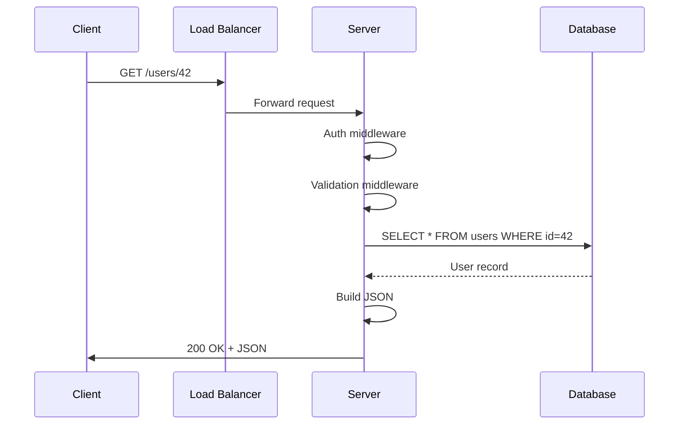

<!-- Generated by Groq via GitHub Actions -->
<!-- Topic ID: T251 -->
<!-- Category: API Architecture -->
<!-- Generated at UTC: 2026-11-24T23:11:32.110968+00:00 -->

# REST

## 1. What problem does this solve?

| Problem | Why it matters | Consequence if ignored | Real‑world appearance |
|---------|----------------|------------------------|-----------------------|
| **Decoupled client–server communication** | Clients (web, mobile, IoT) need a stable contract that can evolve independently of the server. | Tight coupling → every change forces client rewrites, breaking backward compatibility. | Public APIs (Twitter, Stripe), internal microservice gateways |
| **Scalable, stateless interactions** | Statelessness lets any server instance handle any request, enabling horizontal scaling and load balancing. | Stateful servers require session replication or sticky sessions, increasing complexity and resource usage. | CDN‑backed APIs, serverless functions |
| **Cache‑friendly data exchange** | HTTP caching headers let intermediaries (CDNs, browsers) store responses, reducing load on origin servers. | No caching → every request hits the database, hurting performance and cost. | Product catalogs, news feeds |
| **Uniform resource identification** | URIs expose resources as first‑class citizens, making APIs discoverable and self‑describing. | Ambiguous endpoints → hard to document, test, and maintain. | RESTful CRUD endpoints (`/users/123`) |
| **Standardized error handling** | HTTP status codes provide a common language for success/failure, simplifying client error handling. | Custom error formats → brittle client code, harder debugging. | Error responses in microservice meshes |

---

## 2. Mental model

### Analogy: The Library

| Library Concept | REST Concept |
|-----------------|--------------|
| Books on shelves | Resources (`/books/123`) |
| Librarian reads a book | HTTP GET |
| Librarian writes a new book | HTTP POST |
| Librarian updates a book | HTTP PUT/PATCH |
| Librarian removes a book | HTTP DELETE |
| Library catalog (search) | Query parameters (`?author=Rowling`) |
| Library card (auth) | Authentication token |

**Takeaway:** Think of a REST API as a public library where each resource is a book that can be read, written, updated, or deleted through a standard set of operations.

### Engineering model

- **Resource** – an abstract entity identified by a URI.
- **Representation** – the serialized form (JSON, XML) sent over the wire.
- **HTTP verb** – the action to perform (`GET`, `POST`, `PUT`, `PATCH`, `DELETE`).
- **Statelessness** – each request contains all information needed; no server‑side session.
- **Cacheability** – responses can be cached if marked `Cache‑Control`.
- **HATEOAS (optional)** – links in responses guide clients to next actions.

---

## 3. Deep explanation

### Internals

1. **HTTP protocol** – TCP‑based, request/response, supports headers, status codes, body.
2. **URI routing** – server maps incoming path to handler logic.
3. **Middleware stack** – authentication, logging, validation, error handling.
4. **Serialization** – JSON is the de‑facto standard; XML, Protobuf, or custom formats are possible.
5. **Database interaction** – ORM/Query builder (Prisma, TypeORM) or raw SQL.

### Important terminology

| Term | Meaning |
|------|---------|
| **CRUD** | Create, Read, Update, Delete – the four basic operations. |
| **Safe** | Methods that do not modify state (`GET`, `HEAD`). |
| **Idempotent** | Repeating the same request yields the same result (`PUT`, `DELETE`). |
| **Cache‑Control** | Header that instructs intermediaries how long to cache. |
| **HATEOAS** | Hypermedia As The Engine Of Application State – responses include links to related actions. |
| **Versioning** | Strategy to evolve APIs without breaking clients (URI, header, media type). |

### Trade‑offs

| Decision | Pros | Cons |
|----------|------|------|
| **Stateless vs stateful** | Easier scaling, simpler recovery | Cannot maintain session state without external store |
| **Hypermedia vs simple CRUD** | Discoverability, future‑proof | Adds complexity, not always needed |
| **JSON vs binary** | Human readable, wide support | Larger payloads, slower parsing |
| **URI versioning vs header** | Clear in URL, easier caching | URL clutter, may break existing clients |

### Failure modes

- **Concurrent updates** – lost updates if not using optimistic locking.
- **Partial failures** – e.g., database down → 5xx, but client may retry.
- **Cache staleness** – stale data if `Cache‑Control` not set correctly.
- **Rate limiting** – over‑requesting can throttle legitimate traffic.

### Limitations

- **Real‑time streaming** – REST is request/response; WebSockets or gRPC are better for continuous streams.
- **Complex transactions** – multi‑resource updates may require sagas or two‑phase commits.
- **High‑throughput binary data** – REST over HTTP can be less efficient than raw sockets.

### Where it fits

- **API Gateway** – routes requests to microservices, aggregates responses.
- **Service Mesh** – provides observability, retries, circuit breakers around REST calls.
- **Serverless Functions** – each function can expose a REST endpoint.

### Interaction with related concepts

| Concept | Interaction |
|---------|-------------|
| **Authentication** | OAuth2, JWT, API keys – usually in headers. |
| **Rate limiting** | Middleware that counts requests per IP/user. |
| **Caching** | Redis or CDN caches responses based on `ETag`/`Last‑Modified`. |
| **Observability** | OpenTelemetry traces, Prometheus metrics, structured logs. |
| **GraphQL** | Alternative to REST; can be used alongside or replace REST for certain use cases. |

---

## 4. How it works

1. **Client** sends an HTTP request (`GET /users/42`) with headers (auth, accept).
2. **Load balancer** forwards to an available backend instance.
3. **Router** matches the path to a controller/handler.
4. **Middleware** authenticates, logs, validates.
5. **Handler** performs business logic, queries the database, builds a representation.
6. **Response** is serialized to JSON, headers set (`Content‑Type`, `Cache‑Control`), status code returned.
7. **Client** receives the response, may cache it, and act accordingly.



---

## 5. Practical implementation

Below is a minimal, production‑ready CRUD service for a `Book` resource using **Express**, **Prisma** (PostgreSQL), and **Redis** for caching.

```ts
// src/server.ts
import express from 'express';
import { PrismaClient } from '@prisma/client';
import redis from 'redis';
import { json, urlencoded } from 'body-parser';
import morgan from 'morgan';
import helmet from 'helmet';
import { Request, Response, NextFunction } from 'express';

const app = express();
const prisma = new PrismaClient();
const redisClient = redis.createClient();

app.use(helmet());          // Security headers
app.use(morgan('combined')); // Logging
app.use(json());
app.use(urlencoded({ extended: false }));

// ---------- Middleware ----------
app.use(async (req: Request, res: Response, next: NextFunction) => {
  // Simple token auth
  const auth = req.headers.authorization;
  if (!auth || auth !== 'Bearer secret-token') {
    return res.status(401).json({ error: 'Unauthorized' });
  }
  next();
});

// ---------- Routes ----------
app.get('/books/:id', async (req, res) => {
  const id = Number(req.params.id);
  // Try cache first
  const cached = await redisClient.getAsync(`book:${id}`);
  if (cached) {
    return res
      .status(200)
      .set('Cache-Control', 'public, max-age=60')
      .json(JSON.parse(cached));
  }

  const book = await prisma.book.findUnique({ where: { id } });
  if (!book) return res.status(404).json({ error: 'Not found' });

  // Cache for 60s
  redisClient.setex(`book:${id}`, 60, JSON.stringify(book));
  res.status(200).json(book);
});

app.post('/books', async (req, res) => {
  const { title, author } = req.body;
  if (!title || !author) {
    return res.status(400).json({ error: 'Missing title or author' });
  }
  const book = await prisma.book.create({ data: { title, author } });
  // Invalidate cache if needed
  redisClient.del(`books:all`);
  res.status(201).json(book);
});

app.put('/books/:id', async (req, res) => {
  const id = Number(req.params.id);
  const { title, author } = req.body;
  const book = await prisma.book.update({
    where: { id },
    data: { title, author },
  });
  redisClient.del(`book:${id}`);
  redisClient.del(`books:all`);
  res.json(book);
});

app.delete('/books/:id', async (req, res) => {
  const id = Number(req.params.id);
  await prisma.book.delete({ where: { id } });
  redisClient.del(`book:${id}`);
  redisClient.del(`books:all`);
  res.status(204).send();
});

// ---------- Error handling ----------
app.use((err: Error, req: Request, res: Response, _: NextFunction) => {
  console.error(err);
  res.status(500).json({ error: 'Internal server error' });
});

// ---------- Start ----------
const PORT = process.env.PORT ?? 3000;
app.listen(PORT, () => console.log(`🚀 Server listening on ${PORT}`));
```

**Key points**

- **Stateless**: every request contains the auth token.
- **Cache‑friendly**: `Cache‑Control` header and Redis caching.
- **Idempotent**: `PUT` and `DELETE` can be retried safely.
- **Error handling**: consistent JSON error responses.
- **Security**: Helmet, basic token auth, input validation.

---

## 6. Production considerations

| Concern | What to do |
|---------|------------|
| **Scalability** | Keep servers stateless; use a load balancer; horizontal scaling; cache hot data in Redis or CDN. |
| **Reliability** | Implement retries with exponential backoff; circuit breakers; graceful degradation; health checks. |
| **Security** | TLS everywhere; OAuth2/JWT; input sanitization; rate limiting; audit logs. |
| **Observability** | Structured logs (JSON), Prometheus metrics (`http_requests_total`, `http_response_duration_seconds`), OpenTelemetry traces. |
| **Performance** | Use connection pooling for DB; compress responses (`gzip`); keep payloads minimal; batch DB queries. |
| **Error handling** | Return proper status codes (`400`, `401`, `404`, `409`, `500`); provide error IDs for tracing. |
| **Resource usage** | Monitor memory, CPU, DB connections; auto‑scale based on metrics. |
| **Operational concerns** | Blue‑green or canary deployments; automated rollback; versioned migrations. |
| **Failure recovery** | Cache invalidation strategy; idempotency keys for POST/PUT; fallback to read‑only mode. |
| **Deployment** | Dockerize, use Kubernetes or ECS; keep environment variables for secrets; use secrets manager. |

---

## 7. Common mistakes

| Mistake | Why it hurts |
|---------|--------------|
| Using `GET` to create or modify data | Violates idempotency, breaks caching, misleads clients. |
| Ignoring status codes | Clients cannot programmatically react to errors. |
| Not validating input | Security holes, database errors, bad data. |
| Over‑caching dynamic data | Stale responses, inconsistent UI. |
| No pagination on large collections | OOM on server, slow responses, poor UX. |
| Not handling 429 (rate limit) | Clients retry endlessly, causing spikes. |
| Mixing query parameters with path parameters | Ambiguous routes, hard to document. |
| Hard‑coding URLs in client | Tight coupling, brittle to API changes. |
| No idempotency for POST | Duplicate orders, double charges. |
| Using a single DB connection per request | Connection exhaustion, slow queries. |

---

## 8. Senior engineer perspective

### Design decisions at scale

| Decision | What to consider |
|----------|------------------|
| **API versioning** | URI (`/v1/books`) vs header (`Accept: application/vnd.myapp.v1+json`). URI is simpler for caching; header preserves same URL. |
| **Caching strategy** | CDN for public data, Redis for per‑user data, `ETag`/`If‑None-Match` for conditional GETs. |
| **Load balancing** | Round‑robin vs least‑connections; sticky sessions only if necessary. |
| **Rate limiting** | Per‑IP, per‑API key, or per‑user; use Redis or token bucket. |
| **Observability** | Distributed tracing across services; metrics aggregation; alerting on latency thresholds. |
| **Security** | OAuth2 scopes, JWT revocation lists, TLS termination at edge. |
| **Cost** | Cache hit ratio, database read/write costs, network egress. |

### Bottlenecks

- **Database** – slow queries, lack of indexes, connection pool exhaustion.
- **Serialization** – large JSON payloads, slow stringification.
- **Network** – high latency, packet loss, TLS handshake overhead.

### Failure scenarios

- **Partial failures** – e.g., DB down but cache available: serve stale data with `Cache‑Control: stale-while-revalidate`.
- **Circuit breaker** – stop sending requests to a failing downstream service.
- **Graceful degradation** – fallback to read‑only mode if write DB fails.

### When NOT to use REST

- **High‑throughput binary data** – gRPC or raw sockets are more efficient.
- **Real‑time streaming** – WebSockets, Server‑Sent Events, or gRPC‑streaming.
- **Complex multi‑resource transactions** – consider event‑driven architecture or sagas.

---

## 9. Interview questions

1. **Beginner** – *What is a RESTful API?*  
   *Answer:* A stateless, resource‑oriented API that uses standard HTTP verbs and status codes to perform CRUD operations on resources identified by URIs.

2. **Beginner** – *Explain idempotent vs non‑idempotent HTTP methods.*  
   *Answer:* Idempotent methods (`GET`, `PUT`, `DELETE`) can be repeated without changing the result after the first call. Non‑idempotent methods (`POST`, `PATCH`) may produce different results on each call.

3. **Senior** – *How would you design a versioned REST API for a large e‑commerce platform?*  
   *Answer:* Use URI versioning (`/v1/…`) or media‑type versioning; keep backward compatibility; deprecate old endpoints gradually; use feature flags; document changes; employ automated tests for each version.

4. **Senior** – *Discuss trade‑offs between REST and gRPC for microservice communication.*  
   *Answer:* REST is human‑readable, cacheable, works over HTTP/1.1, easy to debug; gRPC is binary, lower latency, supports streaming, better for internal services. Choose based on latency, data size, client diversity, and tooling.

5. **Scenario** – *A client reports that `POST /orders` returns 500 but the order is actually created. Identify the cause and fix.*  
   *Answer:* Likely the server throws an exception after persisting the order (e.g., after sending a confirmation email). The transaction commits, but the error propagates to the client. Fix by wrapping non‑critical side‑effects in a separate async task or by using a transaction that rolls back on error, or by returning `201` before the side‑effect.

---

## 10. Hands‑on task

**Implement a paginated, filterable `/products` endpoint** that:

1. Accepts `?page=1&limit=20&category=electronics`.
2. Uses Prisma to query PostgreSQL.
3. Caches the result set in Redis for 30 s.
4. Returns `Link` headers for pagination.
5. Handles errors with proper status codes.

Add unit tests with Jest and integration tests with Supertest.

---

## 11. Quick revision

- REST = stateless, resource‑oriented HTTP API.
- CRUD → `GET`, `POST`, `PUT/PATCH`, `DELETE`.
- Safe vs idempotent vs non‑idempotent methods.
- Use `Cache‑Control`, `ETag`, `Last‑Modified` for caching.
- Versioning: URI (`/v1/…`) or header (`Accept`).
- Proper status codes: 200, 201, 204, 400, 401, 404, 409, 500.
- Middleware: auth, logging, validation, error handling.
- Cache hot data in Redis or CDN; invalidate on write.
- Observability: logs, metrics, traces.
- Security: TLS, OAuth2/JWT, input sanitization, rate limiting.
- Avoid `GET` for writes; avoid duplicate POSTs; validate input.

---

## 12. References

- RFC 7231 – HTTP/1.1 Semantics and Content: <https://datatracker.ietf.org/doc/html/rfc7231>
- RFC 7230 – HTTP/1.1 Message Syntax and Routing: <https://datatracker.ietf.org/doc/html/rfc7230>
- MDN Web Docs – HTTP: <https://developer.mozilla.org/en-US/docs/Web/HTTP>
- Express.js Docs – <https://expressjs.com/>
- Prisma Docs – <https://www.prisma.io/docs>
- Redis Docs – <https://redis.io/documentation>
- OpenTelemetry – <https://opentelemetry.io/docs/>
- FastAPI Docs (Python) – <https://fastapi.tiangolo.com/>
- AWS API Gateway – <https://docs.aws.amazon.com/apigateway/latest/developerguide/welcome.html>
