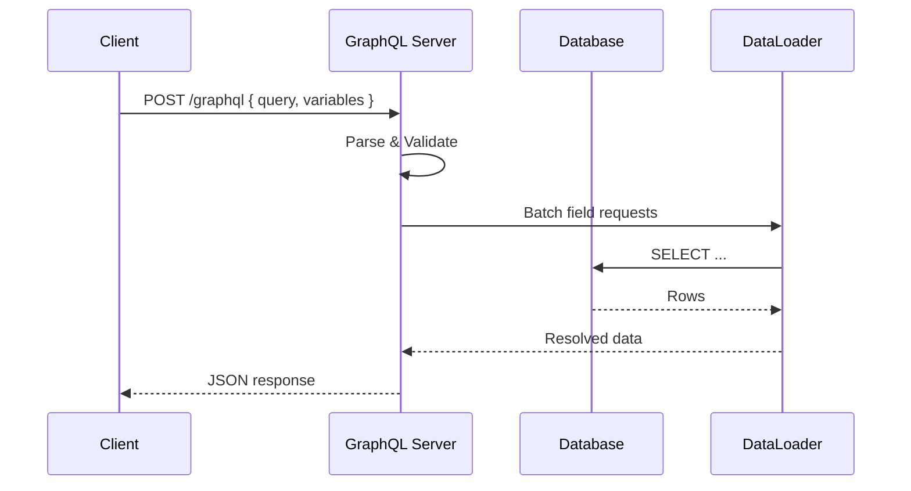

<!-- Generated by Groq via GitHub Actions -->
<!-- Topic ID: T252 -->
<!-- Category: API Architecture -->
<!-- Generated at UTC: 2026-11-24T23:11:32.110968+00:00 -->

# GraphQL

## 1. What problem does this solve?

| Problem | Why it matters | Consequence if ignored | Real‑world use |
|---------|----------------|------------------------|----------------|
| **Over‑fetching / under‑fetching** | Clients often request more data than needed (REST) or split requests into many round‑trips (REST) | Increased bandwidth, slower UI, wasted server resources | Mobile apps, SPAs |
| **Versioning pain** | Every change to a REST endpoint usually requires a new URL or version | Fragmentation, hard maintenance | Microservices, public APIs |
| **Tight coupling** | Backend and frontend evolve independently, but REST forces tight coupling | Fragile integration, slow iteration | E‑commerce sites, SaaS |
| **Complex aggregations** | Pulling data from multiple services or tables requires custom endpoints | Boilerplate, duplicated logic | Social networks, analytics dashboards |

GraphQL solves these by letting the client **declare exactly what it needs** in a single request, while the server **exposes a strongly‑typed schema** that can evolve without breaking clients.

---

## 2. Mental model

### Analogy: Library Catalog vs. Library Card

- **REST**: You ask the librarian for a specific book (endpoint). If you need the book’s author, you ask again. If you need a list of all books by that author, you ask again. Each request is a separate trip.
- **GraphQL**: You give the librarian a catalog request: “Give me book *X*, its author, and all reviews.” The librarian fetches everything in one go, using the catalog to know exactly what to pull.

### Engineering model

1. **Schema** – The library’s catalog: a typed description of all available data.
2. **Query** – The request you hand to the librarian: a tree of fields you want.
3. **Resolver** – The librarian’s staff: fetches each field from the right source.
4. **Execution engine** – The process that walks the tree, calling resolvers, and assembling the final JSON.

---

## 3. Deep explanation

### Internals

| Component | Role |
|-----------|------|
| **Schema** | GraphQL SDL (type definitions, queries, mutations, subscriptions). |
| **Parser & Validator** | Turns the query string into an AST and checks it against the schema. |
| **Execution Engine** | Recursively walks the AST, invoking resolvers for each field. |
| **Resolvers** | Functions that fetch data for a field. |
| **DataLoader** | Batching & caching helper to mitigate N+1 problems. |
| **Persisted Queries** | Store query hashes to avoid parsing on every request. |
| **Instrumentation** | Hooks for logging, tracing, metrics. |

### Important terminology

- **Type** – Scalar (`String`, `Int`) or Object (`User`, `Post`).
- **Query** – Read‑only operation.
- **Mutation** – Write operation.
- **Subscription** – Real‑time updates via WebSocket.
- **Resolver** – Function that returns data for a field.
- **Fragment** – Reusable field selection.
- **Directive** – Runtime behavior modifier (`@include`, `@skip`).
- **Introspection** – Querying the schema itself.

### Trade‑offs

| Benefit | Cost |
|---------|------|
| Fine‑grained data fetching | More complex client logic |
| Single endpoint | Resolver complexity, potential N+1 |
| Strong typing | Schema evolution requires careful versioning |
| Tooling (codegen, IDE support) | Learning curve, tooling setup |

### Failure modes

- **N+1 queries**: Each field resolution triggers a new DB call.
- **Circular dependencies**: Resolvers that call each other endlessly.
- **Over‑fetching**: Client requests too many nested fields, causing heavy load.
- **Unintended data exposure**: Schema exposes sensitive fields if not guarded.

### Limitations

- Not ideal for high‑throughput bulk writes.
- Streaming large datasets can be awkward; consider subscriptions or pagination.
- Requires careful caching strategy; naive caching can return stale data.

### Where it fits

- **API Gateway**: GraphQL can sit in front of microservices, aggregating data.
- **Monolith**: Replace multiple REST endpoints with a single GraphQL layer.
- **Data‑centric services**: When the domain model is naturally hierarchical.

### Interaction with other backend concepts

- **Databases**: Resolvers map to SQL/NoSQL queries; DataLoader batches.
- **Caching**: Apollo Server cache, Redis, or in‑memory LRU.
- **Auth**: Context injection, field‑level authorization.
- **Observability**: OpenTelemetry, Prometheus metrics per resolver.
- **Deployment**: Containerized, can scale horizontally like any HTTP service.

---

## 4. How it works

1. **Client** sends a GraphQL query string (or persisted query ID) over HTTP POST.
2. **Server** receives the request, parses the query into an AST.
3. **Validation** checks AST against the schema; errors are returned early.
4. **Execution engine** walks the AST:
   - For each field, calls its resolver with `parent`, `args`, `context`, `info`.
   - Resolvers may return promises; engine waits for all to resolve.
5. **DataLoader** batches identical field requests into a single DB call.
6. **Result** is assembled into a JSON object matching the query shape.
7. **Response** is sent back to the client.



---

## 5. Practical implementation

Below is a minimal Apollo Server setup that connects to PostgreSQL via Prisma, uses DataLoader to batch user lookups, and exposes a simple blog schema.

```ts
// src/index.ts
import { ApolloServer, gql } from 'apollo-server';
import { PrismaClient } from '@prisma/client';
import DataLoader from 'dataloader';

const prisma = new PrismaClient();

/* 1️⃣ Schema definition (SDL) */
const typeDefs = gql`
  type User {
    id: ID!
    name: String!
    posts: [Post!]!
  }

  type Post {
    id: ID!
    title: String!
    author: User!
  }

  type Query {
    posts: [Post!]!
    user(id: ID!): User
  }
`;

/* 2️⃣ DataLoader for batching users */
const createUserLoader = () =>
  new DataLoader(async (ids: readonly string[]) => {
    const users = await prisma.user.findMany({
      where: { id: { in: ids as string[] } },
    });
    const userMap = new Map(users.map(u => [u.id, u]));
    return ids.map(id => userMap.get(id) ?? null);
  });

/* 3️⃣ Resolvers */
const resolvers = {
  Query: {
    posts: () => prisma.post.findMany(),
    user: (_: any, { id }: { id: string }) => prisma.user.findUnique({ where: { id } }),
  },
  Post: {
    author: (post: { authorId: string }, _: any, { loaders }: { loaders: { userLoader: DataLoader<string, any> } }) =>
      loaders.userLoader.load(post.authorId),
  },
  User: {
    posts: (user: { id: string }) => prisma.post.findMany({ where: { authorId: user.id } }),
  },
};

/* 4️⃣ Apollo Server setup */
const server = new ApolloServer({
  typeDefs,
  resolvers,
  context: () => ({
    loaders: {
      userLoader: createUserLoader(),
    },
  }),
});

server.listen({ port: 4000 }).then(({ url }) => {
  console.log(`🚀  Server ready at ${url}`);
});
```

**Key points**

- `DataLoader` batches `author` field resolutions, preventing N+1 queries.
- `context` provides per‑request loaders, ensuring cache isolation.
- Prisma handles SQL generation; you can swap to any ORM or raw queries.

---

## 6. Production considerations

| Concern | Recommendation |
|---------|----------------|
| **Scalability** | Use persisted queries, query complexity limits, and CDN caching for static responses. |
| **Reliability** | Graceful error handling, fallback resolvers, circuit breakers for external services. |
| **Security** | Disable introspection in prod, enforce query depth/complexity limits, use field‑level auth. |
| **Observability** | Instrument resolvers with OpenTelemetry, expose metrics per resolver, log errors with context. |
| **Performance** | Avoid N+1 via DataLoader, cache expensive resolvers in Redis, use query batching. |
| **Error handling** | Return GraphQL error objects; use `@apollo/server` error handling hooks. |
| **Resource usage** | Monitor memory per resolver, limit concurrent connections, use connection pooling. |
| **Operational concerns** | Versioned schemas, automated schema validation, CI/CD pipeline for schema changes. |
| **Failure recovery** | Retry logic in resolvers, exponential backoff, graceful degradation. |
| **Deployment** | Containerize with Docker, expose health checks, use Kubernetes for autoscaling. |

---

## 7. Common mistakes

| Mistake | Why it’s problematic |
|---------|----------------------|
| **Ignoring N+1** | Each field triggers a DB call → O(n²) queries, high latency. |
| **No batching** | Same data fetched repeatedly; wasteful network & CPU. |
| **Exposing sensitive fields** | Introspection or careless schema design leaks data. |
| **Unrestricted query size** | Clients can send huge queries that exhaust memory or DB. |
| **Not handling partial failures** | GraphQL returns partial data; client may misinterpret. |
| **Over‑fetching** | Clients request deep nested data they never use → wasted bandwidth. |

---

## 8. Senior engineer perspective

### Design decisions

- **Gateway vs. per‑service GraphQL**: Federation (Apollo) vs. schema stitching. Federation scales better but adds complexity.
- **Schema evolution**: Use deprecation, add new fields instead of removing; keep backward compatibility.
- **Caching strategy**: In‑memory LRU vs. Redis; consider per‑field TTLs.
- **Query complexity limits**: Implement depth/complexity analysis to protect against expensive queries.
- **Observability**: Instrument each resolver; correlate with database metrics.

### Trade‑offs & bottlenecks

- **Resolver complexity** can become a performance bottleneck; profile and refactor.
- **Database connections**: Too many concurrent resolvers can exhaust pool; use connection pooling and async/await properly.
- **Network latency**: If resolvers call external services, consider async batching or caching.

### Failure scenarios

- **Cascading failures**: A slow resolver can block the entire query; use timeouts.
- **Schema drift**: If a field is removed but clients still query it, introspection errors occur; enforce schema validation.

### Monitoring & cost

- **Metrics**: Resolver latency, query complexity, error rates.
- **Cost**: GraphQL can reduce over‑fetching, but complex queries may increase compute cost.
- **When NOT to use**: High‑throughput bulk writes, streaming large datasets, simple CRUD with minimal client variation.

---

## 9. Interview questions

1. **Beginner** – *What is GraphQL and how does it differ from REST?*  
   *Answer points:* Single endpoint, typed schema, client‑defined shape, no versioning, query/mutation/subscription.

2. **Beginner** – *Explain the role of a resolver in GraphQL.*  
   *Answer points:* Function that fetches data for a field, receives parent, args, context, info, can return promise.

3. **Senior** – *Describe the N+1 problem in GraphQL and how you would mitigate it.*  
   *Answer points:* Multiple DB calls per field, use DataLoader, batching, caching, query optimization.

4. **Senior** – *Compare schema stitching and Apollo Federation. When would you choose one over the other?*  
   *Answer points:* Stitching merges schemas at runtime; Federation splits schema across services with a gateway; Federation scales better, stitching simpler for small projects.

5. **Scenario/Debugging** – *A client’s query that used to return quickly now times out. What steps would you take to debug the issue?*  
   *Answer points:* Check query complexity, profiler logs, resolver timings, database slow queries, network latency, caching hits, DataLoader batching, check for new code changes.

---

## 10. Hands‑on task

**Build a GraphQL API for a simple blog**

1. **Schema**: `User`, `Post`, `Comment`.  
2. **Resolvers**: Use Prisma to fetch data.  
3. **DataLoader**: Batch comment lookups per post.  
4. **Query complexity**: Add a limit of 10 depth.  
5. **Persisted queries**: Store a sample query in Redis and serve it by hash.  
6. **Testing**: Write a Jest test that sends a complex query and asserts the response shape.

*Deliverable*: A GitHub repo with `docker-compose.yml` that spins up PostgreSQL, Redis, and the Node.js server. Include a README with instructions to run tests.

---

## 11. Quick revision

- GraphQL is a query language + runtime for APIs.
- **Schema** defines types, queries, mutations, subscriptions.
- **Resolvers** fetch data; use DataLoader to avoid N+1.
- **Query complexity limits** protect against expensive queries.
- **Persisted queries** reduce parsing overhead.
- **Apollo Server** is a popular Node.js implementation.
- **Security**: disable introspection, enforce auth, rate limit.
- **Observability**: instrument resolvers, expose metrics.
- **Caching**: in‑memory, Redis, or CDN for static responses.
- **Schema evolution**: deprecate, add fields, avoid breaking changes.
- **When not to use**: high‑throughput bulk writes, streaming large data.

---

## 12. References

- GraphQL Specification – https://spec.graphql.org/
- Apollo Server Docs – https://www.apollographql.com/docs/apollo-server/
- DataLoader – https://github.com/graphql/dataloader
- Prisma – https://www.prisma.io/docs/
- GraphQL Complexity – https://github.com/urigo/graphql-query-complexity
- Apollo Federation – https://www.apollographql.com/docs/federation/
- GraphQL Best Practices – https://www.apollographql.com/docs/apollo-server/best-practices/
- OpenTelemetry for GraphQL – https://opentelemetry.io/docs/instrumentation/js/graphQL/
- GraphQL Security – https://www.apollographql.com/docs/apollo-server/security/
