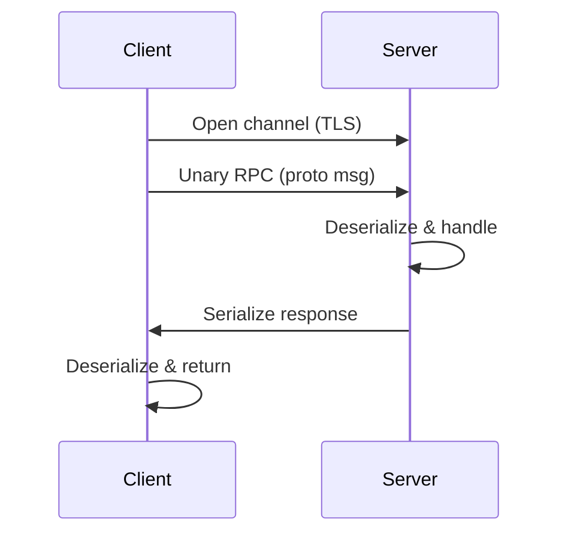

<!-- Generated by Groq via GitHub Actions -->
<!-- Topic ID: T253 -->
<!-- Category: API Architecture -->
<!-- Generated at UTC: 2026-11-25T10:00:04.018292+00:00 -->

# gRPC

## 1. What problem does this solve?

- **Problem**: Traditional HTTP/REST APIs are text‑heavy, stateless, and lack built‑in streaming or strong typing. For high‑performance, internal microservice communication, this can lead to bandwidth waste, higher latency, and brittle contracts.
- **Why it matters**: In a distributed system with many services (e.g., a recommendation engine, AI inference, analytics pipeline), the overhead of JSON over HTTP can become a bottleneck. It also forces developers to manually handle serialization, versioning, and error handling.
- **Without gRPC**: You might see increased CPU usage (JSON parsing), higher network traffic, more complex contract management, and difficulty implementing bi‑directional streaming (e.g., real‑time analytics).
- **Real‑world use**: Google’s internal services, Kubernetes API server, Envoy, and many SaaS backends (e.g., Stripe, Slack) use gRPC for internal service calls. It’s also common in AI pipelines where large tensors are streamed between services.

## 2. Mental model

- **Analogy**: Think of gRPC as a *post office with pre‑printed envelopes*. Each envelope (message) has a fixed format, and the post office (gRPC runtime) knows exactly how to read and write each type of envelope. You don’t need to write the envelope yourself every time; you just hand it to the post office, and it takes care of the details.
- **Engineering model**:  
  1. **Service definition** (`.proto` file) declares the contract.  
  2. **Code generation** creates typed client/server stubs.  
  3. **HTTP/2** transports the binary messages efficiently.  
  4. **Protocol Buffers** serialize the data into a compact binary format.  
  5. **Streaming** (unary, server‑stream, client‑stream, bidi‑stream) is first‑class.

## 3. Deep explanation

| Aspect | Details |
|--------|---------|
| **Internals** | Uses HTTP/2 for multiplexed streams, TLS for security, and Protocol Buffers for binary serialization. The gRPC runtime handles framing, flow control, and error codes. |
| **Important terminology** | *Service*, *Method*, *Request/Response*, *Client*, *Server*, *Channel*, *Stub*, *Descriptor*, *Proto file*, *Package*, *Unary*, *Server‑stream*, *Client‑stream*, *Bidi‑stream*. |
| **Trade‑offs** | <ul><li>**Pros**: low latency, type safety, streaming, language agnostic, efficient binary.</li><li>**Cons**: not human‑readable, requires code generation, less suited for browser clients, steeper learning curve for beginners.</li></ul> |
| **Failure modes** | Connection drops, message size limits, backpressure mismanagement, version incompatibilities, TLS handshake failures. |
| **Limitations** | No built‑in support for HTTP/1.1 clients, limited support for large file uploads without streaming, requires protobuf compiler and plugins. |
| **Where it fits** | Microservice internal APIs, event‑driven pipelines, AI inference services, data ingestion pipelines, and any scenario where low‑latency, high‑throughput, typed contracts are needed. |
| **Interaction with related concepts** | Works alongside REST for public APIs, can be bridged with HTTP/REST via gRPC‑JSON transcoding, integrates with service meshes (Istio), can be used with message brokers (Kafka) for async patterns, and pairs with observability tools (OpenTelemetry). |

## 4. How it works

1. **Define a service** in a `.proto` file.  
2. **Generate code** for client and server stubs.  
3. **Create a channel** (TCP/TLS connection).  
4. **Client calls** a method via the stub; the request is serialized to protobuf.  
5. **HTTP/2** frames the binary payload and sends it over the channel.  
6. **Server receives** the frame, deserializes, invokes the method implementation.  
7. **Server sends** a response (or stream) back, following the same steps.  
8. **Client receives** the response, deserializes, and returns it to the caller.



## 5. Practical implementation

### 5.1. Install dependencies

```bash
npm init -y
npm install @grpc/grpc-js @grpc/proto-loader
npm install -D ts-node typescript
```

### 5.2. `user.proto`

```proto
syntax = "proto3";

package user;

service UserService {
  // Unary RPC
  rpc GetUser (GetUserRequest) returns (User) {}

  // Server streaming
  rpc ListUsers (ListUsersRequest) returns (stream User) {}

  // Client streaming
  rpc CreateUsers (stream CreateUserRequest) returns (CreateUsersResponse) {}

  // Bidirectional streaming
  rpc Chat (stream ChatMessage) returns (stream ChatMessage) {}
}

message GetUserRequest { string id = 1; }

message ListUsersRequest { int32 page = 1; }

message CreateUserRequest { string name = 1; string email = 2; }

message CreateUsersResponse { int32 created = 1; }

message User {
  string id = 1;
  string name = 2;
  string email = 3;
}

message ChatMessage {
  string user = 1;
  string text = 2;
}
```

### 5.3. Server (`server.ts`)

```ts
import * as grpc from '@grpc/grpc-js';
import * as protoLoader from '@grpc/proto-loader';
import * as path from 'path';

const PROTO_PATH = path.join(__dirname, 'user.proto');
const packageDefinition = protoLoader.loadSync(PROTO_PATH, {
  keepCase: true,
  longs: String,
  enums: String,
  defaults: true,
  oneofs: true,
});
const userProto: any = grpc.loadPackageDefinition(packageDefinition).user;

// In‑memory store
const users: any[] = [
  { id: '1', name: 'Alice', email: 'alice@example.com' },
  { id: '2', name: 'Bob', email: 'bob@example.com' },
];

const server = new grpc.Server();

// Unary
server.addService(userProto.UserService.service, {
  GetUser: (call: any, callback: any) => {
    const user = users.find(u => u.id === call.request.id);
    callback(null, user || {});
  },

  // Server streaming
  ListUsers: (call: any) => {
    users.forEach(u => call.write(u));
    call.end();
  },

  // Client streaming
  CreateUsers: (call: any, callback: any) => {
    let count = 0;
    call.on('data', (req: any) => {
      const newUser = { id: (users.length + 1).toString(), ...req };
      users.push(newUser);
      count++;
    });
    call.on('end', () => callback(null, { created: count }));
  },

  // Bidirectional streaming
  Chat: (call: any) => {
    call.on('data', (msg: any) => {
      // Echo back
      call.write({ user: msg.user, text: `Echo: ${msg.text}` });
    });
    call.on('end', () => call.end());
  },
});

const bindAddress = '0.0.0.0:50051';
server.bindAsync(bindAddress, grpc.ServerCredentials.createInsecure(), () => {
  console.log(`gRPC server running at ${bindAddress}`);
  server.start();
});
```

### 5.4. Client (`client.ts`)

```ts
import * as grpc from '@grpc/grpc-js';
import * as protoLoader from '@grpc/proto-loader';
import * as path from 'path';

const PROTO_PATH = path.join(__dirname, 'user.proto');
const packageDefinition = protoLoader.loadSync(PROTO_PATH, {});
const userProto: any = grpc.loadPackageDefinition(packageDefinition).user;

const client = new userProto.UserService(
  'localhost:50051',
  grpc.credentials.createInsecure()
);

// Unary call
client.GetUser({ id: '1' }, (err: any, user: any) => {
  console.log('GetUser:', user);
});

// Server streaming
const stream = client.ListUsers({});
stream.on('data', (user: any) => console.log('ListUsers:', user));
stream.on('end', () => console.log('ListUsers finished'));

// Client streaming
const createStream = client.CreateUsers((err: any, res: any) => {
  console.log('CreateUsers result:', res);
});
createStream.write({ name: 'Charlie', email: 'c@example.com' });
createStream.write({ name: 'Dana', email: 'd@example.com' });
createStream.end();

// Bidirectional streaming
const chat = client.Chat();
chat.on('data', (msg: any) => console.log('Chat reply:', msg));
chat.write({ user: 'Alice', text: 'Hello' });
chat.write({ user: 'Bob', text: 'Hi' });
chat.end();
```

Run with:

```bash
ts-node server.ts
ts-node client.ts
```

## 6. Production considerations

| Concern | gRPC‑specific notes |
|---------|---------------------|
| **Scalability** | HTTP/2 multiplexing keeps a single TCP connection per service; use load balancers or service meshes to distribute traffic. |
| **Reliability** | Implement retries with exponential backoff, circuit breakers, and graceful shutdown. |
| **Security** | Prefer TLS/mTLS; use JWT or OAuth tokens in metadata. |
| **Observability** | Export OpenTelemetry traces, Prometheus metrics (latency, error rates), and structured logs. |
| **Performance** | Binary protobuf reduces payload size; avoid large messages; use streaming for big data. |
| **Error handling** | Use gRPC status codes (`grpc.status.NOT_FOUND`, etc.) and propagate rich error details. |
| **Resource usage** | Monitor CPU for serialization, memory for large streams; use connection pooling. |
| **Operational concerns** | Versioning via protobuf (`optional`, `repeated`, `oneof`); backward compatibility; deploy with Docker/Kubernetes. |
| **Failure recovery** | Graceful shutdown (`server.tryShutdown`), graceful client reconnection, health checks. |
| **Deployment** | Expose via sidecar proxies (Envoy), use Istio for traffic routing, enable TLS termination. |

## 7. Common mistakes

| Mistake | Why it’s problematic |
|---------|----------------------|
| Using HTTP/1.1 instead of HTTP/2 | No multiplexing → head‑of‑line blocking, higher latency. |
| Not enabling TLS | Exposes data in transit, violates compliance. |
| Ignoring backpressure on streams | Can overwhelm the server, cause OOM or dropped messages. |
| Sending large protobuf messages without streaming | Increases latency, memory pressure. |
| Hard‑coding proto paths | Breaks CI/CD; use relative paths or environment variables. |
| Not handling `grpc.status` codes | Leads to silent failures or misinterpreted errors. |
| Forgetting to close streams | Resource leaks, open sockets. |
| Using deprecated protobuf syntax | Future incompatibilities. |

## 8. Senior engineer perspective

- **Architecture decisions**: Choose gRPC for internal microservices where low latency and streaming are critical; use REST/GraphQL for public APIs. Decide on service boundaries and method granularity. |
- **Trade‑offs**: gRPC’s binary format is efficient but not human‑readable; consider adding a JSON transcoding layer for debugging. |
- **Bottlenecks**: CPU serialization/deserialization, TLS handshake overhead, connection pool limits. |
- **Failure scenarios**: Network partitions, version mismatches, backpressure spikes. Mitigate with retries, circuit breakers, and graceful degradation. |
- **Monitoring**: Track per‑method latency, error rates, stream backpressure metrics, and connection counts. |
- **Cost/performance**: Fewer bytes → lower bandwidth costs; fewer connections → lower load balancer costs. |
- **When NOT to use**: Browser‑only clients (use gRPC‑Web or REST), simple CRUD services where HTTP/REST suffices, or when you need human‑readable logs. |

## 9. Interview questions

1. **Beginner**: *What is a `.proto` file and why do we use it in gRPC?*  
   *Answer*: It defines the service contract (messages, methods, packages) in a language‑agnostic way; the compiler generates typed stubs for clients/servers.

2. **Beginner**: *Explain the difference between unary and streaming RPCs.*  
   *Answer*: Unary is a single request → single response. Streaming can be server‑stream (one request → many responses), client‑stream (many requests → one response), or bidi‑stream (many ↔ many).

3. **Senior**: *How does gRPC achieve low latency compared to REST?*  
   *Answer*: Uses HTTP/2 multiplexing, binary protobuf serialization, keeps a single persistent connection, and avoids HTTP headers overhead.

4. **Senior**: *Describe how you would handle backward compatibility when adding a new field to a protobuf message.*  
   *Answer*: Use `optional` or `repeated` fields, avoid renaming or removing fields, and rely on protobuf’s default values; update services incrementally.

5. **Scenario/Debugging**: *A client receives `UNAVAILABLE` errors intermittently. What steps would you take to diagnose and fix the issue?*  
   *Answer*: Check network connectivity, TLS handshake logs, server health checks, load balancer health, connection pool limits, and backpressure metrics; enable retries and circuit breakers; examine server logs for resource exhaustion.

## 10. Hands‑on task

**Build a “Product Catalog” gRPC service**:

1. Define a `.proto` with `ProductService` supporting:
   - `GetProduct` (unary)
   - `ListProducts` (server‑stream)
   - `AddProducts` (client‑stream)
2. Implement the server in Node.js, storing products in an in‑memory array.
3. Write a client that:
   - Requests a product by ID.
   - Streams a list of products and prints each.
   - Streams three new products and prints the created count.
4. Add TLS to the server and client.
5. Deploy both in Docker containers and expose the service via a simple Nginx reverse proxy.

## 11. Quick revision

- gRPC = RPC framework using HTTP/2 + Protocol Buffers.  
- `.proto` files declare services, messages, and packages.  
- Code generation creates typed stubs for client/server.  
- Supports unary, server‑stream, client‑stream, bidi‑stream.  
- Uses TLS/mTLS for security; metadata for auth tokens.  
- HTTP/2 multiplexing reduces connection overhead.  
- Binary protobuf reduces payload size → lower bandwidth.  
- Backpressure and flow control are built‑in.  
- Common pitfalls: no TLS, ignoring backpressure, large messages.  
- Production concerns: retries, circuit breakers, observability, versioning.  
- Use gRPC for internal microservices; REST for public APIs.  

## 12. References

- https://grpc.io/docs/what-is-grpc/introduction/  
- https://grpc.io/docs/quickstart/node/  
- https://grpc.io/docs/protoc-installation/  
- https://developers.google.com/protocol-buffers/docs/proto3  
- https://github.com/grpc/grpc-node  
- https://opentelemetry.io/docs/instrumentation/grpc/  

---
