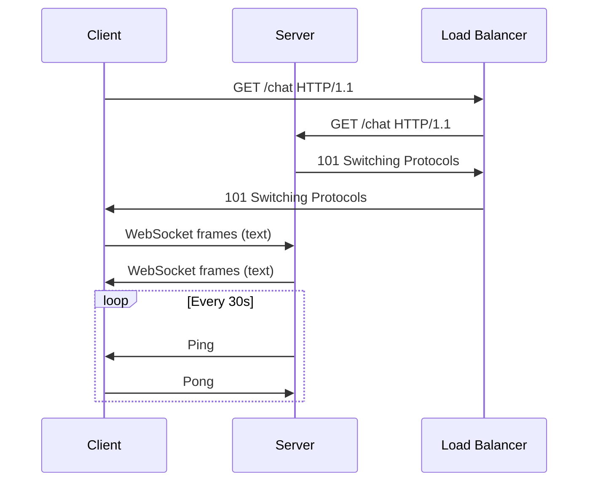

<!-- Generated by Groq via GitHub Actions -->
<!-- Topic ID: T254 -->
<!-- Category: API Architecture -->
<!-- Generated at UTC: 2026-11-25T10:00:04.018292+00:00 -->

# WebSockets

## 1. What problem does this solve?

| Problem | Why it matters | Consequence if ignored | Real‑world use |
|---------|----------------|------------------------|----------------|
| **Real‑time, low‑latency communication** | Users expect instant feedback (chat, live dashboards, multiplayer). | Polling or long‑polling adds latency, increases server load, and wastes bandwidth. | Slack, Discord, live stock tickers, collaborative editors. |
| **Full‑duplex, persistent connection** | HTTP is request/response and stateless; the server cannot push data. | Server must keep polling clients or rely on client‑initiated requests. | Multiplayer games, IoT telemetry, real‑time analytics. |
| **Efficient use of resources** | A single TCP connection can carry many messages, reducing connection overhead. | Each request opens a new TCP handshake, increasing latency and resource consumption. | High‑frequency trading platforms, live sports score updates. |

If WebSockets are not used, developers must resort to polling, long‑polling, or Server‑Sent Events (SSE). These approaches either increase latency, consume more bandwidth, or are limited to one‑way communication.

---

## 2. Mental model

### Analogy  
Think of a **telephone call** versus **mail**.  
- **Mail**: You write a letter, send it, and wait for a reply.  
- **Telephone**: You dial, talk, and both parties can speak freely at any time.  

WebSockets are the telephone: once the connection is established, both client and server can send messages whenever they want, without re‑initiating a new connection.

### Engineering model  
1. **TCP connection** – the underlying transport.  
2. **HTTP Upgrade** – the client requests to switch protocols.  
3. **WebSocket handshake** – server accepts and upgrades the connection.  
4. **Framed binary/text messages** – data is sent over the open channel.  
5. **Ping/Pong & Close frames** – keep‑alive and graceful shutdown.

---

## 3. Deep explanation

### Internals
- **Handshake**: HTTP/1.1 `GET /ws HTTP/1.1` with `Upgrade: websocket`, `Connection: Upgrade`, `Sec-WebSocket-Key`, `Sec-WebSocket-Version`.  
- **Framing**: Each message is a frame with a 2‑byte header, optional masking key, and payload.  
- **Opcodes**: `0x1` (text), `0x2` (binary), `0x8` (close), `0x9` (ping), `0xA` (pong).  
- **Masking**: Clients mask payloads; servers do not.  
- **Extensions**: e.g., permessage-deflate for compression.

### Important terminology
- **Subprotocol**: Application‑level protocol negotiated during handshake (e.g., `"chat"`).  
- **Ping/Pong**: Heartbeat frames to detect dead connections.  
- **Close frame**: Graceful termination with a status code.  
- **Backpressure**: When the receiver cannot keep up with the sender’s rate.

### Trade‑offs
| Aspect | WebSocket | Alternatives |
|--------|-----------|--------------|
| Latency | Very low (≈ 1‑2 ms) | Polling (high), SSE (one‑way) |
| Complexity | Requires handling framing, ping/pong, reconnection | Simpler HTTP requests |
| Scalability | Needs sticky sessions or message broker | Stateless HTTP can scale out easily |
| Firewall traversal | Works through most proxies (but may need TLS) | HTTP/2, SSE also work |

### Failure modes
- **Connection drop**: Network hiccup, server restart.  
- **Fragmentation**: Large messages split across frames.  
- **Backpressure**: Client’s receive buffer full → server must pause or drop.  
- **Resource exhaustion**: Too many open sockets → memory blowup.

### Limitations
- Not ideal for large file transfer (use HTTP/2 or S3).  
- Some older proxies strip `Upgrade` headers.  
- No built‑in load balancing; requires sticky sessions or a message broker.

### Where it fits
- **Event‑driven services**: Push notifications, real‑time analytics.  
- **Microservices**: Use a broker (Redis Pub/Sub, Kafka) to fan‑out messages across instances.  
- **Client‑side**: React, Vue, or plain JS consuming real‑time data.

### Interaction with related concepts
- **HTTP**: Handshake starts as HTTP.  
- **TLS**: `wss://` for encrypted traffic.  
- **JWT/OAuth**: Authentication during handshake.  
- **Redis/Kafka**: Scale horizontally by broadcasting to all nodes.  
- **Load balancers**: Must support sticky sessions or use WebSocket‑aware proxies.

---

## 4. How it works



**Step‑by‑step flow**

1. **Client initiates HTTP GET** with `Upgrade: websocket`.  
2. **Server validates** headers, performs crypto handshake (`Sec-WebSocket-Key`).  
3. **Server responds 101 Switching Protocols**.  
4. **TCP connection stays open**; both sides now speak WebSocket frames.  
5. **Data exchange**: frames are sent as needed.  
6. **Keep‑alive**: Ping/Pong frames keep the connection alive.  
7. **Close**: Either side sends a Close frame; the other acknowledges.

---

## 5. Practical implementation

### Node.js + TypeScript (using `ws`)

```ts
// src/server.ts
import { createServer } from 'http';
import { WebSocketServer, WebSocket } from 'ws';
import jwt from 'jsonwebtoken';
import { Pool } from 'pg';

const httpServer = createServer();
const wss = new WebSocketServer({ server: httpServer });

const pool = new Pool({
  connectionString: process.env.DATABASE_URL,
});

interface Client extends WebSocket {
  userId: string | null;
}

wss.on('connection', async (ws: Client, req) => {
  // 1️⃣ Authenticate via query param or header
  const token = req.headers['sec-websocket-protocol'] as string | undefined;
  try {
    const payload = jwt.verify(token || '', process.env.JWT_SECRET!) as { sub: string };
    ws.userId = payload.sub;
  } catch {
    ws.close(1008, 'Unauthorized');
    return;
  }

  // 2️⃣ Store connection in memory (for demo)
  const clients = new Set<Client>();
  clients.add(ws);

  // 3️⃣ Handle incoming messages
  ws.on('message', async (data) => {
    const msg = JSON.parse(data.toString());
    // Persist to DB
    await pool.query(
      'INSERT INTO messages(user_id, content) VALUES($1, $2)',
      [ws.userId, msg.text]
    );
    // Broadcast to all clients
    for (const c of clients) {
      if (c.readyState === WebSocket.OPEN) {
        c.send(JSON.stringify({ userId: ws.userId, text: msg.text }));
      }
    }
  });

  // 4️⃣ Clean up on close
  ws.on('close', () => {
    clients.delete(ws);
  });
});

httpServer.listen(3000, () => {
  console.log('WebSocket server listening on ws://localhost:3000');
});
```

> **Key lines explained**  
> *Line 12‑17*: Verify JWT passed in `Sec-WebSocket-Protocol` header.  
> *Line 23*: Store each connection in a `Set` for broadcasting.  
> *Line 28‑35*: Persist message to PostgreSQL and broadcast.  
> *Line 39*: Remove connection from the set on close.

### FastAPI (Python) example

```py
# main.py
from fastapi import FastAPI, WebSocket, WebSocketDisconnect
import jwt

app = FastAPI()

@app.websocket("/ws")
async def websocket_endpoint(ws: WebSocket):
    await ws.accept()
    token = ws.headers.get("Sec-WebSocket-Protocol")
    try:
        payload = jwt.decode(token, "secret", algorithms=["HS256"])
        user_id = payload["sub"]
    except Exception:
        await ws.close(code=1008)
        return

    try:
        while True:
            data = await ws.receive_text()
            # Broadcast or store...
            await ws.send_text(f"[{user_id}] {data}")
    except WebSocketDisconnect:
        pass
```

---

## 6. Production considerations

| Concern | What to do | Why |
|---------|------------|-----|
| **Scalability** | Use sticky sessions or a message broker (Redis Pub/Sub, Kafka). | WebSocket connections are stateful; load balancers must route to the same node. |
| **Reliability** | Implement ping/pong heartbeats, exponential backoff reconnection, graceful shutdown. | Detect dead connections early and recover. |
| **Security** | Enforce `wss://`, validate origin, use JWT/OAuth, rate‑limit, TLS termination at LB. | Prevent MITM, CSRF, and DoS. |
| **Observability** | Emit metrics: connection count, message latency, error codes; log close reasons. | Spot capacity issues and bugs. |
| **Performance** | Use binary frames for large payloads, enable permessage-deflate, backpressure handling. | Reduce bandwidth and CPU. |
| **Error handling** | Send proper close codes, log stack traces, retry on transient DB errors. | Easier debugging and resilience. |
| **Resource usage** | Monitor memory per socket; consider using a lightweight library or native `http2` if possible. | Avoid OOM. |
| **Operational** | Deploy in containers, expose health endpoints, use Kubernetes `Service` with `sessionAffinity`. | Consistent scaling and rolling updates. |
| **Failure recovery** | Persist state (e.g., last message ID) so clients can catch up after reconnect. | Prevent data loss. |
| **Deployment** | Ensure LB supports WebSocket (e.g., Nginx, Traefik, AWS ALB). | Avoid dropped connections. |

---

## 7. Common mistakes

| Mistake | Why it hurts |
|---------|--------------|
| **Ignoring ping/pong** | Idle connections get closed by proxies or firewalls. |
| **Using plain `ws://` in production** | Traffic is unencrypted; MITM attacks possible. |
| **Blocking the event loop** | Heavy DB queries or CPU work inside `message` handler stalls all sockets. |
| **No backpressure** | Sending too fast can overflow client buffers → dropped messages. |
| **Not closing sockets on error** | Memory leaks, stale connections. |
| **Hard‑coding client IDs** | Security risk; use JWT or session tokens. |
| **Scaling without sticky sessions** | Clients lose connection when LB routes to a different node. |
| **Using WebSocket for large file uploads** | Inefficient; use HTTP multipart or presigned URLs. |

---

## 8. Senior engineer perspective

### Design decisions

- **Library choice**: `ws` (lightweight) vs. `socket.io` (feature‑rich).  
- **Scaling strategy**:  
  - *Sticky sessions* (Nginx, AWS ALB) for small clusters.  
  - *Message broker* (Redis, Kafka) for large, stateless clusters.  
- **Protocol**: Prefer raw WebSocket for low latency; add subprotocols for versioning.  
- **Compression**: Enable `permessage-deflate` only if bandwidth is a bottleneck.  
- **Monitoring**: Use Prometheus metrics (`ws_connections_total`, `ws_messages_sent_total`).  
- **Security**: Enforce TLS, validate origins, use JWT with short expiry.  
- **Observability**: Trace each message with OpenTelemetry.  

### Bottlenecks

- **Memory per socket**: ~1–2 MB; 10k sockets ≈ 20 GB.  
- **CPU for framing/compression**: high throughput can saturate CPU.  
- **Network I/O**: saturate NIC if many large messages.

### Failure scenarios

- **Network partition**: Clients reconnect to different node; need a shared state store.  
- **Server crash**: Clients receive close code 1011; implement auto‑reconnect.  
- **Load balancer misconfiguration**: Connections dropped; monitor `ws_connection_errors`.

### When NOT to use

- Low‑frequency updates (polling is simpler).  
- Environments with strict firewall rules that block `Upgrade` headers.  
- When you need to support legacy browsers that lack WebSocket support.

---

## 9. Interview questions

1. **Beginner** – *What is a WebSocket and how does it differ from HTTP?*  
   *Answer points:*  
   - Persistent, full‑duplex TCP connection.  
   - Starts with HTTP Upgrade.  
   - No request/response cycle after handshake.  

2. **Beginner** – *Explain the purpose of the Ping/Pong frames in WebSockets.*  
   *Answer points:*  
   - Keep‑alive to detect dead connections.  
   - Prevent idle timeouts by proxies.  

3. **Senior** – *How would you scale a WebSocket service across multiple nodes?*  
   *Answer points:*  
   - Sticky sessions or load‑balancer that supports WebSocket.  
   - Use a message broker (Redis Pub/Sub, Kafka) to broadcast events.  
   - Store connection metadata in a shared store.  

4. **Senior** – *Describe how you would handle backpressure in a WebSocket server.*  
   *Answer points:*  
   - Check `socket.bufferedAmount`.  
   - Pause sending when above threshold.  
   - Use flow‑control or drop messages with priority.  

5. **Scenario** – *A client receives a close frame with code 1006. What does it mean and how would you debug?*  
   *Answer points:*  
   - 1006 is “Abnormal Closure” (no close frame sent).  
   - Likely network issue or abrupt server shutdown.  
   - Check server logs, network traces, TLS handshake errors.  

---

## 10. Hands‑on task

**Build a real‑time chat server**

1. **Create a Node.js project** with `ws` and `pg`.  
2. **Implement JWT authentication** during the WebSocket handshake.  
3. **Persist every message** to PostgreSQL (`messages` table).  
4. **Broadcast** each new message to all connected clients.  
5. **Add a simple HTML client** that connects, sends, and displays messages.  
6. **Deploy** locally using Docker Compose (PostgreSQL + Node).  

*Goal:* Observe connection handling, message flow, and persistence.

---

## 11. Quick revision

- WebSocket = persistent, full‑duplex TCP over HTTP Upgrade.  
- Handshake: `GET /ws HTTP/1.1` → `101 Switching Protocols`.  
- Frames: opcode, masking, payload length.  
- Ping/Pong keep‑alive; Close frames terminate.  
- Scaling needs sticky sessions or a broker.  
- Security: `wss://`, origin check, JWT, TLS.  
- Backpressure: monitor `bufferedAmount`, pause sending.  
- Common pitfalls: no ping, blocking code, no graceful close.  
- Metrics: connection count, message rate, error codes.  

---

## 12. References

- [RFC 6455 – The WebSocket Protocol](https://datatracker.ietf.org/doc/html/rfc6455)  
- [ws – WebSocket library for Node.js](https://github.com/websockets/ws)  
- [FastAPI WebSockets](https://fastapi.tiangolo.com/advanced/websockets/)  
- [Kubernetes Service Session Affinity](https://kubernetes.io/docs/concepts/services-networking/service/#session-affinity)  
- [Traefik WebSocket support](https://doc.traefik.io/traefik/routing/entrypoints/#websocket-support)  
- [OpenTelemetry WebSocket instrumentation](https://opentelemetry.io/docs/instrumentation/js/)  

---
