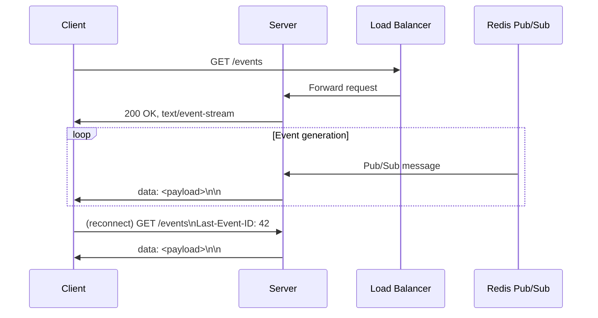

<!-- Generated by Groq via GitHub Actions -->
<!-- Topic ID: T255 -->
<!-- Category: API Architecture -->
<!-- Generated at UTC: 2026-11-25T22:39:39.225463+00:00 -->

# SSE

## 1. What problem does this solve?

**Motivation**  
Modern web applications often need to push real‑time updates to clients: chat messages, live dashboards, notifications, or collaborative editing. Traditionally, the client would poll the server every few seconds, wasting bandwidth and increasing latency.

**Problem**  
- **Polling overhead**: Repeated HTTP requests consume CPU, memory, and network resources on both client and server.  
- **Latency**: Updates are only delivered when the next poll occurs, leading to delays.  
- **Complexity**: Implementing long‑polling or WebSocket fallbacks adds code and maintenance burden.

**Why it matters**  
Real‑time feedback improves user experience, reduces server load compared to frequent polling, and simplifies the client‑side logic compared to WebSockets (no need for a full duplex protocol).

**Consequences of not using SSE**  
- Higher server cost due to more connections and traffic.  
- Slower UI updates, leading to a stale or unresponsive interface.  
- More complex code paths for reconnection, heartbeats, and error handling.

**Where it appears**  
- Live analytics dashboards (e.g., Grafana, Kibana).  
- Notification systems (e.g., Slack, Discord).  
- Real‑time chat or comment streams.  
- Collaborative tools (e.g., Google Docs, Figma).  
- IoT dashboards that stream sensor data.

---

## 2. Mental model

**Analogy**  
Think of SSE as a *one‑way radio broadcast*. The server is a radio station that continuously streams a single channel of information. Clients tune in, listen, and if they lose the signal, they simply re‑join the broadcast. There is no back‑channel communication from the client to the server in the same stream.

**Engineering model**  
- **HTTP/1.1 persistent connection**: The client opens a single GET request and keeps it open.  
- **Content‑type `text/event-stream`**: The server sends a stream of UTF‑8 text lines.  
- **Event format**: Each event is a block of lines ending with a double newline.  
- **Reconnection**: The client automatically reconnects on network failure, optionally sending `Last-Event-ID` to resume from where it left off.

---

## 3. Deep explanation

### Internals
- **Server**: Sends `HTTP/1.1 200 OK` with `Content-Type: text/event-stream`, `Cache-Control: no-cache`, and `Connection: keep-alive`.  
- **Event framing**:  
  ```
  event: <event-name>
  id: <event-id>
  data: <payload>
  
  ```
  Each event ends with a blank line.  
- **Heartbeat**: Optional `retry: <ms>` and `data: \n` lines keep the connection alive.

### Important terminology
- **Event**: A logical unit of data sent to the client.  
- **Event ID**: Optional numeric or string identifier used for reconnection.  
- **Retry**: Suggested reconnection delay in milliseconds.  
- **Last‑Event‑ID**: Header sent by the client to resume from a specific event.

### Trade‑offs
| Feature | SSE | WebSocket |
|---------|-----|-----------|
| **Protocol** | HTTP/1.1 | TCP (WebSocket handshake over HTTP) |
| **Direction** | Server → Client | Bidirectional |
| **Complexity** | Simple API (`EventSource`) | Requires framing, ping/pong, etc. |
| **Browser support** | Native in all modern browsers | Native in all modern browsers |
| **Scaling** | Easier to scale with HTTP load balancers | Requires sticky sessions or WebSocket‑aware load balancers |
| **Firewall friendliness** | Uses standard HTTP ports | May be blocked by strict firewalls |

### Failure modes
- **Connection drop**: Client automatically reconnects; server must handle idempotency.  
- **Backpressure**: If the client processes events slower than they are sent, the server may block; use `res.write()` with backpressure handling.  
- **Event loss**: If the client disconnects before receiving an event, it will be lost unless stored and replayed.

### Limitations
- **No client‑to‑server messages** in the same stream.  
- **No binary data** (only UTF‑8 text).  
- **HTTP/1.1 only** (though HTTP/2 can multiplex, but SSE still uses a single stream).  
- **Large payloads**: Each event is a text block; large binary blobs are inefficient.

### Where it fits in a backend architecture
- **Event producers**: Microservices or background workers publish events (e.g., via Redis Pub/Sub, Kafka).  
- **Event dispatcher**: A dedicated HTTP endpoint streams events to connected clients.  
- **Persistence layer**: Store events in PostgreSQL or MongoDB for replay or audit.  
- **Load balancer**: Must preserve the open connection (sticky sessions or HTTP/2 multiplexing).  
- **Client**: Uses the `EventSource` API or a polyfill.

### Interaction with related concepts
- **Redis Pub/Sub**: Efficient in‑memory broadcast to multiple SSE streams.  
- **Kafka**: Durable event store; can replay events to new clients.  
- **Webhooks**: SSE can be seen as a server‑initiated webhook to browsers.  
- **GraphQL Subscriptions**: Often implemented over WebSockets; SSE is an alternative for simple push.

---

## 4. How it works

1. **Client** sends a `GET /events` request with `Accept: text/event-stream`.  
2. **Server** responds with `200 OK`, sets `Content-Type: text/event-stream`, `Cache-Control: no-cache`, and keeps the connection open.  
3. **Server** writes events as text blocks, each ending with a double newline.  
4. **Client** parses the stream, emits events to JavaScript listeners.  
5. **If the connection drops**, the client automatically reconnects, sending `Last-Event-ID` if available.  
6. **Server** resumes sending events with IDs greater than the last received.  



---

## 5. Practical implementation

### 5.1 Server (Node.js + Express)

```ts
// src/server.ts
import express from 'express';
import { createServer } from 'http';
import { Server } from 'socket.io';
import { createClient } from 'redis';

const app = express();
const httpServer = createServer(app);
const redis = createClient(); // default localhost:6379

// SSE endpoint
app.get('/events', async (req, res) => {
  // Set headers
  res.writeHead(200, {
    'Content-Type': 'text/event-stream',
    'Cache-Control': 'no-cache',
    Connection: 'keep-alive',
  });

  // Optional: send a heartbeat every 15s
  const heartbeat = setInterval(() => {
    res.write(`data: \n\n`);
  }, 15000);

  // Subscribe to Redis channel
  const subscriber = redis.duplicate();
  await subscriber.connect();
  await subscriber.subscribe('updates', (message) => {
    const eventId = Date.now(); // simple incremental id
    res.write(`id: ${eventId}\n`);
    res.write(`event: update\n`);
    res.write(`data: ${message}\n\n`);
  });

  // Clean up on client disconnect
  req.on('close', async () => {
    clearInterval(heartbeat);
    await subscriber.disconnect();
    res.end();
  });
});

httpServer.listen(3000, () => {
  console.log('SSE server listening on http://localhost:3000/events');
});
```

**Key lines**  
- `Content-Type: text/event-stream` tells the browser to treat the response as an event stream.  
- `res.write()` streams data without closing the connection.  
- `req.on('close')` cleans up resources when the client disconnects.

### 5.2 Client (browser)

```html
<script>
  const evtSource = new EventSource('/events');

  evtSource.addEventListener('update', (e) => {
    console.log('New update:', e.data);
  });

  evtSource.onerror = (err) => {
    console.error('EventSource failed:', err);
  };
</script>
```

### 5.3 Publishing events (Redis CLI)

```bash
redis-cli
> PUBLISH updates '{"user":"alice","action":"login"}'
```

The server will stream this JSON payload to all connected clients.

---

## 6. Production considerations

| Concern | Recommendation |
|---------|----------------|
| **Scalability** | Use a reverse proxy (NGINX, HAProxy) that supports HTTP/1.1 keep‑alive and sticky sessions. Scale horizontally; each instance subscribes to the same Redis channel. |
| **Reliability** | Store events in a durable store (PostgreSQL, Kafka) so that clients can replay missed events after reconnection. |
| **Security** | Authenticate the SSE endpoint (JWT, session cookie). Use HTTPS to protect data in transit. |
| **Observability** | Log connection counts, event rates, and backpressure warnings. Expose metrics (Prometheus) for `sse_connections_total`, `sse_events_sent_total`. |
| **Performance** | Avoid large payloads; compress with gzip if needed. Use backpressure handling (`res.write()` returns false). |
| **Error handling** | Catch and log errors from Redis or network failures. Send `retry: 5000` to suggest reconnection delay. |
| **Resource usage** | Each open connection consumes a file descriptor. Monitor limits (`ulimit -n`). |
| **Operational concerns** | Ensure Redis is highly available (replica + failover). Use a message broker (Kafka) if you need guaranteed delivery. |
| **Failure recovery** | On server restart, clients reconnect automatically. Use `Last-Event-ID` to resume. |
| **Deployment** | Containerize the app; expose only port 80/443. Use health checks that verify the SSE endpoint responds with `200 OK`. |

---

## 7. Common mistakes

| Mistake | Why it’s problematic |
|---------|----------------------|
| **Using `res.send()` instead of `res.write()`** | `res.send()` ends the response, closing the stream. |
| **Not setting `Cache-Control: no-cache`** | Browsers may cache the stream, leading to stale data. |
| **Ignoring backpressure** | `res.write()` may block; if you ignore the returned boolean, you can exhaust memory. |
| **Sending binary data** | SSE expects UTF‑8 text; binary blobs will corrupt the stream. |
| **Not handling reconnection** | Clients may lose events if they don’t send `Last-Event-ID`. |
| **Using HTTP/2 without sticky sessions** | Load balancers may split the stream across instances, breaking continuity. |
| **Hard‑coding event IDs** | Duplicate IDs cause clients to ignore events; use monotonically increasing IDs. |
| **Not closing Redis subscriptions** | Memory leaks on client disconnect. |

---

## 8. Senior engineer perspective

### Architecture decisions
- **Event store**: Choose between Redis (fast, in‑memory) vs Kafka (durable, replay).  
- **Load balancing**: Prefer HTTP/2 or sticky sessions; consider using a dedicated SSE gateway.  
- **Backpressure strategy**: Implement flow control or drop policy for slow clients.  
- **Security**: Token‑based authentication per connection; rate limiting.  

### Trade‑offs
- **SSE vs WebSocket**: SSE is simpler but limited to server‑to‑client. If you need two‑way communication, WebSockets or gRPC‑web may be better.  
- **Cost**: Keeping many long‑lived connections can increase server memory usage; consider serverless functions with WebSocket support (e.g., AWS API Gateway).  

### Bottlenecks
- **Connection count**: Each open SSE connection consumes a file descriptor; monitor limits.  
- **Redis pub/sub**: Not durable; if Redis restarts, events are lost. Use a persistent broker if needed.  

### Failure scenarios
- **Redis outage**: Clients will stop receiving events; implement fallback or retry logic.  
- **Server crash**: Clients reconnect automatically; ensure idempotent event handling.  

### Monitoring
- **Metrics**: `sse_active_connections`, `sse_events_sent`, `sse_backpressure_events`.  
- **Logs**: Connection open/close, error codes, retry attempts.  

### Cost/performance
- **Memory**: Each connection holds a buffer; tune `highWaterMark`.  
- **CPU**: Event serialization and I/O; offload heavy processing to workers.  

### When NOT to use SSE
- Need client‑to‑server messages in the same channel.  
- High‑frequency bidirectional communication (e.g., multiplayer games).  
- Environments where HTTP/1.1 keep‑alive is not supported (some corporate proxies).  

---

## 9. Interview questions

1. **Beginner**: *What HTTP headers must be set for an SSE endpoint?*  
   *Answer*: `Content-Type: text/event-stream`, `Cache-Control: no-cache`, `Connection: keep-alive`.  

2. **Beginner**: *How does the client automatically reconnect after a network failure?*  
   *Answer*: The `EventSource` API automatically issues a new GET request, optionally sending `Last-Event-ID`.  

3. **Senior**: *Explain how you would scale an SSE service behind a load balancer.*  
   *Answer points*: Use sticky sessions or HTTP/2 multiplexing; each instance subscribes to the same event source (Redis/Kafka); handle reconnection with `Last-Event-ID`; monitor connection limits.  

4. **Senior**: *Compare SSE and WebSockets in terms of protocol overhead and use cases.*  
   *Answer points*: SSE uses HTTP/1.1, single‑direction, simpler API, no binary; WebSocket is full duplex, lower latency, supports binary, requires ping/pong, more complex.  

5. **Scenario/Debugging**: *A client receives events but after a few minutes the connection stops receiving new events. What could be wrong and how would you investigate?*  
   *Answer points*: Check for backpressure (`res.write()` returning false), client side `EventSource` error handling, server logs for dropped connections, Redis pub/sub lag, load balancer timeouts, network issues. Use `curl -v` to inspect headers, enable Prometheus metrics.  

---

## 10. Hands‑on task

**Goal**: Build a small dashboard that shows live temperature readings from a simulated sensor.

1. **Create a Node.js Express server** with an SSE endpoint `/temperature`.  
2. **Simulate a sensor** that publishes a random temperature every 2 s to a Redis channel `sensor:temp`.  
3. **Client**: A simple HTML page that connects to `/temperature` and displays the latest value.  
4. **Enhancement**: Add a button to pause/resume the stream (client‑side only).  

**Deliverables**  
- `server.ts` with SSE logic.  
- `sensor.js` that publishes to Redis.  
- `index.html` that consumes the stream.  

Run with `npm run dev` and open `http://localhost:3000` to see live updates.

---

## 11. Quick revision

- SSE is a one‑way HTTP/1.1 streaming protocol (`text/event-stream`).  
- Client uses `EventSource`; server writes events with `id`, `event`, `data`.  
- Keep‑alive: send `retry:` or empty `data:` lines.  
- Reconnection: client sends `Last-Event-ID`; server resumes from that ID.  
- Backpressure: monitor `res.write()` return value; use `highWaterMark`.  
- Scaling: sticky sessions or HTTP/2; each instance subscribes to the same event source.  
- Security: HTTPS, authentication, rate limiting.  
- Observability: metrics for connections, events, backpressure.  
- Common pitfalls: using `res.send()`, ignoring backpressure, not closing Redis subs.  
- SSE vs WebSocket: SSE is simpler but only server‑to‑client; WebSocket is full duplex.  

---

## 12. References

- [MDN Web Docs – Server-sent events](https://developer.mozilla.org/en-US/docs/Web/API/Server-sent_events)  
- [HTML Living Standard – EventSource](https://html.spec.whatwg.org/multipage/server-sent-events.html)  
- [Node.js – http module](https://nodejs.org/api/http.html)  
- [Express.js – SSE example](https://expressjs.com/en/advanced/best-practice-performance.html#streaming)  
- [Redis Pub/Sub](https://redis.io/docs/manual/pubsub/)  
- [FastAPI – Streaming responses](https://fastapi.tiangolo.com/tutorial/streaming-response/)  

---
