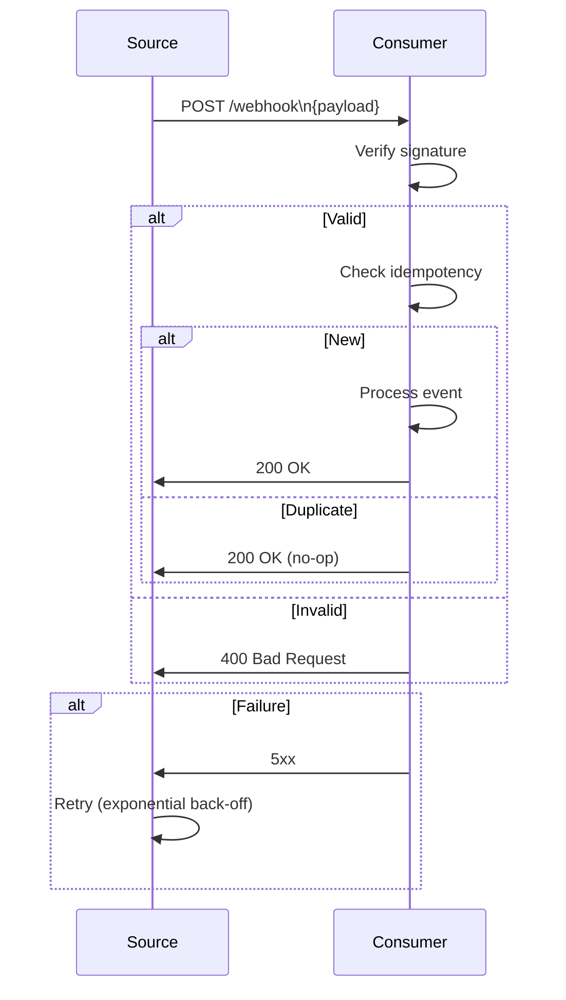

<!-- Generated by Groq via GitHub Actions -->
<!-- Topic ID: T256 -->
<!-- Category: API Architecture -->
<!-- Generated at UTC: 2026-11-25T22:39:39.225463+00:00 -->

# Webhooks

## 1. What problem does this solve?

| What problem exists | Why it matters | Consequences of not using it | Real‑world use cases |
|---------------------|----------------|------------------------------|----------------------|
| **Real‑time integration** – A service needs to react immediately when an event happens in another system (e.g., a payment succeeds, a user signs up). | Users expect instant updates (e.g., order status, notification). | Polling is wasteful, adds latency, and can overload the provider. | Stripe payment success → update order status. |
| **Decoupling** – Services should not need to know each other’s internal APIs or run continuous sync jobs. | Keeps services loosely coupled and easier to evolve independently. | Tight coupling leads to brittle integrations and hard‑to‑maintain code. | GitHub webhook to trigger CI/CD pipeline. |
| **Scalable event delivery** – Sending events to many subscribers without each having to poll. | Avoids a single service becoming a bottleneck. | One service becomes a single point of failure or a traffic bottleneck. | Slack incoming webhooks for notifications. |

In many backend systems, a webhook is the bridge that turns an event in one service into an HTTP request to another service, enabling real‑time, push‑style communication.

---

## 2. Mental model

### Analogy: The Mailbox

Think of a webhook as a **mailbox** that a sender (the event source) drops a letter (payload) into, and the recipient (the webhook consumer) picks it up. The mailbox is always open; the sender doesn’t need to ask if the recipient is ready. The recipient can read the letter whenever they want, but they must keep track of which letters they’ve already processed to avoid double‑counting.

### Engineering model

1. **Event source** publishes an event.  
2. It **POSTs** a JSON payload to a **registered URL** (the consumer’s endpoint).  
3. The consumer **validates** the request (signature, headers).  
4. The consumer **processes** the event, often persisting it or triggering downstream work.  
5. If processing fails, the source **retries** (exponential back‑off).  

The key properties are: **push‑style** (source initiates), **stateless HTTP** (no long‑lived connections), and **idempotency** (consumer can safely retry).

---

## 3. Deep explanation

### Internals

| Term | Meaning |
|------|---------|
| **Event** | A domain‑specific occurrence (e.g., `payment.succeeded`). |
| **Payload** | JSON body containing event data. |
| **Endpoint** | The consumer’s URL that receives the POST. |
| **Signature** | HMAC or JWT that proves the payload came from the source. |
| **Idempotency key** | Unique identifier (often event ID) that lets the consumer ignore duplicates. |
| **Retry policy** | Strategy for the source to re‑POST on failure (max attempts, back‑off). |
| **Webhook secret** | Shared secret used to compute the signature. |

### Trade‑offs

| Aspect | Push (webhook) | Pull (polling) |
|--------|----------------|----------------|
| Latency | Near‑instant | Depends on poll interval |
| Load on source | One request per event | Continuous requests |
| Complexity | Requires endpoint, validation | Simple client logic |
| Reliability | Depends on retry strategy | Can be tuned per request |
| Ordering | Not guaranteed | Can be enforced by client |

### Failure modes

1. **Network failure** – source cannot reach consumer.  
2. **Consumer crash** – request times out or returns 5xx.  
3. **Duplicate delivery** – source retries, consumer processes twice.  
4. **Signature mismatch** – attacker or misconfiguration.  
5. **Rate limiting** – consumer overwhelmed by bursts.

### Limitations

* No built‑in guarantee of delivery or ordering.  
* Requires consumer to expose a public HTTPS endpoint.  
* Scaling to millions of events can overwhelm the source if retries are aggressive.

### Where it fits

* **Event‑driven microservices** – services emit events to external systems.  
* **Integration layer** – bridges SaaS products (Stripe, GitHub).  
* **Serverless triggers** – AWS Lambda can be invoked via webhook.

### Interaction with related concepts

* **Message queues (Kafka, RabbitMQ)** – provide ordering and persistence; webhooks are lighter but less reliable.  
* **Polling** – simpler but adds latency; often used when the source cannot push.  
* **Serverless functions** – ideal consumers; can auto‑scale.  
* **Idempotency** – crucial for safe retries; often implemented with a database or Redis.

---

## 4. How it works

1. **Consumer registers** a webhook URL with the source.  
2. Source stores the URL and optional secret.  
3. When an event occurs, source **creates** a payload and **POSTs** it to the URL.  
4. Source sets `Content-Type: application/json` and a `X-Signature` header.  
5. Consumer **validates** the signature.  
6. Consumer checks the **idempotency key**; if already processed, it returns 200 without side effects.  
7. Consumer processes the event (e.g., updates DB).  
8. Consumer returns 2xx → source stops retrying.  
9. If consumer returns 5xx or times out, source **retries** according to its policy.



---

## 5. Practical implementation

### 5.1 Sending a webhook (Node.js)

```ts
// src/webhookSender.ts
import fetch from 'node-fetch';
import { createHmac } from 'crypto';

const WEBHOOK_SECRET = process.env.WEBHOOK_SECRET!;

export async function sendWebhook(url: string, event: any) {
  const payload = JSON.stringify(event);
  const signature = createHmac('sha256', WEBHOOK_SECRET)
    .update(payload)
    .digest('hex');

  const response = await fetch(url, {
    method: 'POST',
    headers: {
      'Content-Type': 'application/json',
      'X-Signature': signature,
    },
    body: payload,
    timeout: 5000, // 5s timeout
  });

  if (!response.ok) {
    // Simple retry logic
    const retries = 3;
    for (let i = 0; i < retries; i++) {
      await new Promise(r => setTimeout(r, 2 ** i * 1000));
      const retryResp = await fetch(url, {
        method: 'POST',
        headers: { 'Content-Type': 'application/json', 'X-Signature': signature },
        body: payload,
      });
      if (retryResp.ok) return;
    }
    throw new Error(`Webhook failed after retries: ${response.status}`);
  }
}
```

### 5.2 Receiving a webhook (Express + PostgreSQL)

```ts
// src/webhookReceiver.ts
import express from 'express';
import { createHmac } from 'crypto';
import { Pool } from 'pg';

const app = express();
const pool = new Pool(); // assumes PG env vars

const WEBHOOK_SECRET = process.env.WEBHOOK_SECRET!;

// Middleware to parse raw body for signature verification
app.use(express.json({
  verify: (req, res, buf) => {
    (req as any).rawBody = buf;
  },
}));

// Helper: idempotency check
async function isDuplicate(eventId: string) {
  const res = await pool.query(
    'SELECT 1 FROM webhook_events WHERE event_id = $1',
    [eventId]
  );
  return res.rowCount > 0;
}

// Store event (idempotent)
async function storeEvent(event: any) {
  await pool.query(
    `INSERT INTO webhook_events (event_id, payload, received_at)
     VALUES ($1, $2, NOW())
     ON CONFLICT (event_id) DO NOTHING`,
    [event.id, event]
  );
}

// Endpoint
app.post('/webhook', async (req, res) => {
  const raw = (req as any).rawBody;
  const signature = req.headers['x-signature'] as string;

  // Verify signature
  const expected = createHmac('sha256', WEBHOOK_SECRET)
    .update(raw)
    .digest('hex');
  if (signature !== expected) {
    return res.status(400).send('Invalid signature');
  }

  const event = req.body;

  // Idempotency
  if (await isDuplicate(event.id)) {
    return res.status(200).send('Already processed');
  }

  try {
    // Business logic here (e.g., update order)
    await storeEvent(event);
    // ... other async work
    res.status(200).send('OK');
  } catch (err) {
    console.error(err);
    res.status(500).send('Processing error');
  }
});

app.listen(3000, () => console.log('Webhook receiver listening on 3000'));
```

**Database schema**

```sql
CREATE TABLE webhook_events (
  event_id TEXT PRIMARY KEY,
  payload JSONB NOT NULL,
  received_at TIMESTAMPTZ NOT NULL
);
```

---

## 6. Production considerations

| Concern | How to address |
|---------|----------------|
| **Scalability** | Use a load balancer, horizontal scaling of the consumer. Store idempotency keys in a fast store (Redis) or a sharded DB. |
| **Reliability** | Implement retries with exponential back‑off. Use circuit breakers if the consumer is down. |
| **Security** | Verify signatures; use HTTPS; rotate secrets; rate limit incoming requests. |
| **Observability** | Log request IDs, payload sizes, latency. Expose metrics (Prometheus) for success/failure rates. |
| **Performance** | Keep the consumer stateless; offload heavy work to background jobs (Bull, Sidekiq). |
| **Error handling** | Return 5xx for transient errors; 4xx for malformed requests. |
| **Resource usage** | Monitor memory, CPU; use connection pooling for DB. |
| **Operational concerns** | Provide a health endpoint; enable graceful shutdown. |
| **Failure recovery** | Store events before processing; replay from event store if needed. |
| **Deployment** | Use blue/green or canary releases; keep webhook URLs stable. |

---

## 7. Common mistakes

| Mistake | Why it’s problematic |
|---------|----------------------|
| **No idempotency** | Duplicate events cause double charges, duplicate records. |
| **No signature verification** | Open to replay attacks and spoofed events. |
| **No retry policy** | Single failure can lose critical data. |
| **Blocking processing in the HTTP handler** | Causes timeouts and unnecessary retries. |
| **Hard‑coding secrets** | Exposes secrets in code repos. |
| **Ignoring rate limits** | Can be throttled by the source, leading to missed events. |
| **Not handling large payloads** | May exceed request size limits or memory. |
| **Using GET instead of POST** | Semantically wrong; GET should be idempotent. |

---

## 8. Senior engineer perspective

When scaling webhooks to millions of events per day:

1. **Architecture**  
   * Decouple the source from the consumer via a **message queue** (Kafka) that stores events before pushing to the webhook.  
   * Use **serverless functions** (AWS Lambda) for the consumer to auto‑scale.  
   * Store idempotency keys in a **distributed cache** (Redis cluster) to avoid DB bottlenecks.

2. **Trade‑offs**  
   * **Latency vs. reliability** – adding a queue introduces a small delay but guarantees delivery.  
   * **Cost vs. throughput** – serverless can be cheaper at low volume but may cost more at high volume; consider container clusters.

3. **Bottlenecks**  
   * **Signature verification** – CPU‑heavy if many events; consider offloading to a worker pool.  
   * **Database writes** – use bulk inserts or upserts to reduce round‑trips.

4. **Failure scenarios**  
   * **Consumer outage** – queue holds events; source retries until consumer recovers.  
   * **Source outage** – events are queued; consumer can process once source resumes.

5. **Monitoring**  
   * Track **delivery latency**, **retry counts**, **duplicate rates**, **error rates**.  
   * Alert on **high failure rates** or **queue back‑pressure**.

6. **Cost/performance**  
   * Evaluate **request volume** vs. **compute cost**; use **dedicated instances** for high throughput.  
   * Consider **dedicated webhook endpoints** per customer to isolate failures.

7. **When NOT to use**  
   * If the consumer cannot expose a public HTTPS endpoint (e.g., internal services).  
   * If ordering is critical and the source cannot guarantee it.  
   * When the event volume is extremely high and a queue is mandatory.

---

## 9. Interview questions

| Level | Question | Key answer points |
|-------|----------|-------------------|
| Beginner | What is a webhook? | Push‑style HTTP callback; source sends POST to consumer’s URL when an event occurs. |
| Beginner | Why do we need to verify a webhook’s signature? | Prevents spoofed requests; ensures payload integrity; protects against replay attacks. |
| Senior | How would you design a webhook system that can handle 10M events per second? | Use a message queue (Kafka) as buffer, serverless or containerized workers, idempotency store in Redis, horizontal scaling, monitoring, retry back‑off, circuit breakers. |
| Senior | Explain idempotency in webhooks and how you would implement it. | Use event ID or hash; store processed IDs; ignore duplicates; store in DB or cache; design upsert logic. |
| Scenario | A consumer receives duplicate webhook events and ends up double‑charging a customer. What steps would you take to debug and fix this? | Check idempotency key handling; verify source’s retry policy; inspect logs for duplicate IDs; add deduplication logic; add idempotent database upsert; test with replay. |

---

## 10. Hands‑on task

**Task**: Build a minimal webhook system that:

1. **Registers** a consumer URL via a simple REST endpoint (`POST /register`).  
2. **Stores** the URL and secret in a PostgreSQL table.  
3. **Simulates** an event source that triggers a webhook POST to the registered URL.  
4. **Implements** signature verification and idempotency on the consumer side.  
5. **Logs** each event and shows retry behavior when the consumer returns 5xx.

**Steps**:

1. Create two Node.js projects (`source` and `consumer`).  
2. Use `express` for both.  
3. In `consumer`, implement the code from section 5.2.  
4. In `source`, implement a `/trigger` endpoint that reads the consumer URL from the DB and calls `sendWebhook`.  
5. Add a `/health` endpoint to `consumer`.  
6. Run both locally, use `ngrok` to expose the consumer, register it, and trigger events.  
7. Observe retries and idempotency by sending the same event twice.

---

## 11. Quick revision

- Webhook = push‑style HTTP callback triggered by an event.  
- Source → POST → Consumer; consumer must validate signature.  
- **Idempotency key** (event ID) prevents duplicate processing.  
- Retry policy: exponential back‑off, max attempts.  
- Security: HTTPS, HMAC signature, secret rotation.  
- Observability: log request ID, latency, success/failure metrics.  
- Scaling: queue (Kafka), serverless, horizontal scaling, Redis cache.  
- Common pitfalls: no idempotency, no signature check, blocking handler, hard‑coded secrets.  
- Senior design: decouple with queue, monitor retries, use circuit breakers, cost‑aware scaling.  

---

## 12. References

- [Express.js – Request Body Parsing](https://expressjs.com/en/guide/running-application.html#body-parsing)  
- [Node.js crypto – HMAC](https://nodejs.org/api/crypto.html#crypto_crypto_createhmac_algorithm_secret_options)  
- [Stripe Webhook Signing](https://stripe.com/docs/webhooks/signatures)  
- [GitHub Webhooks](https://docs.github.com/en/developers/webhooks-and-events/webhooks)  
- [AWS SNS Webhooks](https://docs.aws.amazon.com/sns/latest/dg/sns-http-ep.html)  
- [Prometheus – Exporter for HTTP metrics](https://prometheus.io/docs/instrumenting/exporters/)  
- [Kafka – High‑throughput messaging](https://kafka.apache.org/documentation/)  
- [Redis – Fast key‑value store](https://redis.io/docs/)  
- [Node‑fetch – HTTP client](https://github.com/node-fetch/node-fetch)  

---
