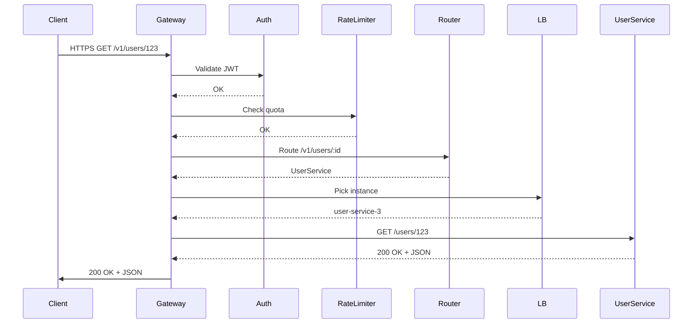

<!-- Generated by Groq via GitHub Actions -->
<!-- Topic ID: T257 -->
<!-- Category: API Architecture -->
<!-- Generated at UTC: 2026-11-26T09:44:28.314274+00:00 -->

# API Gateway

## 1. What problem does this solve?

| Problem | Why it matters | Consequence of not using a gateway | Real‑world example |
|---------|----------------|------------------------------------|--------------------|
| **Multiple entry points** | Microservices expose many HTTP endpoints; clients would need to know each service’s URL. | Fragmented client logic, hard‑to‑maintain SDKs. | A SaaS platform with separate auth, billing, and analytics services. |
| **Cross‑cutting concerns** | Auth, rate limiting, logging, caching, request/response transformation are repeated in every service. | Code duplication, inconsistent security, hard to audit. | Every microservice validates JWTs independently. |
| **Versioning & evolution** | Services evolve independently; clients may need to call different API versions. | Breaking changes ripple through clients. | A payment service releases v2 with new fields. |
| **Load balancing & discovery** | Clients must discover service instances, handle failovers, and distribute traffic. | Manual DNS hacks, increased latency. | A cluster of PostgreSQL replicas behind a load balancer. |
| **Observability & monitoring** | Central point to collect metrics, traces, and logs. | Distributed instrumentation, noisy dashboards. | A monitoring stack that scrapes each service separately. |

Without an API gateway, each microservice becomes a *public* endpoint, exposing internal details, increasing attack surface, and complicating client development. In large systems, this leads to brittle integrations, hard‑to‑debug failures, and security gaps.

## 2. Mental model

### Analogy: The Post Office Hub

Imagine a city where every house (microservice) has its own mailbox. A visitor (client) must know the exact address of each mailbox to drop a letter. The post office hub (API gateway) sits in the city center, receives all letters, authenticates the sender, checks the postage (rate limits), routes the letter to the correct mailbox, and returns a receipt. The visitor only interacts with the hub, not with individual houses.

### Engineering model

- **Reverse proxy**: Accepts HTTP(S) requests and forwards them to backend services.
- **Routing table**: Maps request paths/headers to upstream services.
- **Middleware stack**: Auth, rate limiting, logging, transformation.
- **Service discovery**: Keeps track of healthy instances.
- **Aggregation**: Optionally combine responses from multiple services.

The gateway is the *front door* of your backend ecosystem.

## 3. Deep explanation

### Internals

| Component | Responsibility |
|-----------|----------------|
| **Listener** | Accepts TLS/HTTP connections, performs SNI, HTTP/2 multiplexing. |
| **Router** | Matches request path, method, headers to a route definition. |
| **Auth & Policy Engine** | Validates JWTs, OAuth2 tokens, or API keys; enforces scopes. |
| **Rate Limiter** | Tracks request counts per key/IP; enforces limits. |
| **Load Balancer** | Distributes traffic to healthy instances (round‑robin, least‑conn, etc.). |
| **Health Checker** | Periodically probes upstream services; removes unhealthy nodes. |
| **Transformers** | Modifies request/response bodies, headers, or status codes. |
| **Cache** | Stores responses in Redis or in‑memory for repeat requests. |
| **Circuit Breaker** | Detects upstream failures; short‑circuits requests to fallback. |
| **Observability** | Emits logs, metrics (Prometheus), traces (OpenTelemetry). |

### Important terminology

- **Route**: A mapping from a request pattern to an upstream service.
- **Upstream**: The actual microservice instance handling the request.
- **Middleware**: A pluggable function that runs before/after routing.
- **Policy**: A set of rules (auth, rate limits, quotas) applied to a route.
- **Service registry**: A catalog of service instances (e.g., Consul, Eureka).
- **API version**: Semantic versioning of the contract exposed by a service.

### Trade‑offs

| Trade‑off | Impact |
|-----------|--------|
| **Single point of failure** | Gateway outage blocks all services. Mitigate with clustering. |
| **Latency overhead** | Extra hop adds ~1–5 ms; acceptable for most cases but can accumulate. |
| **Complexity** | Centralized logic can become a maintenance burden. |
| **Vendor lock‑in** | Proprietary gateways (AWS API Gateway) lock you into a cloud. |
| **Feature parity** | Some gateways lack fine‑grained control that custom code can provide. |

### Failure modes

- **Misconfiguration**: Wrong route or auth rule leads to 404 or 403.
- **Overload**: Gateway CPU or memory exhaustion; request throttling.
- **Network partition**: Gateway can’t reach upstream; circuit breaker trips.
- **Cache poisoning**: Stale data served from cache due to invalidation failure.

### Limitations

- **Not a full service mesh**: Lacks mutual TLS, sidecar injection, and fine‑grained traffic shaping.
- **Limited to HTTP(S)**: Cannot proxy non‑HTTP protocols (gRPC, WebSocket) without special support.
- **Stateful services**: Hard to maintain session affinity unless explicitly configured.

### Where it fits

```
Client
  │
  ▼
API Gateway (reverse proxy + policy engine)
  │
  ├─ Auth / Rate Limit
  │
  ├─ Route → Service A
  │
  └─ Route → Service B
```

It sits between the client and the microservice mesh, handling cross‑cutting concerns and providing a stable contract to external consumers.

### Interaction with related concepts

- **Service Mesh**: Mesh handles intra‑cluster traffic; gateway handles external traffic.
- **API Gateway vs. Edge Router**: Edge router focuses on routing; gateway adds policy enforcement.
- **Load Balancer**: Gateway can act as a load balancer, but dedicated LB may be more efficient for pure routing.
- **CI/CD**: Gateways often expose deployment pipelines for versioned APIs.

## 4. How it works

1. **Client sends HTTPS request** to `api.example.com/v1/users/123`.
2. **TLS termination** occurs at the gateway; request is decrypted.
3. **Auth middleware** validates the JWT; if invalid → 401.
4. **Rate limiter** checks the caller’s quota; if exceeded → 429.
5. **Router** matches `/v1/users/:id` to the *User Service*.
6. **Load balancer** selects a healthy instance (e.g., `user-service-3`).
7. **Request is proxied** to `http://user-service-3:3000/users/123`.
8. **User Service** processes the request, returns JSON.
9. **Gateway** may transform the response (e.g., add HATEOAS links).
10. **Response is sent back** to the client over the same TLS connection.



## 5. Practical implementation

Below is a minimal, production‑ready API gateway built with **Fastify** and **http‑proxy‑middleware**. It demonstrates routing, JWT auth, rate limiting (Redis), and caching.

```ts
// gateway.ts
import Fastify from 'fastify';
import { createProxyMiddleware } from 'http-proxy-middleware';
import fastifyJwt from '@fastify/jwt';
import fastifyRateLimit from '@fastify/rate-limit';
import fastifyRedis from '@fastify/redis';
import fastifyCache from '@fastify/cache';
import { Redis } from 'ioredis';

const app = Fastify({ logger: true });

app.register(fastifyJwt, {
  secret: process.env.JWT_SECRET || 'super-secret',
});

app.register(fastifyRateLimit, {
  max: 1000,
  timeWindow: '1 minute',
  keyGenerator: (request) => request.headers['x-api-key'] || request.ip,
});

app.register(fastifyRedis, {
  host: process.env.REDIS_HOST || 'localhost',
  port: Number(process.env.REDIS_PORT) || 6379,
});

app.register(fastifyCache, {
  privacy: 'public',
  expiresIn: 60 * 1000, // 1 minute
});

const proxyOptions = {
  target: 'http://user-service:3000',
  changeOrigin: true,
  onProxyReq: (proxyReq, req, res) => {
    // Forward auth header
    proxyReq.setHeader('Authorization', req.headers.authorization || '');
  },
};

app.register(
  createProxyMiddleware('/v1/users', proxyOptions),
  { prefix: '/v1/users' }
);

app.register(
  createProxyMiddleware('/v1/products', {
    target: 'http://product-service:3000',
    changeOrigin: true,
  }),
  { prefix: '/v1/products' }
);

app.addHook('onRequest', async (request, reply) => {
  // JWT validation
  try {
    await request.jwtVerify();
  } catch (err) {
    reply.code(401).send({ error: 'Unauthorized' });
  }
});

const start = async () => {
  try {
    await app.listen({ port: 8080, host: '0.0.0.0' });
    app.log.info('Gateway listening on 0.0.0.0:8080');
  } catch (err) {
    app.log.error(err);
    process.exit(1);
  }
};

start();
```

**Dockerfile**

```dockerfile
FROM node:20-alpine
WORKDIR /app
COPY package*.json ./
RUN npm ci --omit=dev
COPY . .
EXPOSE 8080
CMD ["node", "gateway.js"]
```

**Key lines explained**

- `fastifyJwt` – verifies JWTs on every request.
- `fastifyRateLimit` – limits per API key/IP; uses in‑memory store by default; can be swapped for Redis.
- `fastifyRedis` – provides a Redis client for caching or rate limiting.
- `fastifyCache` – caches responses for 1 minute; can be backed by Redis for distributed caching.
- `createProxyMiddleware` – forwards requests to the appropriate microservice, preserving headers.

## 6. Production considerations

| Concern | Recommendation |
|---------|----------------|
| **Scalability** | Run gateway in a Kubernetes Deployment with horizontal pod autoscaling. Use a Service Mesh or external LB for load balancing. |
| **Reliability** | Enable health checks (`/healthz`), use circuit breakers, and implement graceful shutdown. |
| **Security** | Terminate TLS at the gateway; enforce JWT/OAuth2; whitelist IPs; use CSP and HSTS headers. |
| **Observability** | Emit Prometheus metrics (`fastify-metrics`), logs (structured JSON), and OpenTelemetry traces. |
| **Performance** | Keep‑alive connections, HTTP/2, gzip compression, and response caching. |
| **Error handling** | Return consistent error payloads; use retry logic with exponential backoff for transient failures. |
| **Resource usage** | Monitor CPU/memory; avoid large in‑memory caches; use Redis for shared cache. |
| **Operational** | CI/CD pipeline that tests routing, auth, and rate limits; use canary releases. |
| **Failure recovery** | Implement fallback routes or static responses when upstream is down. |
| **Deployment** | Use immutable container images, versioned tags, and blue/green or canary strategies. |

## 7. Common mistakes

| Mistake | Why it’s problematic |
|---------|----------------------|
| **Putting business logic in the gateway** | Increases complexity, violates separation of concerns, makes the gateway hard to test. |
| **Ignoring idempotency** | Re‑sending a request after a timeout can cause duplicate side effects. |
| **Using a single gateway instance** | Creates a single point of failure; no horizontal scaling. |
| **Over‑aggressive rate limiting** | Legitimate traffic gets blocked; poor user experience. |
| **Not versioning APIs** | Clients break when services evolve; hard to roll back. |
| **Skipping TLS termination** | Exposes raw traffic to the internet; security risk. |
| **Using in‑memory cache for distributed traffic** | Cache misses across nodes; stale data. |

## 8. Senior engineer perspective

### Architecture decisions

- **Gateway type**: Open‑source (NGINX, Kong, Fastify) vs managed (AWS API Gateway, Azure API Management). Trade‑off: control vs vendor lock‑in.
- **Deployment model**: In‑cluster vs edge (CloudFront, Cloudflare). Edge reduces latency but adds vendor cost.
- **Service discovery**: DNS SRV, Consul, Kubernetes Endpoints. Consul offers health checks and key/value store.
- **Circuit breaker placement**: In gateway vs service. Gateway‑side reduces load on services.

### Trade‑offs

- **Latency vs control**: A gateway adds a hop but centralizes policy enforcement.
- **Cost vs resilience**: Managed gateways reduce ops but incur per‑request fees.
- **Feature richness vs simplicity**: Full‑featured gateways (Kong) support plugins; custom code offers minimalism.

### Bottlenecks

- **CPU**: Parsing headers, JWT verification, rate limiting.
- **Memory**: In‑memory caches, connection pools.
- **Network**: TLS handshake, proxying overhead.

### Failure scenarios

- **Gateway crash**: All services become unreachable. Mitigate with clustering and health checks.
- **Misconfigured auth**: Opens entire API to the world. Use automated policy validation.
- **Rate limiter mis‑tuned**: Legitimate traffic throttled. Monitor metrics and adjust thresholds.

### Monitoring

- **Metrics**: Request count, latency, error rate, cache hit ratio.
- **Tracing**: Propagate trace IDs to upstream services.
- **Alerting**: High error rates, latency spikes, cache miss ratio.

### Cost/performance

- **Compute**: Gateways are stateless; scale horizontally.
- **Network egress**: In‑cluster gateways avoid external egress costs.
- **Cache**: Redis cluster vs in‑memory; balance memory cost vs hit rate.

### When NOT to use

- **Monolith**: A single service can expose a clean API without a gateway.
- **Low traffic**: A simple reverse proxy (NGINX) may suffice.
- **Internal APIs only**: If no external consumers, a gateway may be unnecessary.

## 9. Interview questions

1. **Beginner**: *What is the primary purpose of an API gateway?*  
   *Answer:* It centralizes routing, authentication, rate limiting, and other cross‑cutting concerns for external clients.

2. **Beginner**: *How does an API gateway differ from a load balancer?*  
   *Answer:* A load balancer only distributes traffic; an API gateway also enforces policies, transforms requests, and can aggregate responses.

3. **Senior**: *Describe how you would design an API gateway that supports both REST and gRPC services.*  
   *Answer:* Use a gateway that can proxy HTTP/2 and gRPC (e.g., Envoy). Configure listeners for HTTP/1.1 and HTTP/2, route based on path or content‑type, and use gRPC‑to‑REST translation if needed.

4. **Senior**: *Explain the trade‑offs between using a managed API gateway (e.g., AWS API Gateway) versus running your own open‑source gateway.*  
   *Answer:* Managed gateways reduce ops and provide built‑in scaling, but incur per‑request costs and vendor lock‑in. Open‑source gives full control, lower marginal cost, but requires ops effort for scaling, patching, and monitoring.

5. **Scenario/Debugging**: *A client receives a 502 Bad Gateway after a recent deployment. What steps would you take to diagnose and fix the issue?*  
   *Answer:*  
   - Check gateway logs for connection errors.  
   - Verify upstream service health endpoints.  
   - Ensure DNS or service discovery points to the correct instance.  
   - Inspect rate limiter or auth middleware for mis‑configurations.  
   - Look at circuit breaker state.  
   - If all good, rollback or redeploy the gateway.

## 10. Hands‑on task

**Build a simple API gateway that:**

1. Routes `/v1/users/*` to a mock User Service (Node.js Express on port 3001).  
2. Routes `/v1/products/*` to a mock Product Service (Node.js Express on port 3002).  
3. Validates a JWT on every request.  
4. Applies a rate limit of 5 requests per minute per API key.  
5. Caches GET responses for 30 seconds in Redis.  
6. Logs request/response details to the console.  

*Deliverables:*  
- `gateway.ts` (Fastify or Express)  
- `user-service.js` and `product-service.js` (simple echo servers)  
- `docker-compose.yml` to spin up gateway, services, and Redis.  
- README with instructions to run and test.

## 11. Quick revision

- API gateway = reverse proxy + policy engine.  
- Centralizes auth, rate limiting, routing, caching, and observability.  
- Avoids duplicating cross‑cutting logic in each microservice.  
- Key components: listener, router, auth, rate limiter, load balancer, health checker, transformer, cache, circuit breaker.  
- Common pitfalls: over‑loading with business logic, single point of failure, mis‑tuned limits, lack of versioning.  
- Production concerns: horizontal scaling, TLS termination, observability, graceful shutdown, fallback strategies.  
- Senior decisions: gateway type, deployment model, service discovery, cost vs control.  
- Typical flow: Client → TLS → Auth → Rate Limit → Route → LB → Service → Response → Client.  
- Use OpenTelemetry for tracing, Prometheus for metrics, and structured logs.  
- Avoid using a gateway for simple monoliths or low‑traffic internal APIs.

## 12. References

- [Fastify documentation – HTTP proxy middleware](https://www.fastify.io/docs/latest/Reference/Plugins/#http-proxy-middleware)  
- [http-proxy-middleware](https://github.com/chimurai/http-proxy-middleware)  
- [OpenTelemetry for Node.js](https://opentelemetry.io/docs/instrumentation/node/)  
- [AWS API Gateway documentation](https://docs.aws.amazon.com/apigateway/latest/developerguide/welcome.html)  
- [Kong API Gateway](https://konghq.com/kong/)  
- [NGINX as API Gateway](https://www.nginx.com/blog/nginx-api-gateway/)  
- [Redis rate limiting patterns](https://redis.io/docs/interact/commands/limit/)  
- [Prometheus Node Exporter](https://prometheus.io/docs/introduction/overview/)  
- [Fastify JWT plugin](https://github.com/fastify/fastify-jwt)  
- [Fastify Rate Limit plugin](https://github.com/fastify/fastify-rate-limit)  
- [Fastify Cache plugin](https://github.com/fastify/fastify-cache)  

---
