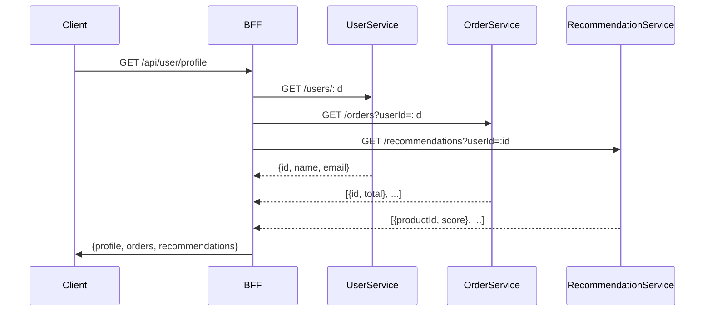

<!-- Generated by Groq via GitHub Actions -->
<!-- Topic ID: T258 -->
<!-- Category: API Architecture -->
<!-- Generated at UTC: 2026-11-26T09:44:28.314274+00:00 -->

# BFF pattern

## 1. What problem does this solve?

**Motivation**

When a single backend serves many different clients (web, iOS, Android, IoT, etc.), each client has its own UI/UX needs, data shape, and performance constraints. A monolithic API that returns the same JSON payload for everyone forces the frontend to:

- **Filter** data it doesn’t need.
- **Re‑shape** data into the format it expects.
- **Make multiple round‑trips** to fetch related data.
- **Handle different error handling strategies** per platform.

**Problem exists**

- **Over‑fetching / under‑fetching**: The API returns too much or too little data.
- **Inconsistent contracts**: Same resource exposed differently across clients.
- **Client‑side complexity**: Frontend developers write glue code to combine data from several services.
- **Performance bottlenecks**: Multiple network hops increase latency and cost.

**Why the problem matters**

- **User experience**: Slow or buggy UIs hurt engagement.
- **Developer productivity**: Frontend teams spend time on plumbing instead of features.
- **Maintainability**: Backend changes ripple through many clients.

**What happens if we ignore BFF**

- Frontend code becomes a “data‑layer” monolith.
- Scaling becomes hard because each client’s needs are baked into the same API.
- Security and rate‑limiting become difficult to enforce per‑client.

**Real‑world appearance**

- Netflix’s “Backend for Frontend” service that tailors data for web, mobile, and smart TVs.
- Shopify’s GraphQL gateway that aggregates multiple microservices per storefront.
- Many SaaS products expose a single REST endpoint that is then wrapped by a BFF for each platform.

---

## 2. Mental model

**Analogy – Personal Concierge**

Imagine you’re a concierge at a luxury hotel. Guests (the frontends) have different requests: a business traveler wants a quick summary of flight status, a family wants a list of nearby restaurants, a VIP wants a personalized itinerary. Instead of each guest calling the hotel’s main switchboard (the monolithic API) and asking for all the hotel’s services, the concierge gathers the relevant information from the concierge desk, housekeeping, and front desk, then delivers a tailored package.

**Engineering model**

- **BFF = a thin service layer** that sits between the frontend and the rest of the backend.
- It **aggregates** data from multiple microservices, **transforms** it, and **optimizes** the payload for a specific client.
- Think of it as a *client‑specific adapter* that hides the complexity of the underlying services.

---

## 3. Deep explanation

| Aspect | Details |
|--------|---------|
| **Internals** | A BFF is usually a lightweight Node.js/Express/Fastify/Next.js API that forwards requests to downstream services, aggregates responses, and returns a single payload. |
| **Important terminology** | • **API Gateway** – generic request routing.<br>• **Service Mesh** – inter‑service communication.<br>• **GraphQL Gateway** – schema stitching.<br>• **BFF** – client‑specific adapter. |
| **Trade‑offs** | • **Pros**: Tailored payloads, reduced client complexity, easier versioning per client.<br>• **Cons**: Extra layer of latency, duplicated logic if not careful, more deployment units. |
| **Failure modes** | • **Downstream failure**: BFF must handle partial failures gracefully.<br>• **Schema drift**: If downstream services change, the BFF must adapt.<br>• **Caching invalidation**: Stale data if caching is mis‑configured. |
| **Limitations** | • Not a replacement for a proper API gateway or service mesh.<br>• Adds operational overhead (monitoring, scaling). |
| **Where it fits** | BFF sits between the *frontend* and the *microservice ecosystem*. It can be deployed as a separate container or as a serverless function. |
| **Interactions** | • **With API Gateway**: BFF can be the final hop after routing.<br>• **With Service Mesh**: BFF calls services via service mesh protocols.<br>• **With GraphQL**: BFF can expose a GraphQL endpoint that stitches schemas. |

---

## 4. How it works

1. **Client sends request** to the BFF endpoint (e.g., `/api/user/profile`).
2. **BFF receives** the request, authenticates/authorizes the user.
3. **BFF forwards** sub‑requests to downstream services (e.g., `UserService`, `OrderService`, `RecommendationService`).
4. **BFF aggregates** responses, transforms data into the shape the client expects.
5. **BFF returns** a single JSON payload.
6. **Client renders** the data.



---

## 5. Practical implementation

Below is a minimal BFF using **Express** and **TypeScript** that aggregates data from three mock services.

```ts
// src/bff.ts
import express, { Request, Response } from 'express';
import fetch from 'node-fetch';

const app = express();
const PORT = process.env.PORT || 4000;

// Mock downstream service URLs
const USER_SERVICE = 'http://localhost:5001';
const ORDER_SERVICE = 'http://localhost:5002';
const RECOMMEND_SERVICE = 'http://localhost:5003';

/**
 * Helper to call downstream services with error handling.
 */
async function callService(url: string, opts = {}) {
  try {
    const res = await fetch(url, opts);
    if (!res.ok) throw new Error(`HTTP ${res.status}`);
    return await res.json();
  } catch (e) {
    console.error(`Service error: ${url}`, e);
    return null; // graceful degradation
  }
}

/**
 * BFF endpoint: aggregates user profile, orders, and recommendations.
 */
app.get('/api/user/:id', async (req: Request, res: Response) => {
  const userId = req.params.id;

  // Parallel calls to downstream services
  const [user, orders, recs] = await Promise.all([
    callService(`${USER_SERVICE}/users/${userId}`),
    callService(`${ORDER_SERVICE}/orders?userId=${userId}`),
    callService(`${RECOMMEND_SERVICE}/recommendations?userId=${userId}`),
  ]);

  // Transform into a single payload
  const payload = {
    profile: user,
    recentOrders: orders?.slice(0, 5), // limit to 5
    recommendations: recs?.map(r => r.productId),
  };

  res.json(payload);
});

app.listen(PORT, () => console.log(`BFF listening on ${PORT}`));
```

**Running the example**

1. Spin up three mock services (simple Express servers that return JSON).
2. Start the BFF (`ts-node src/bff.ts`).
3. Call `GET http://localhost:4000/api/user/123`.

**Why this is realistic**

- Uses `node-fetch` for HTTP calls (common in Node).
- Handles errors gracefully (returns partial data).
- Aggregates and transforms data.
- Keeps the BFF thin and focused on orchestration.

---

## 6. Production considerations

| Concern | How to address |
|---------|----------------|
| **Scalability** | Deploy BFF as a stateless container; use a load balancer; scale horizontally. |
| **Reliability** | Implement circuit breakers (e.g., `opossum`), retries with exponential backoff, and fallback data. |
| **Security** | Enforce OAuth/JWT validation; rate‑limit per client; sanitize inputs; use TLS. |
| **Observability** | Add distributed tracing (OpenTelemetry), metrics (Prometheus), and structured logging. |
| **Performance** | Cache aggregated responses in Redis; use HTTP/2; batch downstream requests. |
| **Error handling** | Return meaningful HTTP status codes; provide error payloads; log errors. |
| **Resource usage** | Keep memory footprint low; use async/await to avoid thread blocking. |
| **Operational concerns** | CI/CD pipelines; health checks; graceful shutdown. |
| **Failure recovery** | Automatic restarts via container orchestrator; fallback to cached data. |
| **Deployment** | Dockerize; use Kubernetes or serverless (AWS Lambda, Vercel). |

---

## 7. Common mistakes

| Mistake | Why it’s problematic |
|---------|----------------------|
| **Treating BFF as a monolith** | It becomes a single point of failure; hard to evolve. |
| **Duplicating business logic** | Increases maintenance burden; risk of inconsistencies. |
| **Ignoring downstream failures** | Leads to silent data loss or broken UIs. |
| **Over‑caching** | Stale data; users see outdated information. |
| **Not versioning per client** | A change for one client breaks another. |
| **Using synchronous calls** | Blocks event loop; hurts throughput. |
| **Not securing the BFF** | Exposes internal services to the internet. |

---

## 8. Senior engineer perspective

### What changes at scale?

- **Architecture decisions**: Decide whether to have one BFF per frontend or a shared BFF with feature flags. Consider a *gateway* vs *BFF* hybrid.
- **Trade‑offs**: More BFFs mean more deployments but tighter coupling to clients; fewer BFFs mean more complex payloads.
- **Bottlenecks**: Network latency to downstream services; CPU bound aggregation logic; database contention in downstream services.
- **Failure scenarios**: Partial failures (e.g., recommendation service down) – need graceful degradation. Cascading failures (e.g., BFF overload causing downstream timeouts).
- **Monitoring**: End‑to‑end latency, error rates per downstream call, cache hit ratios.
- **Cost/performance**: Each BFF instance incurs compute cost; caching can reduce downstream calls. Use CDN for static assets.
- **When NOT to use BFF**: If the frontend is simple and can consume the raw API directly; if the backend is monolithic and already returns client‑specific payloads; if the overhead outweighs benefits.

---

## 9. Interview questions

1. **Beginner**: *What is the BFF pattern and why would you use it?*  
   *Answer*: A Backend‑for‑Frontend is a thin service that tailors API responses for a specific client, reducing over‑fetching and simplifying frontend logic.

2. **Beginner**: *How does a BFF differ from an API gateway?*  
   *Answer*: An API gateway handles routing, authentication, and cross‑cutting concerns for all clients; a BFF is client‑specific, focusing on data aggregation and transformation.

3. **Senior**: *Describe how you would design a BFF that aggregates data from three microservices while ensuring high availability.*  
   *Answer*: Use async parallel calls, circuit breakers, retries, fallback data, caching, and health checks. Deploy horizontally behind a load balancer, instrument with tracing, and monitor latency per downstream call.

4. **Senior**: *What are the main performance trade‑offs when adding a BFF layer?*  
   *Answer*: Adds network hop and CPU overhead for aggregation; can reduce client round‑trips and payload size; must balance caching vs real‑time data; consider using HTTP/2 or gRPC for efficiency.

5. **Scenario/Debugging**: *A user reports that their mobile app receives stale recommendation data. The BFF uses Redis caching with a 60‑second TTL. What could be wrong and how would you investigate?*  
   *Answer*: Possible causes: cache not being invalidated after recommendation updates, cache miss leading to stale data, or TTL too long. Investigate by checking cache keys, TTL, logs for cache hits/misses, and whether the recommendation service updates the cache. Use tracing to see if the BFF is hitting the cache or fetching fresh data.*

---

## 10. Hands‑on task

**Build a BFF that serves a React web app and a Flutter mobile app.**

1. Create two mock downstream services (`UserService`, `ProductService`).
2. Implement a Node.js BFF that:
   - Authenticates JWT tokens.
   - Aggregates user profile and product catalog.
   - Returns a payload tailored for web (full product details) and mobile (only product IDs).
3. Add caching for the product catalog in Redis.
4. Write unit tests for the aggregation logic.
5. Deploy the BFF locally with Docker Compose and verify that both clients receive the correct payloads.

---

## 11. Quick revision

- BFF = Backend‑for‑Frontend, a thin client‑specific adapter.
- Solves over‑fetching, client complexity, and inconsistent contracts.
- Aggregates data from multiple services, transforms it, and returns a single payload.
- Typical stack: Node.js/Express/Fastify + TypeScript, HTTP/2, Redis cache.
- Key concerns: scalability, reliability (circuit breakers), security (JWT), observability (tracing, metrics).
- Avoid duplicating business logic; keep BFF stateless.
- Use parallel async calls and graceful degradation.
- Deploy horizontally; monitor per‑client latency.
- Not a replacement for API gateway or service mesh.

---

## 12. References

- [Netflix BFF Pattern](https://netflixtechblog.com/backend-for-frontend-5f6b1b4b3d8e)
- [Next.js API Routes](https://nextjs.org/docs/api-routes/introduction)
- [Express.js Documentation](https://expressjs.com/)
- [Fastify Documentation](https://www.fastify.io/docs/latest/)
- [OpenTelemetry for Node.js](https://opentelemetry.io/docs/instrumentation/node/)
- [Redis Documentation](https://redis.io/docs/)
- [Node‑fetch](https://github.com/node-fetch/node-fetch)
- [Opossum Circuit Breaker](https://github.com/nodeshift/opossum)
