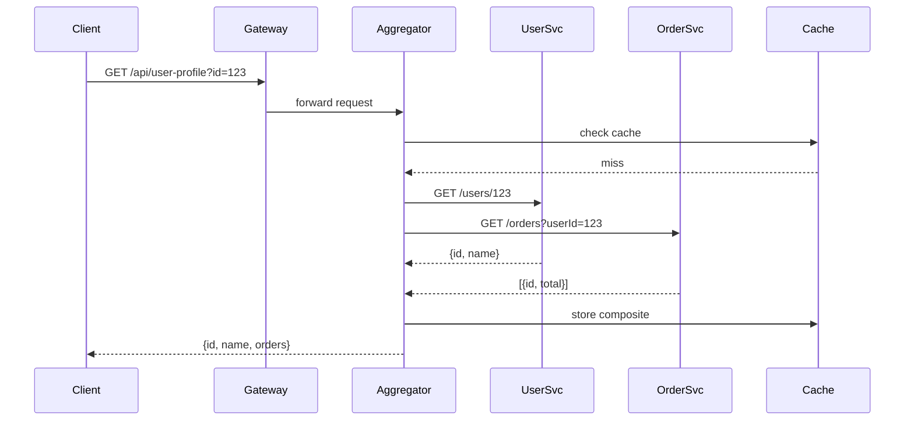

<!-- Generated by Groq via GitHub Actions -->
<!-- Topic ID: T259 -->
<!-- Category: API Architecture -->
<!-- Generated at UTC: 2026-11-26T22:29:44.847114+00:00 -->

# API composition

## 1. What problem does this solve?

API composition is the practice of building a single, cohesive API surface by orchestrating multiple underlying services or data sources. It solves several real‑world pain points:

| Problem | Why it matters | Consequence if ignored | Real‑world example |
|---------|----------------|------------------------|--------------------|
| **Fragmented client experience** | Clients must call many endpoints, handle pagination, merge data, and manage errors. | Higher client complexity, slower development, more bugs. | A mobile app that fetches user profile, posts, and comments from separate microservices. |
| **Inconsistent data shape** | Each service may expose slightly different schemas. | Clients need adapters; data contracts drift. | E‑commerce front‑end consuming product, inventory, and pricing services. |
| **Network overhead** | Multiple round‑trips increase latency and cost. | Poor UX, higher bandwidth usage. | A dashboard that pulls metrics from several monitoring services. |
| **Authorization & auditing** | Each service may enforce its own policy. | Security gaps, duplicate logic. | A SaaS platform that needs to enforce tenant isolation across services. |
| **Versioning chaos** | Each service evolves independently. | Clients break when any service changes. | A social network where the feed, notifications, and messaging services evolve at different rates. |

API composition brings a **single contract** to the client, hides the complexity of the underlying services, and enables better control over performance, security, and observability.

---

## 2. Mental model

### Analogy: The Restaurant Menu

Think of a client as a diner.  
- **Individual services** are separate kitchen stations (appetizers, main course, dessert).  
- **API composition** is the **full‑course menu** that orders all dishes in one go, orchestrates timing, and presents a single bill.

Just as the diner doesn’t need to know which station cooked each dish, a client doesn’t need to know which microservice produced each piece of data.

### Engineering model

1. **Gateway** receives a request.  
2. **Orchestrator** decides which downstream services to call.  
3. **Aggregates** responses, transforms data, and returns a unified payload.  
4. Optionally caches or streams partial results.

---

## 3. Deep explanation

### Internals

- **Gateway / API Gateway**: Entry point (e.g., Kong, AWS API Gateway, custom Express/Next.js API route).  
- **Orchestration layer**: Could be a GraphQL resolver, a REST aggregator, or a dedicated service (e.g., Apollo Federation, Hasura, or a custom Node.js microservice).  
- **Data fetching**: Parallel HTTP calls, gRPC, message queues, or database queries.  
- **Transformation**: Mapping, filtering, enrichment, and schema stitching.  
- **Error handling**: Circuit breakers, retries, fallback data.  
- **Caching**: In‑memory (Redis), CDN, or HTTP cache headers.  

### Important terminology

| Term | Meaning |
|------|---------|
| **Aggregator** | Service that pulls data from multiple sources. |
| **Resolver** | Function that fetches a specific field or entity. |
| **Schema stitching** | Combining multiple GraphQL schemas into one. |
| **Composite API** | A single endpoint that returns a composite payload. |
| **Service mesh** | Infrastructure layer that can handle inter‑service calls (e.g., Istio). |

### Trade‑offs

| Trade‑off | Pros | Cons |
|-----------|------|------|
| **Synchronous aggregation** | Simple, consistent data | Latency increases with each downstream call |
| **Asynchronous aggregation** | Lower latency, better throughput | Complexity: eventual consistency, partial responses |
| **Cache‑first** | Fast, reduces load | Stale data, cache invalidation complexity |
| **GraphQL vs REST** | Flexible queries, fewer round‑trips | Requires schema design, potential over‑fetching if not careful |

### Failure modes

- **Partial failures**: One downstream service fails → entire composite fails unless you provide fallbacks.  
- **Timeouts**: Long‑running calls block the whole request.  
- **Data inconsistency**: Different services may have stale data.  
- **Rate limits**: Aggregator can hit downstream limits if not throttled.  

### Limitations

- **Complexity**: Adds another layer that must be maintained.  
- **Observability**: Need to trace through multiple calls.  
- **Cost**: More network traffic, compute, and storage.  

### Where it fits

- **Microservices**: Acts as the façade that hides service boundaries.  
- **Monoliths**: Can still be used to combine internal modules.  
- **Serverless**: Lambda functions can orchestrate calls.  

### Interaction with related concepts

- **Service Mesh**: Handles retries, circuit breaking, and observability.  
- **CQRS / Event Sourcing**: Aggregator can read from event streams.  
- **Caching**: Redis or CDN can store composite responses.  
- **GraphQL Federation**: Allows each team to own its schema while exposing a unified API.  

---

## 4. How it works

### Step‑by‑step flow

1. **Client** sends a request to `/api/user-profile`.  
2. **API Gateway** forwards to the **Aggregator** service.  
3. Aggregator parses the request, determines required downstream calls.  
4. Aggregator **executes calls in parallel** (e.g., `GET /users/:id`, `GET /orders?userId=:id`).  
5. Aggregator **waits for all responses** (or a timeout).  
6. Aggregator **transforms** data into the unified shape.  
7. Aggregator **returns** the composite payload to the client.  
8. **Observability**: Tracing spans are propagated across calls.



---

## 5. Practical implementation

Below is a minimal **Node.js/TypeScript** aggregator using **Express** and **Axios**.  
It demonstrates parallel calls, error handling, and caching with Redis.

```ts
// src/aggregator.ts
import express from 'express';
import axios from 'axios';
import Redis from 'ioredis';

const app = express();
const redis = new Redis(); // defaults to localhost:6379

// Simple in‑memory cache key generator
const cacheKey = (id: string) => `userProfile:${id}`;

// Timeout for downstream calls (ms)
const DOWNSTREAM_TIMEOUT = 2000;

// Helper to fetch with timeout
const fetchWithTimeout = async (url: string) => {
  return axios.get(url, { timeout: DOWNSTREAM_TIMEOUT });
};

app.get('/api/user-profile', async (req, res) => {
  const userId = req.query.id as string;
  if (!userId) return res.status(400).json({ error: 'id required' });

  const key = cacheKey(userId);

  // 1️⃣ Try cache first
  const cached = await redis.get(key);
  if (cached) {
    return res.json(JSON.parse(cached));
  }

  try {
    // 2️⃣ Parallel downstream calls
    const [userRes, ordersRes] = await Promise.all([
      fetchWithTimeout(`http://user-service/users/${userId}`),
      fetchWithTimeout(`http://order-service/orders?userId=${userId}`),
    ]);

    // 3️⃣ Compose response
    const payload = {
      id: userRes.data.id,
      name: userRes.data.name,
      orders: ordersRes.data,
    };

    // 4️⃣ Cache composite for 30s
    await redis.set(key, JSON.stringify(payload), 'EX', 30);

    res.json(payload);
  } catch (err) {
    // 5️⃣ Graceful degradation: if orders fail, still return user
    if (axios.isAxiosError(err) && err.code === 'ECONNABORTED') {
      // Timeout: return user only
      const userRes = await fetchWithTimeout(`http://user-service/users/${userId}`);
      const payload = { id: userRes.data.id, name: userRes.data.name, orders: [] };
      await redis.set(key, JSON.stringify(payload), 'EX', 30);
      return res.json(payload);
    }
    console.error(err);
    res.status(502).json({ error: 'Bad gateway' });
  }
});

app.listen(3000, () => console.log('Aggregator listening on :3000'));
```

**Key points**

- `Promise.all` runs calls in parallel, reducing latency.  
- Timeout protects against slow downstream services.  
- Redis cache stores the composite payload to avoid repeated work.  
- Fallback logic returns partial data if one service fails.

---

## 6. Production considerations

| Concern | What to watch for | Mitigations |
|---------|-------------------|-------------|
| **Scalability** | Aggregator becomes a bottleneck if many clients hit it. | Horizontal scaling, load balancer, async streaming. |
| **Reliability** | Downstream failures cascade. | Circuit breakers, retries, graceful degradation. |
| **Security** | Exposing internal service URLs. | Use service mesh, network policies, API gateway auth. |
| **Observability** | Hard to trace across services. | Distributed tracing (OpenTelemetry), structured logs. |
| **Performance** | Latency grows with number of downstream calls. | Parallelism, caching, request batching. |
| **Error handling** | Partial failures cause confusing responses. | Define clear error contracts, partial data indicators. |
| **Resource usage** | Aggregator consumes CPU & memory. | Use efficient data structures, limit request size. |
| **Deployment** | Need to update aggregator when downstream APIs change. | Versioned contracts, automated integration tests. |
| **Failure recovery** | Cache invalidation, stale data. | Cache TTL, cache busting on data changes. |

---

## 7. Common mistakes

| Mistake | Why it’s problematic |
|---------|----------------------|
| **Synchronous serial calls** | Increases latency linearly with number of services. |
| **No timeout** | Aggregator hangs forever if a downstream service stalls. |
| **Ignoring partial failures** | Entire request fails even if most data is available. |
| **Over‑caching** | Stale data served to clients; cache invalidation hard. |
| **Tight coupling to service URLs** | Hard to change service discovery or deploy in multiple environments. |
| **Returning raw downstream errors** | Exposes internal implementation details. |
| **Not propagating tracing context** | Makes debugging distributed calls impossible. |
| **Treating aggregator as a monolith** | Misses benefits of microservice isolation. |

---

## 8. Senior engineer perspective

### What changes at scale?

- **Architecture decisions**:  
  - *GraphQL Federation* vs *REST aggregator*?  
  - *Service mesh* for retries and observability.  
  - *Event‑driven* vs *request‑driven* aggregation.  

- **Trade‑offs**:  
  - *Latency vs consistency*: eventual consistency vs synchronous aggregation.  
  - *Cost vs performance*: caching vs recomputing.  

- **Bottlenecks**:  
  - Aggregator CPU, memory, and network I/O.  
  - Downstream rate limits.  

- **Failure scenarios**:  
  - Cascading failures, data skew, partial data.  
  - Need for fallback data stores or cached snapshots.  

- **Monitoring**:  
  - Request latency histograms per downstream service.  
  - Error rates, circuit breaker status.  
  - Cache hit/miss ratios.  

- **Cost/performance**:  
  - Compute cost of parallel calls vs single aggregated call.  
  - Network egress costs in cloud.  

- **When NOT to use**:  
  - If services are tightly coupled and can expose a unified API directly.  
  - If the aggregation adds negligible value compared to the complexity.  
  - If the client can handle multiple calls efficiently (e.g., GraphQL client).  

---

## 9. Interview questions

1. **Beginner**: *What is API composition and why would you use it?*  
   *Answer*: It’s building a single API that aggregates data from multiple services to simplify client interactions, reduce round‑trips, and provide a unified contract.

2. **Beginner**: *How can you prevent an aggregator from becoming a bottleneck?*  
   *Answer*: Parallelize downstream calls, cache results, scale horizontally, use async streaming, and implement circuit breakers.

3. **Senior**: *Explain how you would implement graceful degradation in an aggregator when one downstream service fails.*  
   *Answer*: Use try/catch around each call, fallback to cached data or partial responses, return a status indicating missing parts, and log the failure for alerting.

4. **Senior**: *Compare GraphQL Federation and a REST aggregator for API composition. What are the pros and cons of each?*  
   *Answer*: Federation allows schema stitching and per‑field resolution, good for flexible queries but adds complexity. REST aggregator is simpler, but clients must know the shape; it can be less efficient if many fields are requested.

5. **Scenario/Debugging**: *You notice that the `/api/user-profile` endpoint is slow during peak traffic. Describe the steps you would take to diagnose and fix the issue.*  
   *Answer*:  
   - Enable distributed tracing to see which downstream call is slow.  
   - Check cache hit/miss ratios.  
   - Inspect network latency and service health.  
   - Add timeouts and retries.  
   - Scale the aggregator or move to async batching.  
   - Consider caching the composite response longer or using a CDN.

---

## 10. Hands‑on task

**Task**: Extend the aggregator to support **batching** of user profile requests.

- Add a new endpoint `POST /api/user-profiles` that accepts an array of user IDs.  
- The aggregator should fetch all requested users in parallel, but **batch** the downstream calls to the user service (e.g., `GET /users?ids=1,2,3`).  
- Cache each individual user profile separately and return a single composite array.  
- Ensure the implementation handles partial failures gracefully.

*Hint*: Use `axios.all` or `Promise.allSettled`, and update the Redis cache with individual keys.

---

## 11. Quick revision

- API composition aggregates multiple services into one API surface.  
- It reduces client complexity, round‑trips, and improves UX.  
- Common patterns: REST aggregator, GraphQL federation, event‑driven composition.  
- Key concerns: latency, reliability, caching, observability, security.  
- Parallel calls reduce latency but need timeouts and retries.  
- Circuit breakers prevent cascading failures.  
- Distributed tracing is essential for debugging.  
- Cache hit/miss ratios directly impact performance.  
- Graceful degradation returns partial data on downstream failures.  
- Scaling requires horizontal scaling, async streaming, or batching.  
- Avoid composition if services can expose a unified API directly.

---

## 12. References

- [OpenTelemetry – Distributed Tracing](https://opentelemetry.io/docs/concepts/trace/)  
- [GraphQL Federation – Apollo](https://www.apollographql.com/docs/federation/)  
- [Redis – Caching Patterns](https://redis.io/docs/management/cache/)  
- [Axios – HTTP Client for Node.js](https://axios-http.com/docs/intro)  
- [Express – Web Framework](https://expressjs.com/)  
- [ioredis – Redis client](https://github.com/luin/ioredis)  
- [Kubernetes – Service Mesh (Istio)](https://istio.io/latest/docs/)  
- [AWS API Gateway – Aggregation](https://docs.aws.amazon.com/apigateway/latest/developerguide/api-gateway-multiple-apis.html)
