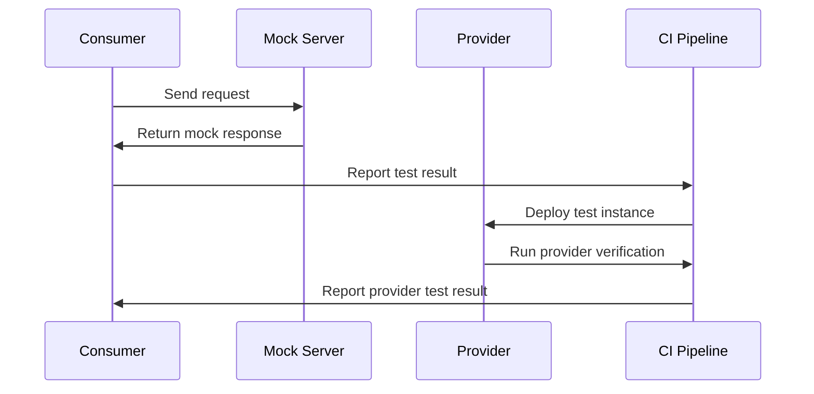

<!-- Generated by Groq via GitHub Actions -->
<!-- Topic ID: T260 -->
<!-- Category: API Architecture -->
<!-- Generated at UTC: 2026-11-26T22:29:44.847114+00:00 -->

# Contract testing

## 1. What problem does this solve?

**Motivation**  
When multiple services talk to each other over HTTP, gRPC, Kafka, etc., each service assumes that the other will return data in a specific shape, status codes, and error semantics. If a downstream service changes its API (even accidentally), the caller can break in subtle ways: missing fields, wrong types, or unexpected status codes. These bugs surface only after deployment, often in production, causing outages or data corruption.

**What problem exists**  
- *Unverified assumptions*: Clients assume a contract but never check it.
- *Regression risk*: A change in a provider’s API can silently break consumers.
- *Integration complexity*: Manual integration tests are brittle and slow.

**Why the problem matters**  
- **Reliability**: A single contract violation can cascade through a microservice ecosystem.
- **Security**: Unexpected payloads can lead to injection or deserialization attacks.
- **Maintainability**: Without a formal contract, teams cannot evolve APIs independently.

**What happens if this concept is not used**  
- Consumers may crash or misbehave at runtime.
- Bugs surface late, increasing cost of fixes.
- Teams lose confidence in automated deployments.

**Where this concept appears in real backend systems**  
- RESTful services exchanging JSON over HTTP.
- gRPC services exchanging Protobuf messages.
- Event-driven architectures where producers publish events consumed by downstream services.
- Internal APIs between monolith modules or between microservices.

---

## 2. Mental model

**Analogy**  
Think of contract testing like a *restaurant menu*. The chef (provider) writes a menu (API spec). Diners (consumers) order dishes (requests). If the chef changes a dish’s ingredients without updating the menu, diners will be disappointed or even harmed. The menu is a contract that guarantees what the diner will receive. Contract tests are the *taste tests* that verify the dish matches the menu before serving.

**Engineering model**  
- **Provider**: Service that offers an API or event stream.
- **Consumer**: Service that calls the provider or subscribes to its events.
- **Contract**: Formal description of request/response shapes, status codes, headers, and error semantics.
- **Contract test**: A test that runs against the provider (or a mock) to assert that the contract is honored.

---

## 3. Deep explanation

### Internals
- **Specification format**: JSON Schema, OpenAPI, Protobuf, Avro, or custom DSL.
- **Test harness**: Executes provider endpoints or event streams, captures actual responses, and validates against the spec.
- **Mocking**: Some frameworks generate provider mocks from the contract, allowing consumer tests to run without the real provider.

### Important terminology
- **Provider test**: Runs against the real provider to ensure it satisfies the contract.
- **Consumer test**: Runs against a mock or stub of the provider to ensure the consumer can handle the contract.
- **Verification**: The act of checking that the provider’s behavior matches the contract.
- **Pact**: A popular format that stores the contract as a JSON file and includes consumer expectations.

### Trade‑offs
| Aspect | Pros | Cons |
|--------|------|------|
| **Strictness** | Guarantees API stability | Overly rigid contracts can hinder evolution |
| **Speed** | Fast consumer tests with mocks | Provider tests can be slower |
| **Coverage** | Detects breaking changes early | May miss runtime edge cases not expressed in contract |

### Failure modes
- **Schema drift**: Provider changes schema without updating contract → verification fails.
- **Partial compliance**: Provider returns correct fields but with wrong types → test may pass if type coercion is allowed.
- **Mock inaccuracies**: Consumer tests may pass against a mock but fail against the real provider.

### Limitations
- Contracts only cover *structure*, not *business logic* (e.g., value ranges, business rules).
- They don’t guarantee *performance* or *security* properties.
- Requires discipline to keep contracts up‑to‑date.

### Where it fits in a backend architecture
- **API Gateway**: Enforces contracts at the edge.
- **Service Mesh**: Can inject contract checks as sidecars.
- **CI/CD pipeline**: Runs provider and consumer contract tests before merging.

### Interaction with related concepts
- **Schema evolution**: Contract tests guide safe evolution (e.g., deprecating fields).
- **Versioning**: Contracts can be versioned; consumers can test against multiple provider versions.
- **Observability**: Contract violations can be logged and monitored.

---

## 4. How it works

1. **Define the contract**  
   Create an OpenAPI spec or Pact file that describes the API endpoints, request/response bodies, headers, and error codes.

2. **Generate mocks (optional)**  
   Use a tool (e.g., Pact JS) to generate a mock server from the contract.

3. **Consumer tests**  
   Run tests against the mock server to assert that the consumer code handles the contract correctly.

4. **Provider verification**  
   Run the same contract against the real provider (or a test instance) to ensure it satisfies the contract.

5. **CI integration**  
   Fail the build if either consumer or provider tests fail.



---

## 5. Practical implementation

### 5.1 Define a contract (OpenAPI)

```yaml
# openapi.yaml
openapi: 3.0.1
info:
  title: User Service
  version: 1.0.0
paths:
  /users/{id}:
    get:
      summary: Get user by ID
      parameters:
        - name: id
          in: path
          required: true
          schema:
            type: string
      responses:
        '200':
          description: Successful response
          content:
            application/json:
              schema:
                $ref: '#/components/schemas/User'
        '404':
          description: User not found
components:
  schemas:
    User:
      type: object
      properties:
        id:
          type: string
        email:
          type: string
        name:
          type: string
      required: [id, email, name]
```

### 5.2 Consumer test (TypeScript + Jest + Pact)

```ts
// consumer.test.ts
import path from 'path';
import { Pact } from '@pact-foundation/pact';
import axios from 'axios';
import { User } from './types';

const provider = new Pact({
  consumer: 'UserClient',
  provider: 'UserService',
  port: 1234,
  log: path.resolve(process.cwd(), 'logs', 'pact.log'),
  dir: path.resolve(process.cwd(), 'pacts'),
  spec: 2,
});

describe('UserClient contract tests', () => {
  beforeAll(() => provider.setup());
  afterAll(() => provider.finalize());

  it('returns a user', async () => {
    await provider.addInteraction({
      state: 'user exists',
      uponReceiving: 'a request for user 1',
      withRequest: {
        method: 'GET',
        path: '/users/1',
      },
      willRespondWith: {
        status: 200,
        body: {
          id: '1',
          email: 'alice@example.com',
          name: 'Alice',
        },
      },
    });

    const res = await axios.get<User>('http://localhost:1234/users/1');
    expect(res.status).toBe(200);
    expect(res.data).toEqual({
      id: '1',
      email: 'alice@example.com',
      name: 'Alice',
    });
  });
});
```

### 5.3 Provider verification (Node.js + Express + Pact)

```ts
// server.ts
import express from 'express';
import { User } from './types';

const app = express();
app.use(express.json());

const users: Record<string, User> = {
  '1': { id: '1', email: 'alice@example.com', name: 'Alice' },
};

app.get('/users/:id', (req, res) => {
  const user = users[req.params.id];
  if (!user) return res.status(404).send();
  res.json(user);
});

export default app;
```

```ts
// provider.test.ts
import path from 'path';
import { Pact } from '@pact-foundation/pact';
import app from './server';
import request from 'supertest';

const provider = new Pact({
  consumer: 'UserClient',
  provider: 'UserService',
  port: 1234,
  log: path.resolve(process.cwd(), 'logs', 'pact.log'),
  dir: path.resolve(process.cwd(), 'pacts'),
  spec: 2,
});

describe('UserService provider verification', () => {
  beforeAll(() => provider.setup());
  afterAll(() => provider.finalize());

  it('verifies the contract', async () => {
    await provider.verify();
  });
});
```

Run `npm test` to execute both consumer and provider tests. The Pact framework will generate a `userclient-userservice.json` file that can be shared with the provider team.

---

## 6. Production considerations

| Concern | How contract testing helps | Practical tips |
|---------|---------------------------|----------------|
| **Scalability** | Contracts prevent breaking changes that could cause cascading failures. | Keep contracts lightweight; avoid over‑specifying optional fields that rarely change. |
| **Reliability** | Early detection of API drift. | Run provider tests in CI before merging; run consumer tests in staging. |
| **Security** | Contracts can enforce required headers (e.g., auth tokens). | Include security headers in the spec; test for missing headers. |
| **Observability** | Contract violations can be logged and monitored. | Emit metrics when provider verification fails. |
| **Performance** | Contracts don’t test latency, but they ensure the shape of responses. | Combine with load tests; use contract tests as a baseline. |
| **Error handling** | Explicitly define error responses. | Test consumer error handling paths. |
| **Resource usage** | Mock servers are lightweight. | Use in-memory mocks for consumer tests; avoid hitting external services. |
| **Operational concerns** | Contracts become part of the API lifecycle. | Store contracts in a versioned repo; enforce PR reviews. |
| **Failure recovery** | Quick identification of breaking changes. | Use feature flags to roll back provider changes if contract fails. |
| **Deployment considerations** | Deploy provider only after contract verification. | Automate contract verification in the deployment pipeline. |

---

## 7. Common mistakes

| Mistake | Why it’s problematic |
|---------|----------------------|
| **Skipping provider verification** | Consumer tests pass against a mock but provider may still break the contract. |
| **Hardcoding expected values** | Tests fail when legitimate data changes (e.g., email format). |
| **Ignoring optional fields** | Provider may omit optional fields, causing consumer failures. |
| **Using outdated contract files** | Leads to false positives/negatives. |
| **Treating contracts as documentation only** | Contracts should be the source of truth, not just docs. |
| **Not versioning contracts** | Teams may diverge on API versions, causing integration hell. |
| **Running consumer tests against production** | Risk of flakiness due to network issues. |
| **Over‑specifying** | Makes evolution painful; small changes break many consumers. |

---

## 8. Senior engineer perspective

### What changes at scale
- **Multiple providers**: Need a central contract registry (e.g., Pact Broker) to share contracts across teams.
- **Versioning strategy**: Adopt semantic versioning for contracts; deprecate fields gradually.
- **Automation**: Integrate contract verification into CI/CD pipelines for every microservice.
- **Governance**: Enforce contract reviews, linting, and automated diff checks.

### Design decisions
- **Contract format**: OpenAPI for REST, Protobuf for gRPC, Avro for Kafka.
- **Mocking strategy**: Use in‑process mocks for unit tests; external mock servers for integration tests.
- **Verification frequency**: Run provider tests nightly; run consumer tests on every PR.
- **Monitoring**: Expose contract verification status as a health endpoint; alert on failures.
- **Cost/performance**: Mock servers are cheap; provider verification can be expensive—run in dedicated test environments.

### Bottlenecks
- **Large contracts**: Validation can be slow; consider partial verification or schema caching.
- **Distributed systems**: Event contracts require schema registry; versioning can become complex.

### Failure scenarios
- **Stale contracts**: Leads to silent failures; mitigate with automated contract diff checks.
- **Schema drift**: Use automated migration scripts and backward‑compatible changes.

### When NOT to use
- **Single‑service monolith**: Contract testing may add unnecessary overhead.
- **Rapid prototyping**: Early stages may benefit from simpler integration tests.

---

## 9. Interview questions

1. **Beginner**: *What is a contract test and why is it useful?*  
   - Ensures provider and consumer agree on request/response shapes.  
   - Detects breaking changes early.

2. **Beginner**: *How does a mock server help in consumer contract tests?*  
   - Provides deterministic responses without needing the real provider.  
   - Speeds up tests and isolates consumer logic.

3. **Senior**: *Explain how you would handle deprecating a field in a JSON API while keeping contract tests green.*  
   - Mark field as optional in the schema.  
   - Add a new version of the contract.  
   - Use feature flags or versioned endpoints.

4. **Senior**: *What are the trade‑offs between strict schema validation and flexibility in a contract?*  
   - Strict validation guarantees consistency but hinders evolution.  
   - Flexible validation allows changes but may hide bugs.

5. **Scenario/Debugging**: *A consumer test passes against the mock, but fails against the real provider with a 500 error. How would you debug?*  
   - Verify provider logs for the endpoint.  
   - Check environment differences (e.g., missing env vars).  
   - Ensure provider is running the same code version as the mock.  
   - Compare request payloads and headers.  
   - Add detailed logging to the provider.

---

## 10. Hands‑on task

**Task**: Add a new endpoint `/users/{id}/profile` that returns a user’s profile picture URL.  
1. Update the OpenAPI contract to include the new endpoint.  
2. Write a consumer contract test that expects a 200 response with `{ pictureUrl: string }`.  
3. Implement the endpoint in the provider (Node.js/Express).  
4. Run provider verification to ensure the contract is satisfied.  
5. Commit the contract file and the test to the repo.

---

## 11. Quick revision

- Contract tests verify API shape between provider and consumer.  
- **Provider test**: Runs against real provider.  
- **Consumer test**: Runs against a mock.  
- Use OpenAPI, Pact, or Protobuf as contract format.  
- Keep contracts versioned and stored in a registry.  
- Run contract tests in CI before merging.  
- Avoid hardcoding values; use schema validation.  
- Contracts enforce backward compatibility.  
- Monitor contract verification status in production.  
- Use feature flags to roll back breaking changes.  
- Don’t over‑specify; keep contracts lean.

---

## 12. References

- [Pact Documentation](https://docs.pact.io/)  
- [OpenAPI Specification](https://spec.openapis.org/oas/v3.1.0)  
- [JSON Schema](https://json-schema.org/)  
- [Protobuf Documentation](https://developers.google.com/protocol-buffers)  
- [Kafka Schema Registry](https://docs.confluent.io/platform/current/schema-registry/index.html)
