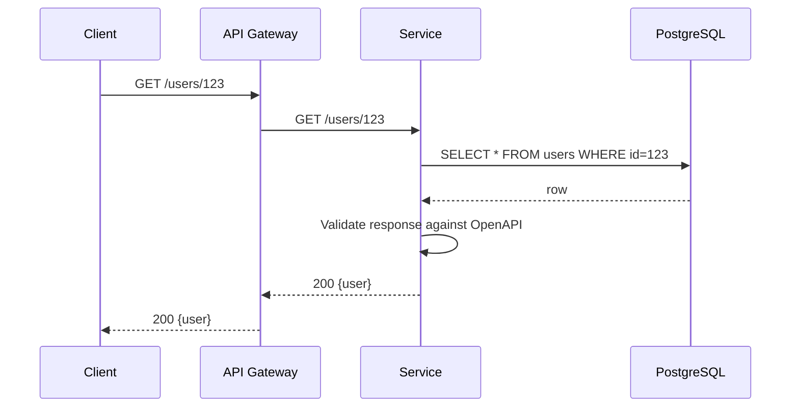

<!-- Generated by Groq via GitHub Actions -->
<!-- Topic ID: T261 -->
<!-- Category: API Architecture -->
<!-- Generated at UTC: 2026-11-27T09:50:03.453566+00:00 -->

# OpenAPI

## 1. What problem does this solve?

| Problem | Why it matters | Consequence of not using it | Real‑world appearance |
|---------|----------------|-----------------------------|-----------------------|
| **Lack of a shared contract** | Teams often disagree on what an endpoint expects/returns, leading to bugs and integration delays. | API changes break clients silently; regression tests are hard to write. | Microservice ecosystems, third‑party integrations, mobile backends. |
| **Inconsistent documentation** | Developers waste time hunting docs; onboarding slows. | New hires struggle; support tickets increase. | Public APIs (Stripe, GitHub), internal services. |
| **Manual client code** | Writing SDKs for each language is costly and error‑prone. | Clients may send malformed requests; maintenance overhead. | SaaS products, internal tooling. |
| **Missing validation** | Without a spec, request/response validation is ad‑hoc. | Security holes, data corruption, hard‑to‑debug errors. | Payment gateways, data pipelines. |

OpenAPI (formerly Swagger) is a **machine‑readable contract** that describes the shape of an HTTP API. It lets you:

* Generate interactive docs (Swagger UI)
* Auto‑generate client SDKs
* Validate requests/responses at runtime
* Drive contract‑first development and CI checks

---

## 2. Mental model

**Analogy – A restaurant menu**  
Think of an API as a restaurant. The **menu** (OpenAPI spec) lists every dish (endpoint), its ingredients (parameters), and how it’s served (HTTP method, status codes). Diners (clients) read the menu before ordering; the kitchen (server) follows the recipe exactly. If the menu is wrong, diners get the wrong dish, and the kitchen is confused.

**Engineering model**  
OpenAPI is a **JSON/YAML schema** that describes:

* **Paths** – URL patterns and HTTP verbs
* **Operations** – request/response bodies, headers, status codes
* **Components** – reusable schemas, parameters, responses
* **Security** – OAuth, API keys, etc.

It’s a *contract* that both client and server agree to, just like a typed interface in TypeScript.

---

## 3. Deep explanation

### Internals
* **Specification format** – YAML or JSON following the OpenAPI 3.x schema.
* **Schema objects** – JSON Schema 2020‑12 (or draft‑07 for 3.0) used for request/response bodies.
* **Extensions** – `x-` prefixed fields allow vendor‑specific data.

### Important terminology
| Term | Meaning |
|------|---------|
| **Path Item** | A URL pattern (e.g., `/users/{id}`) |
| **Operation** | A specific HTTP verb on a path |
| **Component** | Reusable schema, parameter, response, or security definition |
| **Server Object** | Base URL and variables for an environment |
| **Tag** | Logical grouping of operations |

### Trade‑offs
| Benefit | Trade‑off |
|---------|-----------|
| **Strong typing** | Extra maintenance to keep spec in sync |
| **Tooling** | Requires learning new tools (swagger‑ui, openapi‑generator) |
| **Validation overhead** | Runtime validation can add latency |

### Failure modes
* **Spec drift** – Code changes without updating the spec → validation errors or silent failures.
* **Circular references** – In schemas can break generators.
* **Large specs** – Hard to read, slow generation.

### Limitations
* **Not for WebSockets or gRPC** – OpenAPI is HTTP‑REST centric.
* **No built‑in auth flow** – Security definitions are declarative; you still need to implement auth.
* **Versioning** – Must be handled manually (e.g., `/v1/`, `/v2/`).

### Where it fits
```
┌─────────────────────┐
│  Client (SDK)       │
└───────▲─────────────┘
        │
        │  HTTP
        ▼
┌─────────────────────┐
│  API Gateway / LB   │
└───────▲─────────────┘
        │
        │  HTTP
        ▼
┌─────────────────────┐
│  Service (Node.js)  │
│  - OpenAPI spec      │
│  - Validation middleware │
└───────▲─────────────┘
        │
        │  DB / Cache
        ▼
┌─────────────────────┐
│  PostgreSQL / Redis │
└─────────────────────┘
```

### Interaction with related concepts
* **Swagger UI** – renders the spec into interactive docs.
* **Code generators** – `openapi-generator`, `swagger-codegen`.
* **Validation middleware** – `express-openapi-validator`, `@fastify/swagger`.
* **CI/CD** – lint the spec (`spectral`), run contract tests.
* **Observability** – log request/response shapes, compare with spec.

---

## 4. How it works

1. **Define the spec** – Write YAML/JSON or generate from code annotations.
2. **Serve the spec** – Expose `/openapi.json` or `/openapi.yaml`.
3. **Generate docs** – Swagger UI consumes the spec and shows an interactive UI.
4. **Generate code** – Use generators to create server stubs or client SDKs.
5. **Validate** – Middleware checks incoming requests and outgoing responses against the spec.
6. **Deploy** – Include the spec in the Docker image; run linting in CI.



---

## 5. Practical implementation

### 5.1 Project structure

```
/api
  ├─ src/
  │   ├─ index.ts          # Express entry point
  │   ├─ routes/
  │   │   └─ users.ts
  │   └─ openapi.yaml
  ├─ Dockerfile
  └─ package.json
```

### 5.2 `openapi.yaml`

```yaml
openapi: 3.0.3
info:
  title: User Service
  version: 1.0.0
servers:
  - url: http://localhost:3000
paths:
  /users/{id}:
    get:
      summary: Get a user
      parameters:
        - in: path
          name: id
          required: true
          schema:
            type: integer
      responses:
        '200':
          description: Successful response
          content:
            application/json:
              schema:
                $ref: '#/components/schemas/User'
        '404':
          description: User not found
components:
  schemas:
    User:
      type: object
      required: [id, name, email]
      properties:
        id:
          type: integer
        name:
          type: string
        email:
          type: string
          format: email
```

### 5.3 `src/index.ts`

```ts
import express from 'express';
import swaggerUi from 'swagger-ui-express';
import { OpenAPIV3 } from 'openapi-types';
import { readFileSync } from 'fs';
import { OpenApiValidator } from 'express-openapi-validator';
import usersRouter from './routes/users';

const app = express();
app.use(express.json());

// 1️⃣ Load the spec
const spec: OpenAPIV3.Document = JSON.parse(
  readFileSync('./openapi.yaml', 'utf-8')
);

// 2️⃣ Serve the spec for tools
app.get('/openapi.json', (_req, res) => res.json(spec));

// 3️⃣ Interactive docs
app.use('/docs', swaggerUi.serve, swaggerUi.setup(spec));

// 4️⃣ Validation middleware
new OpenApiValidator({
  apiSpec: spec,
  validateRequests: true,
  validateResponses: true,
}).install(app);

// 5️⃣ Routes
app.use('/users', usersRouter);

app.listen(3000, () => console.log('🚀 Server listening on 3000'));
```

### 5.4 `src/routes/users.ts`

```ts
import { Router, Request, Response } from 'express';
const router = Router();

/**
 * @openapi
 * /users/{id}:
 *   get:
 *     summary: Get a user
 *     parameters:
 *       - in: path
 *         name: id
 *         required: true
 *         schema:
 *           type: integer
 *     responses:
 *       '200':
 *         description: Successful response
 *         content:
 *           application/json:
 *             schema:
 *               $ref: '#/components/schemas/User'
 */
router.get('/:id', async (req: Request, res: Response) => {
  const id = Number(req.params.id);
  // Simulate DB
  if (id !== 1) {
    return res.status(404).json({ message: 'Not found' });
  }
  res.json({ id: 1, name: 'Alice', email: 'alice@example.com' });
});

export default router;
```

> **Note**: The `@openapi` comment is parsed by tools like `swagger-jsdoc` if you prefer code‑first generation.

### 5.5 Dockerfile

```dockerfile
FROM node:20-alpine
WORKDIR /app
COPY package*.json ./
RUN npm ci
COPY . .
EXPOSE 3000
CMD ["node", "dist/index.js"]
```

Run:

```bash
npm run build   # tsc
docker build -t user-service .
docker run -p 3000:3000 user-service
```

Open `http://localhost:3000/docs` to see Swagger UI.

---

## 6. Production considerations

| Concern | What to do |
|---------|------------|
| **Scalability** | Keep spec lightweight; serve static `/openapi.json` from CDN or cache. |
| **Reliability** | Validate only on critical paths; disable response validation in high‑traffic prod if latency is an issue. |
| **Security** | Store secrets outside the spec; use `securitySchemes` to declare auth. Enforce HTTPS at gateway. |
| **Observability** | Log validation failures; expose metrics (`openapi.validation.errors`). |
| **Performance** | Use `express-openapi-validator` with `validateRequests: true` only for dev; in prod use pre‑validated stubs. |
| **Error handling** | Return spec‑defined error responses; use `responses` objects for 4xx/5xx. |
| **Resource usage** | Keep schema definitions concise; avoid large `example` objects in production. |
| **Operational concerns** | CI pipeline: `spectral lint openapi.yaml`, run contract tests. |
| **Failure recovery** | Versioned specs (`/v1/`, `/v2/`); keep old spec for legacy clients. |
| **Deployment** | Include spec in Docker image; expose `/openapi.json` for automated tools. |

---

## 7. Common mistakes

| Mistake | Why it’s bad |
|---------|--------------|
| **Spec drift** – code changes without updating the spec | Validation fails; clients break. |
| **Overusing `x-` extensions** | Makes the spec hard to read; tools may ignore them. |
| **Not versioning** | Clients cannot migrate; breaking changes propagate. |
| **Using spec only for docs** | Misses out on validation and contract enforcement. |
| **Large, monolithic specs** | Hard to maintain; slow generation. |
| **Ignoring security definitions** | Clients may send unauthenticated requests; no audit trail. |
| **Not testing spec against code** | Bugs slip into production. |

---

## 8. Senior engineer perspective

### When used at scale

* **Microservice ecosystem** – Each service publishes its own spec; an API gateway aggregates them.
* **Contract testing** – Use tools like Pact or Dredd to test against the spec.
* **Client SDK generation** – Automate SDK releases in CI.
* **Observability** – Correlate logs with spec paths for easier debugging.

### Design decisions

| Decision | Trade‑offs |
|----------|------------|
| **OpenAPI 3.1 vs 3.0** | 3.1 supports JSON Schema 2020‑12; more expressive but fewer generators. |
| **Schema reuse** | `components.schemas` reduces duplication but can become a single source of truth that must be carefully versioned. |
| **Validation strategy** | Runtime validation guarantees correctness but adds latency; static type checking (e.g., `zod` + `openapi-zod`) can catch errors earlier. |
| **Spec hosting** | Serve from CDN for global latency; keep behind auth for internal specs. |
| **Versioning strategy** | Path‑based (`/v1/`) vs header‑based; path is simpler but duplicates docs. |
| **Tooling stack** | `swagger-ui-express` + `express-openapi-validator` vs `fastify-swagger` + `fastify-oas`. |

### Bottlenecks & failure scenarios

* **Validation overhead** – In high‑throughput services, consider disabling response validation or using a compiled validator (e.g., `ajv`).
* **Spec drift** – Automate spec linting and contract tests; fail CI if drift detected.
* **Large specs** – Split into multiple files; use `$ref` to keep each file small.

### Monitoring

* **Validation error metrics** – Count per endpoint.
* **Spec compliance** – Periodic checks that all endpoints in the spec have corresponding handlers.
* **Latency per spec path** – Identify slow paths.

### When NOT to use

* **Simple, internal APIs** – If the team is small and the API rarely changes, a lightweight JSDoc approach may suffice.
* **Real‑time services** – WebSocket or gRPC APIs are better served by gRPC or GraphQL specs.
* **Rapid prototyping** – Draft the spec later; focus on core features first.

---

## 9. Interview questions

| Level | Question | Answer points |
|-------|----------|---------------|
| Beginner | What is OpenAPI? | A machine‑readable specification for REST APIs; defines paths, parameters, schemas, responses. |
| Beginner | How do you generate interactive documentation from an OpenAPI spec? | Use Swagger UI (`swagger-ui-express`), Redoc, or other UI libraries that consume the spec. |
| Senior | How would you handle versioning in OpenAPI for a large microservice ecosystem? | Path‑based (`/v1/`, `/v2/`) or header‑based; maintain separate specs; use CI to enforce backward compatibility; deprecate old paths. |
| Senior | How do you integrate OpenAPI validation into a Node.js pipeline? | Install `express-openapi-validator` or `fastify-oas`; run `spectral lint` in CI; generate stubs; use `ajv` for high‑performance validation. |
| Scenario | A service returns HTTP 500 but the spec says 200. How would you debug? | Check validation middleware logs; verify response schema; inspect controller logic; add `console.log` or use a debugger; ensure no unhandled exceptions. |

---

## 10. Hands‑on task

**Build a “Book Store” API**

1. Create an Express service with two endpoints:
   * `GET /books/{isbn}` – returns book details.
   * `POST /books` – creates a new book.
2. Write an OpenAPI 3.0 spec (`openapi.yaml`) that describes both endpoints, including request/response schemas and error responses.
3. Serve the spec and Swagger UI.
4. Add `express-openapi-validator` to validate requests and responses.
5. Write a simple integration test that:
   * Calls `POST /books` with valid data → expects 201.
   * Calls `GET /books/{isbn}` → expects 200.
   * Calls `POST /books` with missing fields → expects 400 (validation error).
6. Push the code to a GitHub repo, add a Dockerfile, and run it locally.

---

## 11. Quick revision

- OpenAPI is a contract‑first spec for REST APIs.
- It defines paths, operations, schemas, and security.
- Use Swagger UI or Redoc to render interactive docs.
- Generate server stubs or client SDKs with `openapi-generator`.
- Validate requests/responses with `express-openapi-validator` or `ajv`.
- Keep the spec in sync with code; lint with `spectral`.
- Version the spec (`/v1/`, `/v2/`) and deprecate old paths.
- Monitor validation errors and latency per path.
- Avoid spec drift; automate spec checks in CI.
- Use extensions (`x-`) sparingly; keep the spec readable.
- For high‑traffic services, consider disabling response validation or using compiled validators.

---

## 12. References

* OpenAPI Specification – https://spec.openapis.org/oas/v3.1.0
* Swagger UI – https://swagger.io/tools/swagger-ui/
* express-openapi-validator – https://github.com/cdimascio/express-openapi-validator
* openapi-generator – https://openapi-generator.tech/
* Spectral linter – https://github.com/stoplightio/spectral
* Fastify OAS – https://github.com/fastify/fastify-oas
* OpenAPI 3.1 vs 3.0 – https://swagger.io/blog/openapi-3-1/
* Contract testing with Dredd – https://dredd.org/  
* Pact – https://pact.io/  

---
