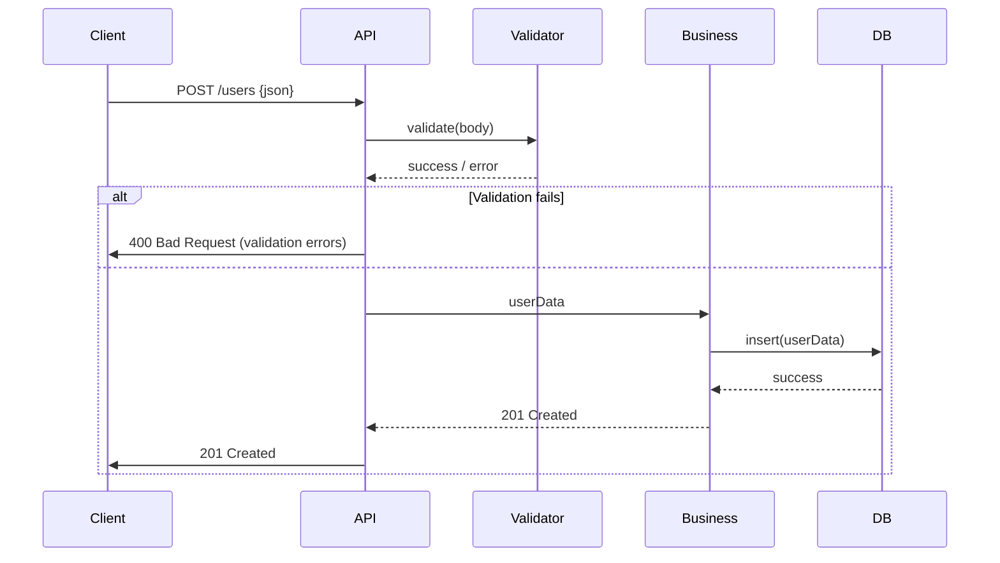

<!-- Generated by Groq via GitHub Actions -->
<!-- Topic ID: T262 -->
<!-- Category: API Architecture -->
<!-- Generated at UTC: 2026-11-27T09:50:03.453566+00:00 -->

# Schema validation

## 1. What problem does this solve?

**Motivation**  
When a backend receives data (HTTP request body, message from a queue, database row, etc.) it must decide whether that data is *well‑formed* before it can be processed. Without a clear contract, the system can:

- Crash on unexpected types or missing fields.
- Persist corrupt data.
- Expose sensitive information through stack traces.
- Make debugging hard because errors surface deep in the stack.

**What problem exists**  
- **Untrusted input**: Clients can send malformed or malicious payloads.
- **Schema drift**: The contract between services evolves, but code may not keep up.
- **Complex data**: Nested objects, arrays, optional fields, polymorphic types.

**Why the problem matters**  
- **Reliability**: A single bad request can bring down a service if not caught early.
- **Security**: Validation is a first line of defense against injection attacks.
- **Developer experience**: Clear errors help front‑end and API consumers fix bugs quickly.
- **Data integrity**: Prevents corrupt data from entering databases or caches.

**What happens if this concept is not used**  
- Runtime exceptions propagate to clients or crash workers.
- Inconsistent data in databases leads to hard‑to‑track bugs.
- Attackers can exploit unvalidated input (e.g., SQL injection, XSS).

**Where this concept appears in real backend systems**  
- HTTP request body validation in REST/GraphQL APIs.
- Message schema validation for Kafka, RabbitMQ, or AWS SQS.
- Database row validation (e.g., PostgreSQL constraints, MongoDB schema validation).
- Cache key/value validation in Redis.
- Configuration file validation at startup.

---

## 2. Mental model

**Analogy – The Post Office**  
Imagine every incoming request is a package that must be sorted before delivery. The post office uses *labels* (schemas) to decide:

- Where the package goes (endpoint or service).
- What checks it must pass (weight, dimensions, fragile flag).

If a package lacks a label or the label is wrong, the post office rejects it or sends it to a quarantine area.

**Engineering model**  
- **Schema** = contract (JSON Schema, Zod, Prisma, etc.).
- **Validator** = the sorting machine that checks the package against the contract.
- **Error handling** = quarantine area that returns a clear error to the sender.
- **Versioning** = different label versions for different post office branches.

---

## 3. Deep explanation

### Internals
- **Static vs. runtime**: TypeScript types are erased at runtime; runtime validation libraries (Zod, Joi, Yup, JSON Schema) perform checks after the code runs.
- **Parsing**: Many validators parse raw input (e.g., JSON string) into a typed object, coercing types if configured.
- **Error reporting**: Validators return structured error objects (field path, message, value) that can be serialized to HTTP responses.

### Important terminology
- **Schema**: Declarative description of expected shape.
- **Validator**: Function that enforces a schema.
- **Coercion**: Automatic conversion (e.g., string → number).
- **Strict mode**: Rejects unknown keys.
- **Partial / Optional**: Allows missing fields.
- **Discriminated unions**: Polymorphic schemas.

### Trade‑offs
| Aspect | Pros | Cons |
|--------|------|------|
| **Runtime validation** | Immediate error feedback, security | Performance overhead, duplicate logic |
| **Static types only** | Zero runtime cost | No protection against malformed data |
| **Schema libraries** | Rich DSL, composability | Learning curve, potential bloat |
| **Database constraints** | Enforced at persistence layer | Duplicate effort, harder to test |

### Failure modes
- **False positives**: Overly strict schemas reject valid data.
- **False negatives**: Missing validation allows bad data.
- **Schema drift**: Code changes without updating schemas.
- **Performance bottlenecks**: Deeply nested validation can be slow.

### Limitations
- Cannot validate *semantic* correctness (e.g., email uniqueness) – requires business logic.
- Cannot enforce *cross‑field* constraints without custom logic.
- Overhead in high‑throughput services if not optimized.

### Where it fits in a backend architecture
```
┌───────────────────────┐
│  Client / API Gateway │
└────────────┬──────────┘
             │
             ▼
┌───────────────────────┐
│  Request Validation   │  ← Schema validation
└────────────┬──────────┘
             │
             ▼
┌───────────────────────┐
│  Business Logic Layer │
└────────────┬──────────┘
             │
             ▼
┌───────────────────────┐
│  Persistence Layer    │
└───────────────────────┘
```
- Validation sits between the gateway and business logic.
- It also protects the persistence layer from corrupt data.

### Interaction with related concepts
- **Type safety**: Runtime validation bridges the gap between static types and dynamic data.
- **Migrations**: Schema evolution must be coordinated with validation changes.
- **Serialization**: Validation often occurs after deserialization (e.g., `JSON.parse`).
- **Caching**: Validated data can be cached safely; invalid data should never reach cache.

---

## 4. How it works

1. **Receive raw input** (e.g., `req.body`).
2. **Parse** the raw input into a JavaScript object (JSON parsing).
3. **Validate** the object against a schema.
4. **Coerce** types if configured.
5. **Return** either the validated object or a structured error.
6. **Proceed** to business logic if validation succeeded.



---

## 5. Practical implementation

### TypeScript + Node.js (Express + Zod)

```ts
// src/validation/user.ts
import { z } from 'zod';

export const UserSchema = z.object({
  username: z.string().min(3).max(30),
  email: z.string().email(),
  age: z.number().int().min(0).optional(),
  // Discriminated union example
  role: z.enum(['admin', 'user', 'guest']),
  profile: z.object({
    firstName: z.string(),
    lastName: z.string(),
  }),
});
export type User = z.infer<typeof UserSchema>;
```

```ts
// src/routes/user.ts
import express from 'express';
import { UserSchema, User } from '../validation/user';

const router = express.Router();

router.post(
  '/users',
  async (req, res, next) => {
    try {
      // 1️⃣ Validate request body
      const user: User = UserSchema.parse(req.body);

      // 2️⃣ Business logic (e.g., save to DB)
      const saved = await saveUserToDB(user); // pretend function

      // 3️⃣ Respond
      res.status(201).json(saved);
    } catch (err) {
      if (err instanceof z.ZodError) {
        // Structured validation error
        return res.status(400).json({
          message: 'Invalid request',
          errors: err.errors,
        });
      }
      next(err); // other errors
    }
  }
);

export default router;
```

**Key lines explained**

- `UserSchema.parse(req.body)` – throws `ZodError` if validation fails.
- `z.ZodError` – provides `errors` array with `path`, `message`, and `value`.
- `User` type – inferred from the schema, giving compile‑time safety downstream.

### Optional: Database constraint example (PostgreSQL)

```sql
ALTER TABLE users
ADD CONSTRAINT unique_email UNIQUE (email);
```

This is a *second line of defense* after runtime validation.

---

## 6. Production considerations

| Concern | What to watch for | Mitigation |
|---------|-------------------|------------|
| **Scalability** | Validation can be CPU‑bound on high‑throughput APIs. | Use fast libraries (Zod), pre‑compile schemas, batch validation if possible. |
| **Reliability** | Validation errors should never crash the service. | Catch `ZodError`, return 400, log details. |
| **Security** | Unvalidated input can lead to injection attacks. | Strict schemas, disallow unknown keys, use `strict()` mode. |
| **Observability** | Need to see how often validation fails. | Emit metrics (`validation_failures_total`) and log error payloads. |
| **Performance** | Coercion and deep validation add latency. | Disable coercion if not needed, use `z.lazy` for recursive schemas. |
| **Error handling** | Clients need actionable errors. | Return `400` with field‑specific messages. |
| **Resource usage** | Large payloads may consume memory. | Stream parsing, limit body size (`express.json({ limit: '1mb' })`). |
| **Operational concerns** | Schema drift across services. | Versioned schemas, CI tests that compare API contracts. |
| **Failure recovery** | If validation fails, ensure no partial writes. | Transactional DB writes, idempotent endpoints. |
| **Deployment** | Schema changes require coordinated rollout. | Feature flags, canary releases, backward‑compatible changes. |

---

## 7. Common mistakes

| Mistake | Why it’s problematic |
|---------|----------------------|
| **Skipping validation** | Runtime errors, data corruption, security holes. |
| **Using only static types** | Types are erased at runtime; untrusted data still passes. |
| **Over‑strict schemas** | Legitimate requests rejected, poor UX. |
| **Allowing unknown keys** | Silent data leaks, future bugs. |
| **Validating after business logic** | Bad data can corrupt state before validation. |
| **Not handling nested objects** | Partial validation leads to missing errors. |
| **Not versioning schemas** | Clients and services drift apart. |
| **Using synchronous validation in async context** | Blocks event loop, hurts throughput. |
| **Not testing validation** | Undetected regressions. |
| **Ignoring error messages** | Clients get vague errors, hard to debug. |

---

## 8. Senior engineer perspective

### When used at scale
- **Architecture decisions**: Place validation at the API gateway or in a dedicated middleware layer to centralize logic.
- **Trade‑offs**: Choose a library that balances speed and expressiveness; consider compiled schemas for hot paths.
- **Bottlenecks**: Deeply nested or polymorphic schemas can become CPU hotspots; profile and refactor.
- **Failure scenarios**: A malformed payload can trigger a cascade of errors; design graceful degradation.
- **Monitoring**: Track `validation_failures_total`, latency of validation, error rates per endpoint.
- **Cost/performance**: In serverless, validation cost directly impacts cold‑start latency; pre‑compile schemas to reduce startup time.
- **When NOT to use**: For highly dynamic data where schemas change frequently, consider schema‑less approaches (e.g., JSON schema with runtime checks only when needed). Also, if the service is purely internal and data is already sanitized, you might skip validation to save cycles.

---

## 9. Interview questions

1. **Beginner**: *What is the difference between static type checking and runtime schema validation?*  
   **Answer**: Static types are checked at compile time and removed at runtime; runtime validation checks data after it arrives, ensuring it matches a contract.

2. **Beginner**: *Why should we use `strict()` mode in Zod?*  
   **Answer**: It rejects unknown keys, preventing accidental data leakage and catching typos or extra fields that could indicate bugs.

3. **Senior**: *How would you design a system that supports multiple API versions with different schemas without breaking existing clients?*  
   **Answer**: Use versioned endpoints or a content‑type header, maintain separate schema validators per version, and deprecate old schemas gradually. Employ feature flags or canary releases.

4. **Senior**: *Explain how you would monitor and alert on validation failures in a high‑traffic service.*  
   **Answer**: Emit a `validation_failures_total` metric with labels (endpoint, status code). Set alerts for sudden spikes. Log detailed error payloads for debugging, but mask sensitive data.

5. **Scenario/Debugging**: *A production endpoint returns 400 for valid requests after a recent deployment. What steps would you take to diagnose and fix the issue?*  
   **Answer**:  
   - Check the deployed schema version; compare with client payload.  
   - Enable verbose logging of validation errors.  
   - Verify that the schema was correctly compiled (e.g., `z.object` vs. `z.lazy`).  
   - Look for accidental `strict()` or `unknownKeys: 'strip'` changes.  
   - Roll back to previous schema if necessary, then incrementally adjust the new schema to accept the payload.

---

## 10. Hands‑on task

**Goal**: Add request validation to the `/login` endpoint in the existing `auth` module.

1. Create a Zod schema that requires:
   - `email` (string, email format)
   - `password` (string, min 8 chars)
2. Update the Express route to parse and validate the request body.
3. Return a `400` with detailed errors if validation fails.
4. Write a Jest test that sends an invalid payload and expects a `400` response.

**Repository structure** (assumed):

```
src/
  routes/
    auth.ts
  validation/
    auth.ts
tests/
  auth.test.ts
```

---

## 11. Quick revision

- Schema validation protects against malformed input and enforces contracts.
- Static types alone are insufficient; runtime validation is required.
- Zod/Joi/Yup are common Node.js validators; choose based on speed vs. DSL.
- Use `strict()` to reject unknown fields.
- Validation should happen before business logic and persistence.
- Emit metrics and log structured errors for observability.
- Version schemas and keep backward compatibility.
- Avoid over‑strict schemas that reject legitimate data.
- Test validation paths thoroughly.
- In high‑throughput services, pre‑compile schemas and profile.

---

## 12. References

- [Zod documentation](https://github.com/colinhacks/zod)
- [Joi documentation](https://joi.dev/)
- [FastAPI validation (Python)](https://fastapi.tiangolo.com/tutorial/body/)
- [JSON Schema](https://json-schema.org/)
- [PostgreSQL constraints](https://www.postgresql.org/docs/current/ddl-constraints.html)
- [Express error handling](https://expressjs.com/en/guide/error-handling.html)
- [Observability with Prometheus](https://prometheus.io/docs/introduction/overview/)
- [OpenAPI schema validation](https://swagger.io/docs/specification/2-0/validation/)
