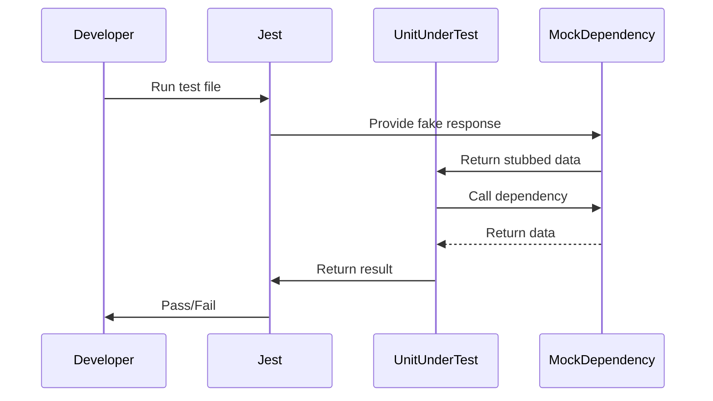

<!-- Generated by Groq via GitHub Actions -->
<!-- Topic ID: T263 -->
<!-- Category: Testing -->
<!-- Generated at UTC: 2026-11-27T22:13:55.295072+00:00 -->

# Unit testing

## 1. What problem does this solve?

**Motivation**  
When you change a piece of code, you want to be confident that the change didn’t break anything else. Unit tests give you that confidence by asserting that a *small, isolated* unit of logic behaves as expected.

**What problem exists**  
- **Regression risk**: A new feature or bug fix can unintentionally alter existing behavior.  
- **Documentation gap**: Code comments are often insufficient to convey intended behavior.  
- **Rapid iteration**: Modern dev cycles push changes fast; without tests, each change is a gamble.

**Why the problem matters**  
- **Customer impact**: A regression can surface as a bug in production, leading to downtime or data corruption.  
- **Developer productivity**: Fixing bugs that should have been caught early costs time and effort.  
- **Team trust**: A codebase with solid tests fosters confidence in refactoring and feature addition.

**What happens if this concept is not used**  
- **Increased bug surface**: More bugs reach production.  
- **Harder onboarding**: New developers lack clear expectations of behavior.  
- **Slower releases**: Manual testing or exploratory QA becomes the bottleneck.

**Where this concept appears in real backend systems**  
- **API handlers**: Testing that a request returns the correct status and payload.  
- **Business logic**: Verifying that a discount calculation returns the right amount.  
- **Data access layers**: Ensuring repository methods return expected entities.  
- **Background workers**: Confirming that a job processes a message correctly.

---

## 2. Mental model

**Analogy**  
Think of a unit test like a *quality gate* in a factory line. Each product (function) passes through a gate that checks a specific property (output). If the product fails, it is rejected before it reaches the next stage.

**Engineering model**  
- **Unit**: The smallest testable part of your code (a function, class method, or small module).  
- **Test**: A deterministic assertion that the unit produces the expected result given a known input.  
- **Isolation**: The unit is tested without real dependencies (databases, network, etc.) – mocks or stubs replace them.  
- **Repeatability**: Running the test should always yield the same result, regardless of environment.

---

## 3. Deep explanation

### Internals
- **Test runner** (e.g., Jest, Mocha) discovers and executes test files.  
- **Assertion library** (e.g., `expect`, `chai`) provides expressive checks.  
- **Mocking framework** (e.g., `jest.mock`, `sinon`) replaces external dependencies.  
- **Test lifecycle hooks** (`beforeEach`, `afterAll`) set up and tear down state.

### Important terminology
- **Test case**: A single assertion or set of assertions for a specific scenario.  
- **Test suite**: A collection of test cases grouped by feature or module.  
- **Mock**: A fake implementation that mimics an external dependency.  
- **Stub**: A simplified function that returns predetermined data.  
- **Spies**: Objects that record calls to verify interactions.

### Trade‑offs
| Aspect | Benefit | Drawback |
|--------|---------|----------|
| **Speed** | Unit tests run fast (ms). | Over‑mocking can hide integration issues. |
| **Coverage** | High coverage of logic paths. | Does not guarantee end‑to‑end correctness. |
| **Isolation** | Easier to pinpoint failures. | Requires effort to maintain mocks. |

### Failure modes
- **False positives**: Tests pass but real code fails due to environment differences.  
- **False negatives**: Tests fail because of brittle assertions (e.g., deep equality on timestamps).  
- **Mock drift**: Mocks become stale when external APIs evolve.

### Limitations
- Cannot test asynchronous side effects that involve real I/O (e.g., database writes).  
- Requires careful design; code that is hard to test often indicates poor separation of concerns.

### Where this concept fits in a backend architecture
```
┌───────────────────────┐
│  API Layer (Express)  │
├───────────────────────┤
│  Service Layer        │
├───────────────────────┤
│  Repository Layer     │
└───────────────────────┘
```
Unit tests target the **Service** and **Repository** layers, mocking the **API** and **DB** layers. Integration tests cover the whole stack.

### Interaction with related backend concepts
- **Dependency Injection**: Makes units easier to mock.  
- **Continuous Integration**: Unit tests run on every commit.  
- **Feature Flags**: Tests can assert behavior under different flag states.  
- **Observability**: Unit tests can assert that metrics or logs are emitted.

---

## 4. How it works

1. **Define the unit** – isolate the function or method you want to test.  
2. **Write a test case** – describe the input and expected output.  
3. **Mock dependencies** – replace external services with fakes.  
4. **Run the test** – the test runner executes the test case.  
5. **Assert** – compare actual output to expected.  
6. **Repeat** – add more cases for edge conditions.  
7. **Integrate** – add the test to CI pipeline.  

**Mermaid diagram**



---

## 5. Practical implementation

### Example: Discount service

```ts
// discountService.ts
export class DiscountService {
  constructor(private readonly repo: DiscountRepository) {}

  async calculate(userId: string, amount: number): Promise<number> {
    const discount = await this.repo.getDiscountForUser(userId);
    return amount * (1 - discount / 100);
  }
}
```

```ts
// discountService.test.ts
import { DiscountService } from './discountService';
import { DiscountRepository } from './discountRepository';

jest.mock('./discountRepository'); // auto‑mock

describe('DiscountService', () => {
  let service: DiscountService;
  let mockRepo: jest.Mocked<DiscountRepository>;

  beforeEach(() => {
    mockRepo = new DiscountRepository() as jest.Mocked<DiscountRepository>;
    service = new DiscountService(mockRepo);
  });

  it('applies 10% discount for user A', async () => {
    // Arrange
    mockRepo.getDiscountForUser.mockResolvedValue(10);

    // Act
    const result = await service.calculate('userA', 200);

    // Assert
    expect(result).toBe(180); // 200 * 0.9
    expect(mockRepo.getDiscountForUser).toHaveBeenCalledWith('userA');
  });

  it('handles zero discount', async () => {
    mockRepo.getDiscountForUser.mockResolvedValue(0);
    const result = await service.calculate('userB', 150);
    expect(result).toBe(150);
  });
});
```

**Key lines explained**

- `jest.mock('./discountRepository')`: Replaces the real repository with a mock.  
- `mockResolvedValue`: Configures the mock to return a promise that resolves to the desired value.  
- `toHaveBeenCalledWith`: Verifies that the service called the repository correctly.

### Integration with Docker

Add a `docker-compose.yml` that runs Jest inside a container:

```yaml
services:
  test:
    image: node:20
    working_dir: /app
    volumes:
      - .:/app
    command: npm test
```

Run with `docker compose up test`.

---

## 6. Production considerations

| Concern | How unit tests help | Caveats |
|---------|--------------------|---------|
| **Scalability** | Fast tests allow frequent runs on CI, catching regressions early. | Over‑mocking may hide scaling issues that only appear with real DB load. |
| **Reliability** | Deterministic tests reduce flaky bugs. | Tests must be kept up‑to‑date with API changes. |
| **Security** | Tests can assert that sensitive data is not logged or exposed. | Mocked dependencies may not reflect real security constraints. |
| **Observability** | Unit tests can assert that metrics/loggers are called. | Requires instrumentation in test environment. |
| **Performance** | Unit tests run in milliseconds, enabling quick feedback loops. | Heavy mocking can slow down test suite if not managed. |
| **Error handling** | Verify that exceptions are thrown and caught correctly. | Need to test both happy and error paths. |
| **Resource usage** | No real DB or network traffic → minimal resources. | Mock objects may consume memory if not cleaned up. |
| **Operational concerns** | Tests run in CI, ensuring code quality before deployment. | Must integrate with CI/CD pipelines. |
| **Failure recovery** | Detect regressions before they reach production. | Unit tests alone cannot guarantee recovery; integration tests needed. |
| **Deployment considerations** | Tests can be run in staging environments to validate before release. | Must maintain test data consistency across environments. |

---

## 7. Common mistakes

| Mistake | Why it’s problematic |
|---------|----------------------|
| **Testing implementation details** | Coupling tests to internal structure makes refactoring hard. |
| **Over‑mocking external services** | Hides integration bugs; tests pass while real code fails. |
| **Using real databases in unit tests** | Slows tests and introduces flakiness. |
| **Neglecting edge cases** | Misses bugs that only occur under rare conditions. |
| **Relying on global state** | Tests become order‑dependent and flaky. |
| **Ignoring async/await** | Tests may pass prematurely before promises resolve. |
| **Not cleaning up mocks** | Residual state can affect subsequent tests. |
| **Writing too many tests for trivial getters/setters** | Wastes effort; focus on business logic. |

---

## 8. Senior engineer perspective

### What changes at scale
- **Test suite size**: Hundreds of files; need to structure directories and naming conventions.  
- **Parallel execution**: Run tests across multiple workers or CI nodes.  
- **Mock management**: Use dependency injection frameworks (e.g., Inversify) to centralize mocks.  
- **Coverage thresholds**: Enforce minimum coverage, but balance against maintenance cost.  
- **Test data factories**: Generate realistic data instead of hard‑coding values.

### Design decisions
- **Isolation vs. integration**: Decide which layers need unit tests and which need integration tests.  
- **Mock strategy**: Prefer *interface* mocks over *implementation* mocks to reduce brittleness.  
- **Test environment**: Use a dedicated test database or in‑memory DB (e.g., SQLite) for integration tests.  
- **CI pipeline**: Split tests into fast (unit) and slow (integration) stages.  
- **Monitoring**: Track test flakiness metrics; auto‑fail if flakiness exceeds threshold.  
- **Cost**: Running tests in containers adds overhead; consider caching dependencies.

### When NOT to use the approach
- **Highly dynamic code** (e.g., code that generates code at runtime) may be hard to unit test.  
- **Legacy monoliths** where refactoring to isolate units is too costly.  
- **Rapid prototyping** where unit tests would slow down iteration more than they help.

---

## 9. Interview questions

| Level | Question | Answer points |
|-------|----------|---------------|
| Beginner | What is a unit test? | Small, isolated test of a single function/method. |
| Beginner | Why do we mock dependencies in unit tests? | To isolate the unit, avoid external I/O, make tests deterministic. |
| Senior | How would you structure a large test suite for a microservice? | Directory layout, naming conventions, test runners, parallel execution, CI integration. |
| Senior | Explain the trade‑offs between unit tests and integration tests. | Speed vs. coverage, isolation vs. real environment, maintenance overhead. |
| Scenario | A test for a function that calculates tax fails intermittently. What steps would you take to debug it? | Check for nondeterministic data (timestamps, random numbers), ensure mocks are reset, add deterministic seeds, use `toBeCloseTo` for floating point, run test in isolation, inspect logs. |

---

## 10. Hands‑on task

**Task**: Add unit tests for the `OrderProcessor` service in the repository.

1. Locate `src/services/orderProcessor.ts`.  
2. Identify its dependencies (`PaymentGateway`, `InventoryService`).  
3. Create a test file `src/services/orderProcessor.test.ts`.  
4. Mock the dependencies using Jest.  
5. Write tests for:
   - Successful order placement.  
   - Payment failure scenario.  
   - Inventory out‑of‑stock scenario.  
6. Run `npm test` and ensure all tests pass.  
7. Commit the changes and push to a feature branch.

---

## 11. Quick revision

- Unit tests assert *behavior* of isolated units.  
- Use mocks to replace external dependencies.  
- Keep tests deterministic: no real I/O, no random data.  
- Structure tests: `describe` for feature, `it` for scenario.  
- Verify both happy paths and error paths.  
- Run tests in CI; split fast (unit) and slow (integration).  
- Avoid testing implementation details; focus on public contract.  
- Clean up mocks after each test (`afterEach`).  
- Use `toHaveBeenCalledWith` to assert interactions.  
- Maintain coverage thresholds but balance against maintenance cost.

---

## 12. References

- [Jest Documentation – Testing](https://jestjs.io/docs/getting-started)  
- [Mocha Documentation – Testing](https://mochajs.org/)  
- [Sinon Documentation – Spies, Stubs, Mocks](https://sinonjs.org/)  
- [Node.js Testing Guide](https://nodejs.org/api/testing.html)  
- [TypeScript Handbook – Testing](https://www.typescriptlang.org/docs/handbook/testing.html)  
- [CI/CD with Jest](https://docs.github.com/en/actions/automating-builds-and-tests/building-and-testing-nodejs)  
- [Testing in a Microservices Architecture](https://martinfowler.com/articles/microservices-testing.html)
