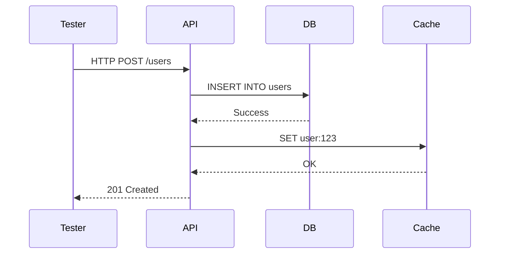

<!-- Generated by Groq via GitHub Actions -->
<!-- Topic ID: T264 -->
<!-- Category: Testing -->
<!-- Generated at UTC: 2026-11-27T22:13:55.295072+00:00 -->

# Integration testing

## 1. What problem does this solve?

Integration testing verifies that **multiple components of a system work together correctly**.  
While unit tests confirm that a single function behaves as expected, integration tests catch issues that arise only when those functions are wired together:

- **Data flow errors** (e.g., a service writes to a DB but the consumer reads a different schema).
- **Protocol mismatches** (e.g., an HTTP client expects JSON but receives XML).
- **Configuration bugs** (e.g., environment variables missing in a container).
- **External dependency failures** (e.g., a cache miss causing a fallback to a slow DB).

If integration tests are omitted, a backend can pass all unit tests yet fail in production when services interact. Real‑world systems—microservice architectures, serverless functions, or monoliths with multiple layers—rely on correct inter‑component communication. Integration tests provide the safety net that ensures those interactions remain stable as code evolves.

## 2. Mental model

**Analogy**  
Think of a car: unit tests are like checking each part in isolation (brakes, engine, steering). Integration tests are like driving the car on a test track to see if all parts work together—does the engine power the wheels, do the brakes stop the car, does the steering respond while the engine is running?

**Engineering model**  
- **Components**: services, databases, caches, message brokers, external APIs.  
- **Contracts**: APIs, database schemas, message formats.  
- **Execution flow**: a request enters one component, passes through others, and a response returns.  
Integration testing validates that the *entire flow* respects the contracts and produces the expected outcome.

## 3. Deep explanation

| Topic | Explanation |
|-------|-------------|
| **Internals** | Integration tests spin up real or realistic instances of external dependencies (e.g., a Postgres container, a Redis cache). They exercise the actual network or IPC protocols, not mocks. |
| **Important terminology** | *Contract testing* (ensuring API shape), *end‑to‑end* (full user journey), *service under test* (SUT), *fixtures* (pre‑populated data). |
| **Trade‑offs** | Faster to run when using mocks, but less confidence. Real dependencies increase flakiness and resource usage. |
| **Failure modes** | Flaky tests due to timing, network latency, or shared state. Over‑mocking can hide real bugs. |
| **Limitations** | Cannot fully simulate production scale; may miss concurrency issues. |
| **Where it fits** | Part of the CI pipeline after unit tests, before deployment. Often grouped with contract tests. |
| **Interactions** | Works with *dependency injection* to swap real services for test doubles when needed. Ties into *observability* (logs, metrics) to debug failures. |

## 4. How it works

1. **Set up test environment** – spin up containers or in‑memory services.  
2. **Seed data** – insert necessary rows or cache entries.  
3. **Execute request** – call the API endpoint or invoke the function.  
4. **Assert response** – check status, body, headers.  
5. **Verify side effects** – query the DB, check cache, ensure messages were published.  
6. **Tear down** – clean up containers and data.



## 5. Practical implementation

Below is a realistic integration test for a Next.js API route that creates a user in PostgreSQL and caches the result in Redis.  
We use **Jest**, **Supertest**, and **testcontainers** to spin up real Postgres and Redis instances.

```ts
// /pages/api/users.ts
import { NextApiRequest, NextApiResponse } from 'next';
import { pool } from '../../lib/db';
import { redisClient } from '../../lib/redis';

export default async function handler(req: NextApiRequest, res: NextApiResponse) {
  if (req.method !== 'POST') return res.status(405).end();

  const { name, email } = req.body;
  const client = await pool.connect();

  try {
    await client.query('BEGIN');
    const insert = await client.query(
      'INSERT INTO users(name, email) VALUES($1, $2) RETURNING id',
      [name, email]
    );
    const userId = insert.rows[0].id;

    // Cache the user
    await redisClient.set(`user:${userId}`, JSON.stringify({ id: userId, name, email }));

    await client.query('COMMIT');
    res.status(201).json({ id: userId, name, email });
  } catch (err) {
    await client.query('ROLLBACK');
    res.status(500).json({ error: 'Internal error' });
  } finally {
    client.release();
  }
}
```

```ts
// /tests/integration/users.test.ts
import request from 'supertest';
import { createServer } from 'http';
import { Server } from 'http';
import { GenericContainer, StartedTestContainer } from 'testcontainers';
import { pool } from '../../lib/db';
import { redisClient } from '../../lib/redis';
import handler from '../../pages/api/users';

let pgContainer: StartedTestContainer;
let redisContainer: StartedTestContainer;
let server: Server;

beforeAll(async () => {
  // Start Postgres
  pgContainer = await new GenericContainer('postgres')
    .withEnv('POSTGRES_PASSWORD', 'secret')
    .withEnv('POSTGRES_DB', 'testdb')
    .withExposedPorts(5432)
    .start();

  // Start Redis
  redisContainer = await new GenericContainer('redis')
    .withExposedPorts(6379)
    .start();

  // Configure DB pool to point to the container
  process.env.PGHOST = pgContainer.getHost();
  process.env.PGPORT = pgContainer.getMappedPort(5432).toString();
  process.env.PGUSER = 'postgres';
  process.env.PGPASSWORD = 'secret';
  process.env.PGDATABASE = 'testdb';

  // Re‑initialize pool after env change
  await pool.query('CREATE TABLE IF NOT EXISTS users(id SERIAL PRIMARY KEY, name TEXT, email TEXT)');

  // Configure Redis client
  process.env.REDIS_HOST = redisContainer.getHost();
  process.env.REDIS_PORT = redisContainer.getMappedPort(6379).toString();
  await redisClient.connect();

  // Spin up a tiny HTTP server that forwards to the Next.js handler
  server = createServer((req, res) => handler(req as any, res as any));
});

afterAll(async () => {
  await redisClient.disconnect();
  await pool.end();
  await pgContainer.stop();
  await redisContainer.stop();
  server.close();
});

test('POST /api/users creates user and caches it', async () => {
  const payload = { name: 'Alice', email: 'alice@example.com' };

  const response = await request(server).post('/api/users').send(payload);
  expect(response.status).toBe(201);
  expect(response.body).toMatchObject(payload);

  // Verify DB row
  const { rows } = await pool.query('SELECT * FROM users WHERE email = $1', [payload.email]);
  expect(rows).toHaveLength(1);
  const userId = rows[0].id;

  // Verify Redis cache
  const cached = await redisClient.get(`user:${userId}`);
  expect(JSON.parse(cached!)).toMatchObject(payload);
});
```

**Key points**

- `testcontainers` gives us isolated, reproducible Postgres/Redis instances.  
- The HTTP server is minimal; it forwards requests to the real Next.js handler.  
- We seed the DB schema in `beforeAll`.  
- All resources are cleaned up in `afterAll`.

## 6. Production considerations

| Concern | How integration tests help / what to watch |
|---------|-------------------------------------------|
| **Scalability** | Tests run on a single machine; they cannot simulate thousands of concurrent users. Use load tests for that. |
| **Reliability** | Flaky tests can mask real bugs. Use deterministic data, avoid time‑based assertions, and isolate containers. |
| **Security** | Do not expose real credentials. Use test credentials and containerized services. |
| **Observability** | Capture logs from containers; enable metrics in test containers if needed. |
| **Performance** | Integration tests are slower; run them in a dedicated CI job or on a nightly build. |
| **Error handling** | Verify that the system recovers from partial failures (e.g., DB down, cache down). |
| **Resource usage** | Containers consume memory/CPU; clean up promptly. |
| **Operational concerns** | Keep test environment close to production (same DB version, same Redis config). |
| **Failure recovery** | Use retries for transient network issues, but fail fast on persistent errors. |
| **Deployment considerations** | Integration tests should run before merging to `main`; they can gate deployments. |

## 7. Common mistakes

| Mistake | Why it’s problematic |
|---------|----------------------|
| **Mocking everything** | You lose confidence that the real DB or cache works. |
| **Using the same DB as production** | Risk of data corruption; tests may interfere with live data. |
| **Not cleaning up** | Leftover data or containers can cause flaky tests and resource leaks. |
| **Hard‑coding ports** | Port conflicts in CI environments. |
| **Running integration tests in the same process as unit tests** | Slows down the entire test suite; can mask performance regressions. |
| **Ignoring environment variables** | Tests may run against wrong services if envs are misconfigured. |
| **Not asserting side effects** | Only checking the HTTP response misses bugs in DB or cache writes. |

## 8. Senior engineer perspective

When scaling integration tests to a large codebase:

- **Architecture decisions**  
  - Use *service virtualization* (e.g., WireMock) for external APIs to avoid network flakiness.  
  - Adopt *container orchestration* (Docker Compose, Kubernetes) for complex dependency graphs.  
  - Separate *unit*, *integration*, and *end‑to‑end* pipelines to balance speed and coverage.

- **Trade‑offs**  
  - Real containers give confidence but increase CI time and cost.  
  - Mocking reduces cost but risks missing protocol bugs.  
  - Parallel test execution can expose race conditions but requires careful isolation.

- **Bottlenecks**  
  - Database migrations can slow down test startup.  
  - Network latency between containers can make tests flaky.  
  - Shared state between tests can cause hidden dependencies.

- **Failure scenarios**  
  - Container startup failures (image pull errors).  
  - Resource exhaustion (memory limits).  
  - Schema drift between test and prod databases.

- **Monitoring**  
  - Capture container logs, metrics, and health checks.  
  - Use test result dashboards to surface flaky tests.

- **Cost/performance**  
  - Run heavier integration tests on a nightly or pre‑merge job.  
  - Cache Docker layers to speed up container startup.

- **When NOT to use the approach**  
  - For very small services where unit tests suffice.  
  - When CI resources are extremely constrained.  
  - When external dependencies are stable and well‑documented; contract tests may be enough.

## 9. Interview questions

1. **Beginner** – *What is the difference between a unit test and an integration test?*  
   *Answer:* Unit tests isolate a single function or module, often using mocks. Integration tests run multiple components together, exercising real interfaces and data stores.

2. **Beginner** – *Why do we need to spin up a real database for integration tests?*  
   *Answer:* To verify that SQL queries, transactions, and schema constraints work as expected, and to catch issues like missing indexes or type mismatches that mocks cannot reveal.

3. **Senior** – *How would you design an integration test suite for a microservice that depends on three external services (DB, cache, message broker)?*  
   *Answer:* Use containerized instances for each dependency, employ dependency injection to swap real services for test doubles when appropriate, isolate tests to avoid shared state, and run the suite in a dedicated CI job with parallel execution.

4. **Senior** – *Describe a scenario where integration tests could give a false sense of security and how to mitigate it.*  
   *Answer:* If tests use a single test database instance, they may miss concurrency issues that only appear under load. Mitigate by adding load or concurrency tests, using separate databases per test, and monitoring for race conditions.

5. **Scenario/Debugging** – *You run an integration test that passes locally but fails in CI with a timeout when inserting a user. What steps would you take to debug?*  
   *Answer:*  
   - Check CI logs for container startup times and resource limits.  
   - Verify that the test database is reachable and has enough memory.  
   - Add verbose logging to the handler and database client.  
   - Run the test locally with the same Docker Compose configuration.  
   - Consider increasing timeout or using a faster in‑memory DB for CI.

## 10. Hands‑on task

Add an integration test for a new `/api/users/:id` GET endpoint that retrieves a user from the cache first, then falls back to the database if missing.  
Your test should:

1. Create a user in the database.  
2. Call the endpoint and verify it returns the cached data.  
3. Invalidate the cache entry.  
4. Call the endpoint again and verify it fetches from the DB.

Commit the test and ensure it passes in the CI pipeline.

## 11. Quick revision

- Integration tests exercise real component interactions, not mocks.  
- Use containers (testcontainers, Docker Compose) to spin up dependencies.  
- Seed data and clean up after each test to avoid flakiness.  
- Verify both responses and side effects (DB rows, cache entries).  
- Separate unit, integration, and E2E tests for speed vs coverage.  
- Watch for resource leaks, port conflicts, and environment misconfigurations.  
- In CI, run integration tests in a dedicated job; consider nightly runs.  
- Senior engineers balance realism with cost, using service virtualization when appropriate.  
- Common pitfalls: over‑mocking, shared state, hard‑coded ports, missing cleanup.  
- Use logs, metrics, and dashboards to monitor test health.

## 12. References

- [Jest Documentation – Testing APIs](https://jestjs.io/docs/using-mocks)  
- [Supertest Documentation](https://github.com/visionmedia/supertest)  
- [Testcontainers for Node.js](https://github.com/testcontainers/testcontainers-node)  
- [Next.js API Routes](https://nextjs.org/docs/api-routes/introduction)  
- [PostgreSQL Node.js Driver – pg](https://node-postgres.com/)  
- [ioredis – Redis client for Node.js](https://github.com/luin/ioredis)  
- [Docker Compose Documentation](https://docs.docker.com/compose/)  
- [Mermaid Live Editor](https://mermaid.live/)
