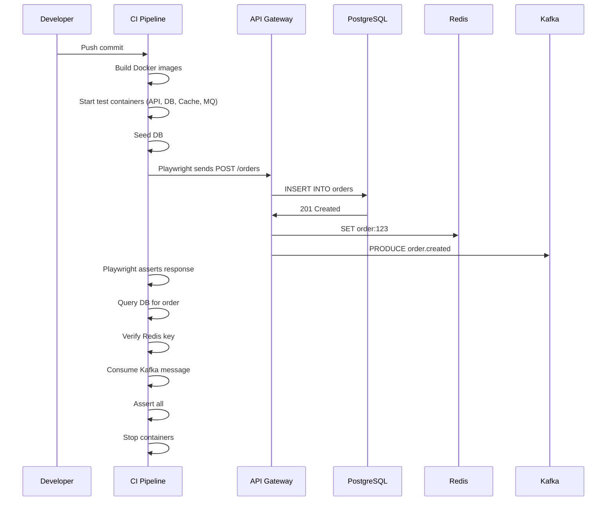

<!-- Generated by Groq via GitHub Actions -->
<!-- Topic ID: T265 -->
<!-- Category: Testing -->
<!-- Generated at UTC: 2026-11-28T09:02:03.324078+00:00 -->

# E2E testing

## 1. What problem does this solve?

**Motivation**  
When you ship a backend service, you often write unit tests for individual functions and integration tests for a couple of components. Yet, the real user experience is a *chain* of services: a request hits an API gateway, goes through authentication, hits a database, maybe a cache, and finally returns a response. A bug can appear only when all those pieces work together in the exact order they will in production.

**What problem exists**  
- Unit tests miss cross‑service contract violations (e.g., wrong JSON shape, missing fields).
- Integration tests that target a single service ignore the orchestration layer (API gateway, load balancer, service mesh).
- Manual QA is slow, flaky, and hard to repeat.

**Why the problem matters**  
- A broken end‑to‑end flow can cause silent data corruption, security holes, or a complete outage.
- Bugs that surface only in production are expensive to fix and damage user trust.
- Continuous delivery pipelines rely on automated tests to guarantee that a new commit does not break the whole system.

**What happens if this concept is not used**  
- Increased regression risk: a change in one microservice can silently break downstream services.
- Longer feedback loops: developers wait for manual QA or production incidents.
- Higher MTTR (Mean Time To Recovery) because issues surface late.

**Where this concept appears in real backend systems**  
- E‑commerce checkout flows that involve inventory, payment, and notification services.
- Social media posting that touches user profiles, feeds, and analytics.
- SaaS billing that triggers events across billing, usage, and notification services.

---

## 2. Mental model

**Analogy**  
Think of a backend system as a *train network*.  
- **Stations** are individual services (API, auth, DB, cache).  
- **Tracks** are the network protocols (HTTP, gRPC, Kafka).  
- **Trains** are the requests that move through the network.  
An E2E test is like a *test run* of a train from the origin station to the destination, ensuring all tracks, switches, and stations are operational and the train arrives on time.

**Engineering model**  
- **Test harness** orchestrates a *full stack* environment (containers, databases, caches).  
- **Test script** simulates a user or client, sending a request to the entry point.  
- **Assertions** verify that the final response and side‑effects (DB rows, cache entries, messages) match expectations.  
- **Isolation** is achieved by resetting the environment between runs (e.g., fresh containers, seeded data).

---

## 3. Deep explanation

### Internals
- **Test runner** (e.g., Playwright, Cypress, Jest with `@playwright/test`) manages test lifecycle, parallelism, and reporting.
- **Container orchestration** (Docker Compose, Testcontainers) spins up dependent services (PostgreSQL, Redis, Kafka) in a reproducible state.
- **Test hooks** (`beforeAll`, `afterAll`, `beforeEach`, `afterEach`) prepare data, clean up, and capture logs.
- **Network isolation**: tests run on a dedicated network to avoid interference with real services.

### Important terminology
- **End‑to‑End (E2E)** – tests the entire request/response cycle from the client to the final output.
- **Integration test** – focuses on a subset of services (e.g., API + DB) but not the full stack.
- **Contract test** – verifies that a service’s API adheres to a defined contract (OpenAPI, gRPC proto).
- **Test environment** – a sandbox that mimics production (same versions, same data shape).

### Trade‑offs
| Aspect | Pros | Cons |
|--------|------|------|
| **Realism** | Captures cross‑service bugs. | Slower, more flaky. |
| **Speed** | Unit tests run in ms. | E2E tests run in seconds/minutes. |
| **Isolation** | Unit tests are isolated. | E2E tests share state; need cleanup. |
| **Maintenance** | Less boilerplate for small services. | Requires keeping test data in sync with schema changes. |

### Failure modes
- **Flaky tests** due to timing, network latency, or shared state.
- **Environment drift**: test containers use older images than production.
- **Hidden dependencies**: tests pass locally but fail in CI because of missing env vars or secrets.

### Limitations
- **Resource intensive**: spinning up databases, caches, and services consumes CPU/memory.
- **Limited coverage**: you cannot test every possible path (e.g., rare error branches) without writing many tests.
- **Security**: tests may expose credentials if not handled properly.

### Where this concept fits in a backend architecture
- **Layered**: sits above the API gateway, below the monitoring layer.
- **CI/CD pipeline**: runs after unit tests, before integration tests, and before deployment to staging.
- **Observability**: logs and traces from E2E runs are valuable for debugging.

### Interaction with related concepts
- **Contract testing**: E2E can validate that the contract is respected end‑to‑end.
- **Chaos engineering**: E2E tests can be combined with fault injection to test resilience.
- **Feature flags**: E2E tests can toggle flags to verify different code paths.

---

## 4. How it works

1. **Spin up test environment**  
   - Docker Compose or Testcontainers starts PostgreSQL, Redis, Kafka, and the API gateway.
2. **Seed data**  
   - Run migration scripts and insert test fixtures.
3. **Run test script**  
   - Playwright sends an HTTP request to the API gateway.
4. **Capture side‑effects**  
   - Query the database, check Redis keys, consume Kafka messages.
5. **Assert**  
   - Verify HTTP status, response body, DB state, cache state, and message payload.
6. **Cleanup**  
   - Rollback migrations, delete containers, clear logs.



---

## 5. Practical implementation

### Project structure

```
/e2e
  ├─ tests
  │   └─ order.spec.ts
  ├─ docker-compose.yml
  └─ jest.config.ts
```

### `docker-compose.yml`

```yaml
version: "3.9"
services:
  api:
    build: .
    ports:
      - "3000:3000"
    depends_on:
      - db
      - redis
      - kafka
  db:
    image: postgres:15
    environment:
      POSTGRES_USER: test
      POSTGRES_PASSWORD: test
      POSTGRES_DB: testdb
    volumes:
      - ./migrations:/docker-entrypoint-initdb.d
  redis:
    image: redis:7
  kafka:
    image: bitnami/kafka:3
    environment:
      KAFKA_CFG_ZOOKEEPER_CONNECT: zookeeper:2181
      KAFKA_CFG_ADVERTISED_LISTENERS: PLAINTEXT://kafka:9092
      KAFKA_CFG_LISTENERS: PLAINTEXT://0.0.0.0:9092
  zookeeper:
    image: bitnami/zookeeper:3
    environment:
      ZOO_MY_ID: 1
      ZOO_SERVERS: server.1=zookeeper:2888:3888
```

### `jest.config.ts`

```ts
import type { Config } from '@jest/types';

const config: Config.InitialOptions = {
  testEnvironment: 'node',
  globalSetup: './e2e/setup.ts',
  globalTeardown: './e2e/teardown.ts',
  testTimeout: 30000,
};

export default config;
```

### `setup.ts` – spin up containers

```ts
import { GenericContainer } from 'testcontainers';
import { spawnSync } from 'child_process';

export default async () => {
  // Start Docker Compose
  spawnSync('docker-compose', ['up', '-d'], { stdio: 'inherit' });

  // Wait for services to be ready
  await new Promise((r) => setTimeout(r, 5000));

  // Run migrations
  spawnSync('npm', ['run', 'migrate'], { stdio: 'inherit' });
};
```

### `teardown.ts` – clean up

```ts
import { spawnSync } from 'child_process';

export default async () => {
  // Stop Docker Compose
  spawnSync('docker-compose', ['down'], { stdio: 'inherit' });
};
```

### `order.spec.ts` – Playwright E2E test

```ts
import { test, expect } from '@playwright/test';
import { Client } from 'pg';
import { createClient } from 'redis';
import { Kafka } from 'kafkajs';

const pgClient = new Client({
  host: 'localhost',
  port: 5432,
  user: 'test',
  password: 'test',
  database: 'testdb',
});
await pgClient.connect();

const redisClient = createClient({ url: 'redis://localhost:6379' });
await redisClient.connect();

const kafka = new Kafka({ brokers: ['localhost:9092'] });
const consumer = kafka.consumer({ groupId: 'e2e-test' });
await consumer.connect();
await consumer.subscribe({ topic: 'orders', fromBeginning: true });

test('Create order end‑to‑end', async () => {
  // 1️⃣ Send request
  const response = await test.request.post('http://localhost:3000/api/orders', {
    data: { productId: 42, quantity: 3 },
  });

  expect(response.status()).toBe(201);
  const body = await response.json();
  expect(body).toHaveProperty('id');

  // 2️⃣ Verify DB
  const res = await pgClient.query('SELECT * FROM orders WHERE id = $1', [body.id]);
  expect(res.rowCount).toBe(1);
  expect(res.rows[0].quantity).toBe(3);

  // 3️⃣ Verify Redis cache
  const cacheVal = await redisClient.get(`order:${body.id}`);
  expect(cacheVal).not.toBeNull();

  // 4️⃣ Verify Kafka message
  const messages: any[] = [];
  await consumer.run({
    eachMessage: async ({ message }) => {
      messages.push(JSON.parse(message.value?.toString() ?? '{}'));
    },
  });

  // Wait a bit for the consumer to pick up the message
  await new Promise((r) => setTimeout(r, 500));

  expect(messages).toContainEqual({
    id: body.id,
    productId: 42,
    quantity: 3,
  });
});
```

**Key lines explained**

- `test.request.post` – Playwright’s built‑in HTTP client; no browser needed.
- `pgClient.query` – Direct DB assertion to avoid relying on API round‑trip.
- `redisClient.get` – Checks cache side‑effect.
- `consumer.run` – Consumes Kafka message to validate event emission.

---

## 6. Production considerations

| Concern | How to address it |
|---------|-------------------|
| **Scalability** | Run tests in parallel workers; use lightweight containers (e.g., `postgres:15-alpine`). |
| **Reliability** | Add retries for flaky network calls; use deterministic test data. |
| **Security** | Never expose real secrets; use test‑only credentials. |
| **Observability** | Capture logs from containers; integrate with Loki/Prometheus. |
| **Performance** | Cache test data; reuse containers across test suites. |
| **Error handling** | Wrap DB/Redis calls in try/catch; fail fast with clear messages. |
| **Resource usage** | Limit container memory/CPU; clean up after each run. |
| **Operational concerns** | Use CI runners with Docker support; keep Docker Compose file in version control. |
| **Failure recovery** | Store container logs on failure; use `docker logs`. |
| **Deployment considerations** | Keep test environment identical to staging; use same image tags. |

---

## 7. Common mistakes

| Mistake | Why it’s problematic |
|---------|----------------------|
| **Hard‑coding URLs** | Tests break when the service address changes (e.g., CI vs. local). |
| **Not resetting state** | Residual data causes flaky tests and false positives. |
| **Ignoring async timing** | Race conditions between DB writes and cache reads. |
| **Using real services** | Tests become slow, flaky, and may affect production data. |
| **Over‑testing** | Writing E2E tests for trivial getters; wastes time. |
| **Not isolating secrets** | Exposing credentials in test code or logs. |
| **Skipping cleanup** | Containers left running consume resources and may interfere with subsequent runs. |

---

## 8. Senior engineer perspective

### What changes at scale
- **Test environment orchestration**: use Kubernetes or a dedicated test cluster instead of Docker Compose.
- **Parallelism**: split tests into shards; use a test matrix to run across multiple nodes.
- **Data volume**: seed large datasets; use snapshotting to avoid full re‑seed.
- **Observability**: aggregate logs, traces, and metrics from test runs; alert on failures.

### Design decisions
- **Container strategy**: single‑image vs. multi‑container; choose lightweight base images.
- **Test data management**: deterministic fixtures vs. random data; trade‑off between realism and repeatability.
- **Network isolation**: use separate Docker networks or Kubernetes namespaces to avoid cross‑test interference.
- **Failure scenarios**: simulate network partitions, slow DB, or message broker outages to test resilience.

### Bottlenecks
- **Database seeding**: can dominate test runtime; consider using `pg_restore` from a pre‑built dump.
- **Kafka consumption**: consumer lag can delay test completion; use `consumer.pause()` and `consumer.resume()` strategically.

### Monitoring
- **Metrics**: test duration, pass/fail ratio, resource usage per test.
- **Tracing**: instrument test runner to emit traces; correlate with service traces.

### Cost/performance
- **Compute**: running full stacks in CI can be expensive; consider shared test environments or cloud test services.
- **Storage**: keep logs and artifacts; rotate older runs.

### When NOT to use
- **Unit‑only coverage**: if the service is simple and has no external dependencies.
- **Rapid prototyping**: when you need instant feedback; use integration tests instead.
- **Highly dynamic services**: where the state changes too frequently for deterministic E2E tests.

---

## 9. Interview questions

### Beginner / Intermediate

1. **What is the difference between unit, integration, and end‑to‑end tests?**  
   *Answer points:*  
   - Unit: single function, no external dependencies.  
   - Integration: multiple components, usually one external dependency.  
   - E2E: full stack, all services, simulates real user flow.

2. **Why do we need to reset the database between E2E test runs?**  
   *Answer points:*  
   - Prevents data leakage between tests.  
   - Guarantees deterministic results.  
   - Avoids flaky failures due to stale data.

### Senior‑level

3. **How would you design an E2E test strategy for a microservices architecture with 20 services?**  
   *Answer points:*  
   - Identify critical user journeys.  
   - Use contract tests to guarantee API compatibility.  
   - Run E2E tests in a dedicated test cluster.  
   - Parallelize tests, shard by service or feature.  
   - Use test data factories and snapshotting.

4. **Explain how you would integrate chaos engineering into your E2E tests.**  
   *Answer points:*  
   - Inject faults (latency, failures) in services during test runs.  
   - Use tools like Gremlin or Chaos Mesh.  
   - Verify that the system recovers or fails gracefully.  
   - Capture metrics and logs for analysis.

### Scenario / Debugging

5. **You run an E2E test that passes locally but fails in CI with a 502 error from the API gateway. What steps would you take to debug?**  
   *Answer points:*  
   - Check CI logs for container startup errors.  
   - Verify that all services are listening on the expected ports.  
   - Inspect gateway logs for routing or auth failures.  
   - Ensure environment variables (e.g., DB host) are correctly set.  
   - Run the test locally against the CI environment (e.g., `docker-compose up`).  
   - Add `--verbose` to the test runner to capture raw HTTP traffic.

---

## 10. Hands‑on task

**Add an end‑to‑end test for the “Create User” flow in the existing `nextjs-backend` repository.**

Steps:
1. Spin up a PostgreSQL container with the same schema as production.
2. Seed the database with a test user fixture.
3. Use Playwright to send a `POST /api/users` request with a JSON body.
4. Assert that:
   - The response status is 201 and contains the new user ID.
   - A row exists in the `users` table with the correct data.
   - A Redis key `user:{id}` is set.
   - A Kafka message `user.created` is produced.
5. Clean up the database and stop containers after the test.

Deliverable: `tests/user.spec.ts` and updated `docker-compose.yml` if needed.

---

## 11. Quick revision

- E2E tests validate the *full request/response* path, including all services.
- Use containers (Docker Compose / Testcontainers) to mimic production.
- Seed data deterministically; clean up after each run.
- Assert on HTTP, DB, cache, and message broker side‑effects.
- Parallelize tests; limit resource usage with lightweight images.
- Capture logs, metrics, and traces for debugging.
- Avoid hard‑coding URLs; use environment variables.
- Do not run E2E tests against production data or services.
- Use contract tests to reduce E2E test surface area.
- Monitor test duration and failure rates; adjust test matrix accordingly.

---

## 12. References

- Playwright: https://playwright.dev/docs/intro  
- Cypress: https://docs.cypress.io/guides/overview/why-cypress  
- Testcontainers for Node.js: https://github.com/testcontainers/testcontainers-node  
- Docker Compose: https://docs.docker.com/compose/  
- PostgreSQL official image: https://hub.docker.com/_/postgres  
- Redis official image: https://hub.docker.com/_/redis  
- Kafka official image: https://hub.docker.com/r/bitnami/kafka  
- Next.js API routes: https://nextjs.org/docs/api-routes/introduction  
- FastAPI: https://fastapi.tiangolo.com/  
- OpenAPI contract testing: https://github.com/stoplightio/stoplight  
- Chaos Mesh: https://chaos-mesh.org/docs/  

---
