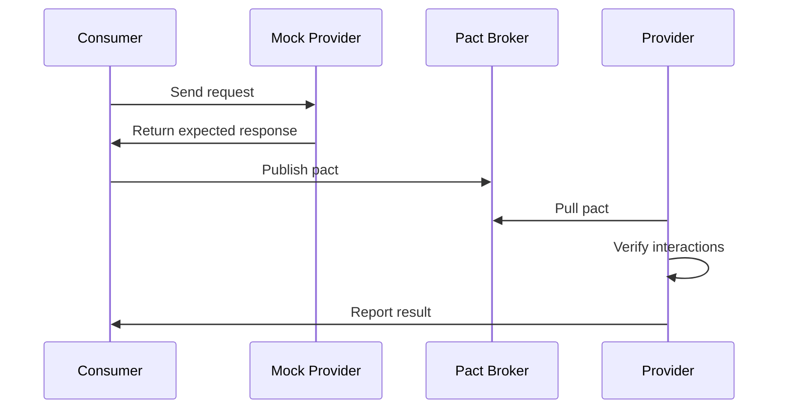

<!-- Generated by Groq via GitHub Actions -->
<!-- Topic ID: T266 -->
<!-- Category: Testing -->
<!-- Generated at UTC: 2026-11-28T09:02:03.324078+00:00 -->

# Contract testing

## 1. What problem does this solve?

**Motivation**  
When multiple services talk to each other over HTTP, gRPC, Kafka, or any other protocol, each side must agree on *what* data is exchanged. If one service changes its API (adds a field, changes a type, removes an endpoint) the other side can break without any obvious error until a request is made in production. Contract testing ensures that the *agreement* between a consumer and a provider remains valid across changes.

**What problem exists**  
- **Silent failures**: A provider changes its response shape; the consumer still sends requests but receives unexpected data, leading to runtime errors that surface only after a user interacts with the system.  
- **Coupling without verification**: Teams often rely on documentation or manual checks to confirm API compatibility, which is error‑prone.  
- **Regression risk**: When a provider is refactored, tests that only cover the provider’s own logic may not detect that the consumer’s expectations are violated.

**Why the problem matters**  
- **Customer impact**: Users may see errors or corrupted data.  
- **Operational risk**: Production incidents cost money and damage reputation.  
- **Developer productivity**: Debugging cross‑service contract violations is time‑consuming.

**What happens if this concept is not used**  
- Increased number of production incidents.  
- Longer release cycles because teams must manually test integrations.  
- Higher technical debt as services evolve independently.

**Where this concept appears in real backend systems**  
- Microservice architectures where services expose REST or gRPC APIs.  
- Event‑driven systems where producers and consumers agree on message schemas.  
- API gateways or service meshes that enforce contract compliance.  
- CI/CD pipelines that run integration tests against a mock or real provider.

---

## 2. Mental model

**Analogy**  
Think of a contract test like a *restaurant menu* that both the chef (provider) and the waiter (consumer) agree on. The waiter knows exactly what dishes the chef can prepare and how they should be presented. If the chef suddenly decides to remove a dish or change its ingredients, the waiter will notice immediately because the menu is the shared contract. Without the menu, the waiter might still ask for the dish and be disappointed.

**Engineering model**  
- **Provider**: Service that offers an API or publishes events.  
- **Consumer**: Service that calls the provider’s API or subscribes to its events.  
- **Contract**: Formal specification of the request/response shape, status codes, headers, or message schema.  
- **Contract test**: A test that runs on the consumer side, records the expected interactions, and later verifies that the provider still satisfies them.

---

## 3. Deep explanation

### Internals
1. **Consumer‑side recording**  
   - The consumer sends a request to a *mock provider* (or a real provider in a test environment).  
   - The mock records the request and the expected response (status, headers, body).  
   - The recorded interaction is stored as a *pact* (Pact.io) or *spec* (OpenAPI, AsyncAPI).

2. **Provider verification**  
   - The provider loads the recorded interactions.  
   - For each interaction, it sends the same request to the real provider and compares the actual response to the expected one.  
   - If any mismatch occurs, the verification fails.

3. **CI integration**  
   - The consumer test generates a pact file and publishes it to a pact broker or artifact store.  
   - The provider test pulls the pact file and runs verification as part of its CI pipeline.

### Important terminology
- **Pact**: A JSON file that describes the interactions between consumer and provider.  
- **Pact broker**: A registry that stores pacts and facilitates sharing between teams.  
- **Verification**: The act of checking that the provider satisfies the pact.  
- **Provider states**: Optional setup steps that put the provider in a known state before verification.

### Trade‑offs
| Aspect | Benefit | Drawback |
|--------|---------|----------|
| **Speed** | Consumer tests run quickly against a mock. | Provider verification adds extra CI steps. |
| **Coverage** | Guarantees API compatibility. | Only covers recorded interactions; untested paths remain risky. |
| **Granularity** | Fine‑grained control over expected responses. | Requires maintaining pact files as APIs evolve. |
| **Tooling** | Mature libraries (Pact, OpenAPI Generator). | Learning curve for new teams. |

### Failure modes
- **Stale pacts**: If the consumer updates its expectations but forgets to publish the new pact, the provider may pass verification but the consumer will fail at runtime.  
- **Provider state mismatch**: If the provider state setup is incomplete, verification may pass but real requests fail.  
- **Mock vs real differences**: Mocks may not fully emulate provider behavior (e.g., authentication, rate limiting).

### Limitations
- Only tests the *shape* of data, not business logic.  
- Requires coordination between teams to keep pacts up to date.  
- Not suitable for highly dynamic schemas (e.g., free‑form JSON) without schema evolution strategies.

### Where it fits in a backend architecture
- **Layered**: Contract tests sit between the *consumer* and *provider* layers.  
- **CI/CD**: Integrated into the pipeline after unit tests and before deployment.  
- **Observability**: Pact broker can surface contract health metrics.

### Interaction with related concepts
- **API versioning**: Contracts can be versioned; each provider state can target a specific API version.  
- **Schema evolution**: Combine contract tests with JSON Schema validation to detect breaking changes.  
- **Service mesh**: Contracts can be enforced at the network layer via sidecar proxies.

---

## 4. How it works

1. **Consumer writes a contract test**  
   - Calls the mock provider.  
   - Asserts expected response.  
   - Generates a pact file.

2. **Consumer publishes pact**  
   - Pushes the pact to a broker or artifact store.

3. **Provider pulls pact**  
   - Loads pact file in its test suite.

4. **Provider verifies**  
   - For each interaction, sends real request to its own endpoint.  
   - Compares actual response to expected.  
   - Fails if any mismatch.

5. **CI pipeline reports**  
   - If verification passes, the provider can be released.  
   - If it fails, the provider team fixes the contract violation.



---

## 5. Practical implementation

Below is a minimal Node.js example using **Pact.js** (TypeScript).  
Assume we have a provider service `orders` exposing `GET /orders/:id`.

### 5.1 Consumer contract test

```ts
// consumer/tests/orders.contract.test.ts
import path from 'path';
import { Pact } from '@pact-foundation/pact';
import { OrderService } from '../src/orderService'; // consumer client

const provider = new Pact({
  consumer: 'OrderConsumer',
  provider: 'OrderProvider',
  port: 1234,
  log: path.resolve(process.cwd(), 'logs', 'pact.log'),
  dir: path.resolve(process.cwd(), 'pacts'),
  logLevel: 'INFO',
});

describe('OrderProvider Pact', () => {
  beforeAll(() => provider.setup());
  afterAll(() => provider.finalize());

  it('returns order details', async () => {
    const orderId = 'abc123';

    await provider.addInteraction({
      state: 'order exists',
      uponReceiving: 'a request for an order',
      withRequest: {
        method: 'GET',
        path: `/orders/${orderId}`,
        headers: { Accept: 'application/json' },
      },
      willRespondWith: {
        status: 200,
        headers: { 'Content-Type': 'application/json' },
        body: {
          id: orderId,
          status: 'shipped',
          items: [{ sku: 'X', qty: 2 }],
        },
      },
    });

    // The consumer client uses the mock provider's URL
    const client = new OrderService(`http://localhost:${provider.opts.port}`);
    const order = await client.getOrder(orderId);

    expect(order.id).toBe(orderId);
    expect(order.status).toBe('shipped');
  });
});
```

**Key lines**  
- `provider.addInteraction` records the expected request/response.  
- The consumer client (`OrderService`) points to the mock provider (`localhost:1234`).  
- After the test, Pact writes a JSON pact file to `pacts/OrderConsumer-OrderProvider.json`.

### 5.2 Provider verification test

```ts
// provider/tests/orders.verification.test.ts
import path from 'path';
import { Verifier } from '@pact-foundation/pact';
import { OrderProvider } from '../src/orderProvider'; // Express app

describe('OrderProvider Pact Verification', () => {
  const provider = new OrderProvider(); // starts Express on 9876

  beforeAll(() => provider.start());
  afterAll(() => provider.stop());

  it('verifies the consumer pact', async () => {
    const result = await new Verifier({
      providerBaseUrl: 'http://localhost:9876',
      pactUrls: [path.resolve(process.cwd(), 'pacts', 'OrderConsumer-OrderProvider.json')],
      // Optional: specify provider states endpoint
      providerStatesSetupUrl: 'http://localhost:9876/_pact/provider_states',
    }).verifyProvider();

    expect(result.status).toBe(0); // 0 = success
  });
});
```

**Key lines**  
- `Verifier` loads the pact file and sends real requests to the provider.  
- `providerStatesSetupUrl` allows the provider to set up the required state (`order exists`).  
- If the provider returns a different body or status, the test fails.

### 5.3 Provider state setup

```ts
// provider/src/providerStates.ts
import express from 'express';
import { db } from './db'; // mock DB

export const providerStatesRouter = express.Router();

providerStatesRouter.post('/_pact/provider_states', async (req, res) => {
  const { state } = req.body;
  if (state === 'order exists') {
    await db.saveOrder({ id: 'abc123', status: 'shipped', items: [{ sku: 'X', qty: 2 }] });
    return res.sendStatus(200);
  }
  res.sendStatus(400);
});
```

Attach this router to the provider app. The verifier will POST to this endpoint before each interaction.

---

## 6. Production considerations

| Concern | How contract testing helps | Practical tips |
|---------|---------------------------|----------------|
| **Scalability** | Contracts are lightweight; verification runs in CI, not in production. | Keep pact files small; use incremental verification for large APIs. |
| **Reliability** | Detects breaking changes early, reducing runtime failures. | Run provider verification on a dedicated test environment that mirrors production. |
| **Security** | Contracts can include authentication headers; verify that provider enforces them. | Use secure pact broker with TLS and access control. |
| **Observability** | Pact broker exposes contract health dashboards. | Integrate broker metrics into Prometheus/Grafana. |
| **Performance** | Verification is a one‑time cost; does not affect user traffic. | Parallelize provider verification across services. |
| **Error handling** | Contracts expose expected error responses. | Include negative tests for 4xx/5xx scenarios. |
| **Resource usage** | Mock provider consumes minimal resources. | Run mock provider in a lightweight container. |
| **Operational concerns** | Pact broker centralizes pact storage; reduces manual coordination. | Automate pact publishing via CI scripts. |
| **Failure recovery** | If a provider fails verification, rollback to previous stable release. | Use feature flags to gate new API changes until contracts pass. |
| **Deployment considerations** | Deploy provider only after all consumer pacts verify. | Enforce pact verification as a CI gate. |

---

## 7. Common mistakes

| Mistake | Why it’s problematic |
|---------|----------------------|
| **Publishing stale pacts** | Consumers may think they’re up to date while provider has changed. |
| **Not using provider states** | Verification may pass on mock but fail in real scenarios. |
| **Testing only happy paths** | Real clients encounter errors; contracts miss them. |
| **Ignoring versioning** | A new API version may break older consumers if contracts aren’t versioned. |
| **Running provider verification against a mock** | Misses real integration issues (auth, DB, external services). |
| **Treating contracts as documentation only** | Contracts should be the source of truth, not just docs. |
| **Hardcoding URLs in consumer tests** | Makes tests brittle; use environment variables or configuration. |
| **Not integrating pact broker** | Manual sharing leads to version drift and merge conflicts. |

---

## 8. Senior engineer perspective

### When used at scale
- **Multiple teams**: Each service publishes its own pacts; the broker becomes the central contract registry.  
- **Continuous delivery**: Contracts act as a gate; a provider cannot be deployed until all consumer pacts verify.  
- **Governance**: Policies can enforce that every new API change must have an associated contract test.

### Design decisions
- **Pact broker vs local storage**: Broker centralizes, but introduces network latency; local storage is faster but harder to share.  
- **Provider state strategy**: Use database fixtures, Docker containers, or external services to set up state.  
- **Verification frequency**: Full verification on every PR vs incremental verification on changed services.  
- **Schema evolution**: Combine contract tests with JSON Schema validation to detect breaking changes automatically.  
- **Tooling stack**: Pact.js, OpenAPI/AsyncAPI generators, or custom DSLs.

### Bottlenecks
- **Large pacts**: Verification can become slow; split pacts by service or endpoint.  
- **Stateful provider tests**: Setting up complex states can dominate CI time.  
- **Network latency**: Broker access may slow down pipelines; cache locally if possible.

### Failure scenarios
- **Provider drift**: Provider changes without updating pacts → verification fails.  
- **Consumer drift**: Consumer updates expectations but forgets to publish → provider passes but consumer fails.  
- **State mismatch**: Provider state setup fails → verification passes incorrectly.

### Monitoring
- **Pact broker metrics**: Number of pacts, verification status, staleness.  
- **CI pipeline metrics**: Verification duration, success rate.  
- **Alerting**: Notify teams when a provider fails verification.

### Cost/performance
- **CI time**: Verification adds minutes; optimize by parallelizing and caching.  
- **Storage**: Pact files are tiny; cost negligible.  
- **Broker hosting**: Self‑hosted broker is free; managed broker incurs subscription.

### When NOT to use
- **Single‑service monolith**: Contract tests add overhead without much benefit.  
- **Highly dynamic schemas**: If data shapes change frequently and unpredictably, maintaining contracts may be more trouble than it saves.  
- **Legacy systems**: If you cannot instrument provider states, contract tests may be infeasible.

---

## 9. Interview questions

1. **Beginner**: *What is a contract test and why is it useful?*  
   *Answer:* A contract test verifies that two services agree on the shape of requests and responses. It prevents silent failures when one service changes its API.

2. **Intermediate**: *How does Pact.js separate consumer and provider responsibilities?*  
   *Answer:* The consumer records interactions with a mock provider and generates a pact file. The provider later verifies that it satisfies those interactions against the real API.

3. **Senior**: *Describe how you would handle provider state setup in a distributed system with multiple databases.*  
   *Answer:* Use a dedicated provider‑states endpoint that orchestrates data seeding across databases, possibly via Docker Compose or Kubernetes jobs. Ensure idempotency and cleanup after tests.

4. **Senior**: *What trade‑offs arise when choosing between a local pact broker and a cloud‑hosted one?*  
   *Answer:* Local broker is faster and cheaper but requires manual sharing; cloud broker offers centralization, access control, and audit logs but adds network latency and cost.

5. **Scenario/Debugging**: *A provider passes all unit tests but fails contract verification for a consumer that expects a `200 OK` with a JSON body. The provider returns a `500` instead. What could be the cause and how would you debug?*  
   *Answer:* Likely a missing provider state or a runtime error triggered by the request. Check the provider‑states endpoint, inspect logs for the failing request, and verify that the route handler correctly handles the input. Use `curl` to replicate the request manually.

---

## 10. Hands‑on task

**Goal**: Add a contract test for a new endpoint `POST /orders` that creates an order.

1. **Consumer side**  
   - Create a new test file `consumer/tests/createOrder.contract.test.ts`.  
   - Record an interaction where the consumer sends a JSON body `{ sku: 'Y', qty: 3 }` and expects a `201 Created` with `{ id: 'new-id', status: 'pending' }`.  
   - Publish the pact to the local broker.

2. **Provider side**  
   - Implement the `/orders` endpoint in the provider.  
   - Add a provider state `no existing orders` that ensures the database is clean.  
   - Run the provider verification test and fix any mismatches.

3. **CI integration**  
   - Add the consumer test to the CI pipeline.  
   - Ensure the provider verification runs after the consumer test and before deployment.

**Deliverables**  
- Updated consumer test file.  
- Updated provider route and provider state handler.  
- Updated CI config (e.g., GitHub Actions workflow).  
- A screenshot or log showing a successful pact verification.

---

## 11. Quick revision

- Contract tests verify API compatibility between consumer and provider.  
- Pact.js separates consumer (recording) and provider (verification).  
- Pacts are JSON files stored in a broker or artifact store.  
- Provider states set up required data before verification.  
- Contracts catch breaking changes before they hit production.  
- Integration into CI pipelines enforces contract compliance.  
- Common pitfalls: stale pacts, missing provider states, only happy‑path tests.  
- At scale, use a pact broker, parallel verification, and monitoring.  
- Failure modes: provider drift, consumer drift, state mismatch.  
- Senior decisions: broker choice, state orchestration, verification frequency.

---

## 12. References

- [Pact.js Documentation](https://docs.pact.io/)
- [Pact Broker](https://docs.pact.io/pact_broker/)
- [OpenAPI Specification](https://swagger.io/specification/)
- [AsyncAPI Specification](https://www.asyncapi.com/)
- [Node.js Express](https://expressjs.com/)
- [TypeScript Handbook](https://www.typescriptlang.org/docs/handbook/intro.html)
